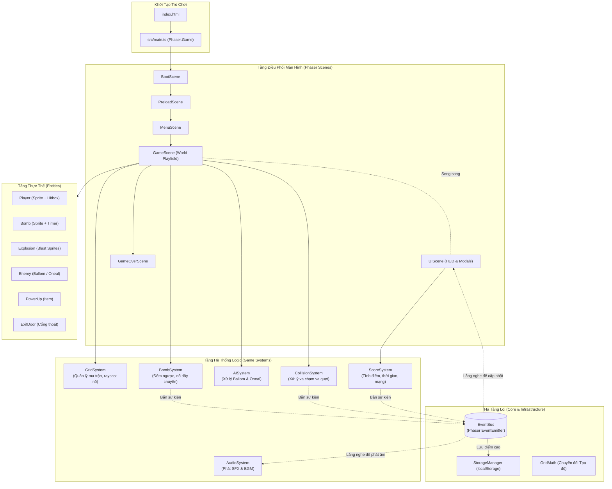
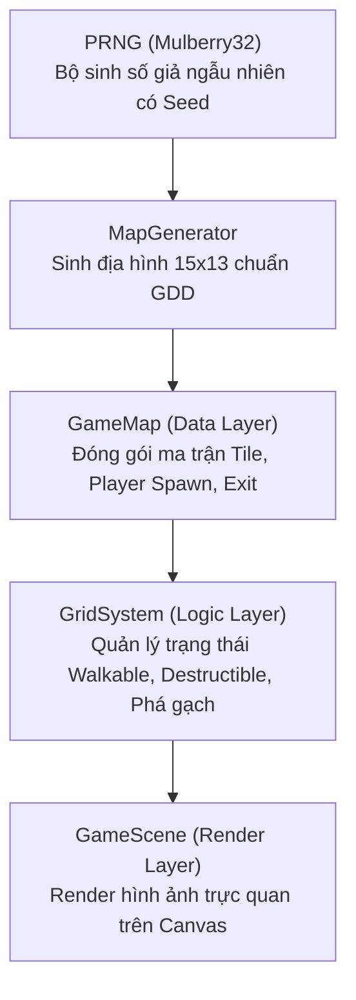
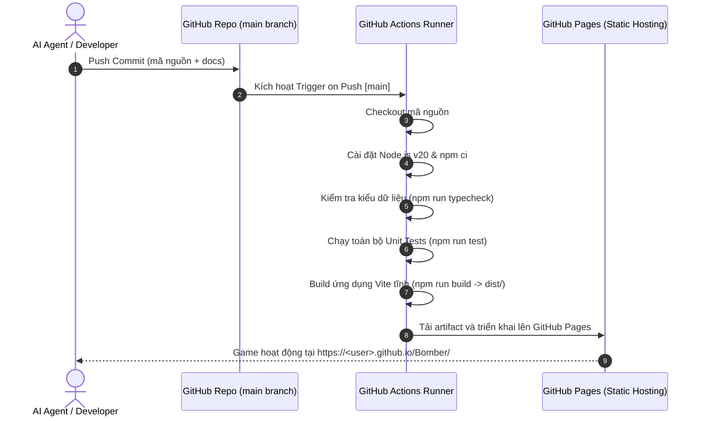

# TÀI LIỆU KIẾN TRÚC PHẦN MỀM (SOFTWARE ARCHITECTURE SPECIFICATION)

---

## 1. NGUYÊN TẮC THIẾT KẾ & TỔNG QUAN KIẾN TRÚC

Dự án **Bomber** áp dụng mô hình **Modular Layered Architecture (Kiến trúc phân tầng mô-đun hóa)** kết hợp với **Event-Driven Communication (Giao tiếp dựa trên sự kiện)**. 

### Các nguyên tắc cốt lõi:
1. **Phân tách hoàn toàn Giao diện (Scene/UI) và Nghiệp vụ (System Logic)**:
   - Scene của Phaser chỉ chịu trách nhiệm điều phối vòng đời (Lifecycle) và gắn kết hình ảnh (Rendering).
   - Toàn bộ thuật toán (Grid raycasting, bomb countdown, AI pathfinding, scoring) được đóng gói trong các System độc lập.
2. **Mô hình Thực thể Hướng đối tượng tinh gọn (Lightweight Entity Pattern)**:
   - Các thực thể kế thừa từ `Phaser.Physics.Arcade.Sprite` nhưng không chứa logic nghiệp vụ phức tạp mà chỉ quản lý trạng thái, hoạt ảnh (Animation) và thuộc tính vật lý của riêng mình.
3. **Mô hình Va chạm Lai (Hybrid Collision Model)**:
   - **Tầng ma trận logic (Discrete Grid Map)**: Ma trận 2D `TileType[][]` quản lý trạng thái tĩnh/động của từng ô lưới, phục vụ tính toán nổ bom (Blast Propagation) và AI tìm đường.
   - **Tầng vật lý liên tục (Continuous Arcade Physics)**: Bounding box thu nhỏ phục vụ di chuyển mượt mà và thuật toán trượt góc (Corner Sliding).

---

## 2. SƠ ĐỒ KIẾN TRÚC TỔNG THỂ (SYSTEM ARCHITECTURE DIAGRAM)



---

## 3. CƠ CHẾ GIAO TIẾP QUA EVENTBUS (EVENT-DRIVEN SPECIFICATION)

Để triệt tiêu phụ thuộc vòng lặp (Circular Dependency), các hệ thống giao tiếp với nhau thông qua `EventBus` toàn cục.

### Danh mục sự kiện chuẩn (Event Catalogue):
| Tên sự kiện (Event Name) | Dữ liệu truyền kèm (Payload) | Bên phát tín hiệu (Emitter) | Bên lắng nghe (Listener) |
| :--- | :--- | :--- | :--- |
| `BOMB_PLACED` | `{ col: number, row: number, power: number }` | `BombSystem` | `AudioSystem` |
| `BOMB_EXPLODED` | `{ col: number, row: number, power: number }` | `BombSystem` | `GridSystem`, `AudioSystem` |
| `BLOCK_DESTROYED` | `{ col: number, row: number }` | `GridSystem` | `ScoreSystem`, `PowerUpSystem` |
| `POWERUP_SPAWNED` | `{ col: number, row: number, type: PowerUpType }` | `GridSystem` | `GameScene` |
| `POWERUP_COLLECTED` | `{ type: PowerUpType, player: Player }` | `CollisionSystem` | `ScoreSystem`, `AudioSystem`, `Player` |
| `ENEMY_KILLED` | `{ enemy: Enemy, score: number }` | `CollisionSystem` | `ScoreSystem`, `AudioSystem`, `AISystem` |
| `ALL_ENEMIES_DEFEATED` | `void` | `AISystem` | `GridSystem` (Kích hoạt mở Cửa) |
| `PLAYER_HIT` | `{ remainingLives: number }` | `CollisionSystem` | `Player`, `UIScene`, `AudioSystem` |
| `PLAYER_DIED` | `void` | `ScoreSystem` | `GameScene` -> Chuyển `GameOverScene` |
| `STAGE_CLEARED` | `{ stage: number, finalScore: number }` | `GameScene` | `UIScene`, `AudioSystem` |
| `SCORE_CHANGED` | `{ currentScore: number, highScore: number }` | `ScoreSystem` | `UIScene` |
| `TIMER_TICK` | `{ remainingSeconds: number }` | `ScoreSystem` | `UIScene` |

---

### 4.1. Kiến Trúc Chi Tiết Phân Hệ Lưới & Bản Đồ (Grid & Map Subsystem - Stage 2B)

Phân hệ Grid & Map được thiết kế phân tầng độc lập tuyệt đối với Phaser:



- **Tile Definitions (`src/types/Tile.types.ts`)**:
  - `TILE_PROPERTIES`: Bảng ánh xạ thuộc tính hành vi cố định (`isWalkable`, `isDestructible`, `blocksBlast`).
  - Hàm tiện ích: `isTileWalkable()`, `isTileDestructible()`, `doesTileBlockBlast()`.
- **Map Representation (`src/core/GameMap.ts`)**:
  - Đóng gói dữ liệu bản đồ (`IGameMapData`), bảo vệ tính bất biến bằng Deep Copy cho cả dữ liệu nạp vào và dữ liệu trích xuất (`cloneTiles()`, `toData()`).
- **Map Generator (`src/systems/MapGenerator.ts`)**:
  - Sinh bản đồ 15x13 tất định bằng `PRNG`:
    - Tường bao: 100% `HARD_WALL`.
    - Trụ cột: `col % 2 === 0 && row % 2 === 0` là `HARD_WALL`.
    - Vùng an toàn: (1,1), (1,2), (2,1) luôn là `EMPTY`.
    - Gạch mềm: Phân bổ ngẫu nhiên theo Stage (Stage 1: 30, Stage 2: 42, Stage 3: 50).
    - Cửa thoát hiểm: Ẩn dưới 1 khối gạch mềm ngẫu nhiên.
- **Grid System (`src/systems/GridSystem.ts`)**:
  - Quản lý trạng thái runtime của bản đồ.
  - Cung cấp API an toàn: `getTile()`, `setTile()`, `destroySoftWall()`, `unlockExitDoor()`, `getTilesSnapshot()`.

---

## 5. HỆ THỐNG KIỂU DỮ LIỆU & HỢP ĐỒNG (DATA CONTRACTS & TYPESCRIPT INTERFACES)

Mọi tệp tin phải sử dụng các hợp đồng dữ liệu chuẩn hóa trong `src/types/`:

```typescript
// src/types/Grid.types.ts
export enum TileType {
  EMPTY = 0,
  HARD_WALL = 1,
  SOFT_BRICK = 2,
  BOMB = 3,
  EXIT_DOOR_LOCKED = 4,
  EXIT_DOOR_OPEN = 5,
}

export interface IGridCoord {
  col: number; // 0 -> 14
  row: number; // 0 -> 12
}

export interface IWorldPosition {
  x: number;
  y: number;
}

// src/types/PowerUp.types.ts
export enum PowerUpType {
  BOMB_UP = 'BOMB_UP',
  FIRE_UP = 'FIRE_UP',
  SPEED_UP = 'SPEED_UP',
}

// src/types/Enemy.types.ts
export enum EnemyType {
  BALLOM = 'BALLOM',
  ONEAL = 'ONEAL',
}

export interface IEnemyConfig {
  type: EnemyType;
  speed: number;
  scoreValue: number;
  initialCoord: IGridCoord;
}

// src/types/Bomb.types.ts
export interface IBomb {
  id: string;
  coord: IGridCoord;
  power: number;
  fuseTimer: Phaser.Time.TimerEvent;
}

export interface IBlastRayResult {
  affectedCells: Array<{
    coord: IGridCoord;
    isTerminator: boolean; // Điểm cuối của tia lửa
    destroyedBrick: boolean;
  }>;
}
```

---

## 5. PHÂN HỆ BOM, VỤ NỔ & LAN TRUYỀN TIA LỬA (BOMB & EXPLOSION SYSTEM - STAGE 3, ADR-013)

### 5.0. Hệ Thống Bom Cốt Lõi (BombSystem Core Logic - Stage 3B.1)
- [`BombSystem`](file:///G:/GIT/Bomber/src/systems/BombSystem.ts) hoạt động độc lập 100% với Phaser, quản lý vòng đời bom và sức chứa:
  - **State Machine 4 trạng thái**: `ARMED` (đang đếm lùi fuse) -> `TRIGGERED` (kích nổ sớm) -> `EXPLODING` (đang nổ, giải phóng capacity và ô lưới) -> `FINISHED` (kết thúc hoàn toàn, dọn dẹp khỏi bộ nhớ).
  - **Ownership & Capacity Isolation**: Quản lý độc lập theo `ownerId`. Khi đặt bom, trừ capacity; khi bom chuyển sang `EXPLODING`, hồi phục capacity ngay lập tức (`isCapacityReleased = true`), bảo đảm không giải phóng 2 lần và không tăng khi `FINISHED`.
  - **Grid Integration Boundary**: Khi đặt bom, cập nhật `gridSystem.setTile(coord, TileType.BOMB)`. Khi bom chuyển sang `EXPLODING`, kiểm tra an toàn và giải phóng ô về `TileType.EMPTY` theo ADR-013.
  - **Typed Event Emission**: Phát các sự kiện `BOMB_PLACED`, `BOMB_TRIGGERED`, `BOMB_EXPLODING`, `BOMB_EXPLODED`, `BOMB_FINISHED` qua `TypedEventBus`.

### 5.1. Cơ Chế Đi Xuyên Bom (Spatial Disjoint AABB Pass-through)
- Khi Player đặt bom tại tâm ô lưới, bom được đăng ký vào danh sách `passThroughBombIds` của Player đó.
- Miễn là AABB của Player còn giao cắt (overlap) với ô chứa bom: Player được phép di chuyển tự do qua lại.
- Ngay khi toàn bộ AABB của Player bước ra ngoài ô bom (Spatial Disjoint: `player.right <= cellLeft || player.left >= cellRight || player.bottom <= cellTop || player.top >= cellBottom`):
  - Quyền pass-through bị thu hồi (`player.removePassThrough(bombId)`).
  - Quả bom chính thức hóa rắn (`isWalkable = false`), Player không thể quay lại khi bom còn tồn tại.
- Các thực thể khác (quái vật, người chơi khác) bị chặn đứng ngay từ đầu.
- Capacity của Player và ô trên `GridSystem` được giải phóng ngay thời điểm bom phát nổ (`EXPLODING`).

### 5.2. Thuật Toán Lan Truyền Tia Lửa Nổ (Blast Raycasting Algorithm)
Thuật toán lan truyền tia lửa nổ độc lập 100% với Phaser rendering:

```typescript
/**
 * Tính toán các ô bị ảnh hưởng bởi vụ nổ từ tâm ô bom
 * Lan truyền theo 4 hướng: Lên (Up), Xuống (Down), Trái (Left), Phải (Right)
 */
calculateBlastArea(center: IGridCoord, power: number): IBlastRayResult {
  const directions = [
    { x: 0, y: -1, dir: 'UP' },
    { x: 0, y: 1, dir: 'DOWN' },
    { x: -1, y: 0, dir: 'LEFT' },
    { x: 1, y: 0, dir: 'RIGHT' },
  ];

  const affectedCells = [{ coord: center, direction: 'CENTER', isTip: (power === 0), destroyedBrick: false }];
  const triggeredBombCoords: IGridCoord[] = [];

  for (const { x, y, dir } of directions) {
    for (let step = 1; step <= power; step++) {
      const targetCol = center.col + x * step;
      const targetRow = center.row + y * step;
      const targetCoord = { col: targetCol, row: targetRow };

      // 1. Kiểm tra biên bản đồ
      if (!this.isValidCoord(targetCoord)) break;

      const tile = this.getTile(targetCoord);

      // 2. Chặn hoàn toàn bởi Tường cứng (Hard Wall)
      if (tile === TileType.HARD_WALL) {
        break; 
      }

      // 3. Phá vỡ Gạch mềm (Soft Brick) và DỪNG LẠI
      if (tile === TileType.SOFT_BRICK) {
        affectedCells.push({ coord: targetCoord, direction: dir, isTip: true, destroyedBrick: true });
        break; // Tia nổ không xuyên qua gạch mềm tiếp theo
      }

      // 4. Quét trúng Quả bom khác (Chain Reaction - DECISION 2)
      if (tile === TileType.BOMB) {
        triggeredBombCoords.push(targetCoord);
        // Tia nổ kích hoạt bom và TIẾP TỤC LAN nếu còn tầm nổ (blocksBlast = false)
      }

      // 5. Ô trống hoặc quái/người chơi/item -> Tiếp tục lan
      const isEnd = (step === power);
      affectedCells.push({ coord: targetCoord, direction: dir, isTip: isEnd, destroyedBrick: false });
    }
  }

  return { affectedCells, triggeredBombCoords };
}
```

### 5.3. Thuật Toán Kích Nổ Dây Chuyền Phi Đệ Quy (Non-recursive BFS Chain Reaction)
- Sử dụng hàng đợi `explosionQueue: Bomb[]` và tập hợp `processedBombIds: Set<string>`.
- Mỗi quả bom bị quét trúng chuyển ngay sang `TRIGGERED`, đưa vào queue và đánh dấu vào Set.
- Xử lý tuần tự vòng lặp `while (explosionQueue.length > 0)`, loại bỏ 100% rủi ro đệ quy sâu gây tràn ngăn xếp (Stack Overflow).

### 5.4. Quản Lý Vụ Nổ Theo Ô & Gộp Hiển Thị (CellExplosionTracker & Visual Stacking)
- Mỗi ô lưới duy trì một `CellExplosionState`:
  - Lưu danh sách `contributions` của từng vụ nổ đang hoạt động trên ô đó.
  - Gộp rendering representation (tự động nhận diện hình dạng tia lửa: tâm, thân ngang, thân dọc, ngã tư giao nhau).
  - Visual sprite chỉ bị xóa khi toàn bộ các vụ nổ trên ô đó kết thúc (`activeCount === 0`).
  - Trạng thái gameplay (sát thương) được duy trì chính xác trong 0.4s của mỗi vụ nổ.

---

## 6. PHÂN HỆ ĐIỀU KHIỂN NHÂN VẬT & TRƯỢT GÓC (PLAYER, INPUT & CORNER SLIDING - STAGE 2C)

### 6.1. Kiến Trúc Phân Hệ Player
Phân hệ được tách biệt rõ ràng theo nguyên tắc Single Responsibility:
- **`PlayerInputSystem` & `OrthogonalInputResolver` (`src/systems/PlayerInputSystem.ts`)**:
  - Hỗ trợ cả 2 cụm phím: Arrow Keys và WASD.
  - Sử dụng cơ chế ngăn xếp phím nhấn (Last-In-First-Out) để giải quyết xung đột khi nhấn đồng thời 2 phím vuông góc (phím mới nhất được ưu tiên).
  - Tự động giải phóng listener khi Scene `shutdown` hoặc `destroy`.
- **`PlayerCollisionSystem` (`src/systems/PlayerCollisionSystem.ts`)**:
  - Độc lập 100% với Phaser, tính toán va chạm theo Hitbox AABB `28 x 28` pixel căn giữa (offset 10px trên tile 48x48).
  - Kỹ thuật **Sub-stepping (bước tối đa 4px)**: Chia nhỏ quãng đường di chuyển theo delta time, loại bỏ hoàn toàn nguy cơ xuyên thấu (Tunneling) khi frame rate thấp.
  - Chặn trần thời gian frame **Delta Clamping (max 0.1s)**: Ngăn chặn hiện tượng giật lag / freeze khi người dùng switch tab, giới hạn tối đa 3 bước sub-stepping mỗi frame.
  - Thuật toán **Trượt góc hai lớp (Dual-mode Corner Sliding)** (ADR-012):
    1. *Corridor Entry Auto-Centering (AUD-02)*: Khi ô thẳng phía trước MỞ (`isWalkable`), nếu nhân vật lệch tâm (`|offset| <= 14px`) khiến mép hitbox va chạm với tường bên cạnh -> Tự động trượt ngược chiều lệch để kéo nhân vật về tâm ô (`rowCenterY` hoặc `colCenterX`).
    2. *T-Junction Corner Rounding*: Khi ô thẳng phía trước BỊ CHẶN, nếu độ lệch tâm `|offset| <= 14px` và ô góc vuông chéo tiếp theo có thể đi qua -> Tự động bù vận tốc cùng chiều để trượt vòng qua góc vào hành lang mới.
  - Áp sát mặt vật cản (Pixel-flush stopping): Di chuyển tối đa đến sát mép vật cản mà không có khoảng trống thừa.
- **`Player` Entity (`src/entities/Player.ts`)**:
  - Kế thừa `Phaser.Physics.Arcade.Sprite`, hoạt động theo mô hình **Kinematic Sensor Body** (`body.moves = false`, ADR-012).
  - `PlayerCollisionSystem` giữ quyền lực duy nhất (Single Source of Authority) điều khiển vị trí của Player thông qua `this.setPosition(result.x, result.y)`. Arcade Body chỉ đóng vai trò Trigger Sensor phục vụ kiểm tra Overlap (thu thập Item, dính tia lửa Bom, va chạm Quái vật) ở Stage 3 và Stage 5.
  - Tích hợp `tryDropBomb()`: Đặt bom tại tâm ô lưới nhân vật đang đứng, kết nối trực tiếp với `BombSystem`.
  - Đồng bộ hoạt ảnh 4 hướng và phát sự kiện `PLAYER_MOVED` qua `EventBus` khi đổi ô lưới.
- **`PlayerTextureGenerator` (`src/utils/PlayerTextureGenerator.ts`)**:
  - Sinh procedural pixel art 48x48 và 8 hoạt ảnh (Idle/Walk cho 4 hướng) độc lập, không phụ thuộc tài nguyên bên ngoài.

### 6.2. Cơ Chế Player Bomb Pass-through & Quản Lý Quyền Đi Xuyên (Stage 3B.2, ADR-013)
- **Quyết định kiến trúc ADR-013 (Spatial Disjoint AABB)**:
  - Loại bỏ hoàn toàn timer 0.2s tạm thời trước đây.
  - Người chơi được phép đi xuyên qua quả bom do chính mình vừa đặt chừng nào hộp va chạm AABB 28x28 của nhân vật còn giao nhau (Overlap) với ô chứa quả bom đó.
  - Ngay thời điểm toàn bộ AABB của Player rời khỏi ô chứa bom (`player.right <= cellLeft || player.left >= cellRight || player.bottom <= cellTop || player.top >= cellBottom`), quyền đi xuyên bị thu hồi vĩnh viễn cho quả bom đó.
  - Sau khi thu hồi quyền, ô chứa bom trở thành vật cản rắn (`TileType.BOMB`, `isWalkable = false`), người chơi không thể quay trở lại ô đó khi bom vẫn còn tồn tại.
- **Trình Quản lý Quyền Đi Xuyên (`BombPassThroughManager.ts`)**:
  - Quản lý độc lập theo cấu trúc bảng băm: `Map<playerId, Set<bombId>>`.
  - Mỗi khi Player di chuyển, `BombSystem.checkEntityDisjoint(playerId, aabb)` kiểm tra tất cả các quả bom Player đang có quyền đi xuyên và tự động thu hồi khi thỏa mãn điều kiện Disjoint.
  - Khi quả bom phát nổ (`EXPLODING`) hoặc kết thúc (`FINISHED`), quyền đi xuyên của quả bom đó bị thu hồi khỏi tất cả thực thể (`revokeBombFromAll`).
- **Phím đặt bom Single-shot (`PlayerInputSystem.isBombJustPressed`)**:
  - Sử dụng phím `Space` với cơ chế nhận diện JustDown: theo dõi trạng thái frame trước (`isSpaceDownPrevious`).
  - Nhấn giữ phím `Space` không tự động đặt bom liên tục; người chơi bắt buộc phải nhả phím và nhấn lại để đặt quả bom tiếp theo.
  - Hỗ trợ mô phỏng Headless (`setSpaceState`) phục vụ kiểm thử tự động 100% không phụ thuộc Phaser.

---

## 7. KIẾN TRÚC CI/CD VÀ TRIỂN KHAI (GITHUB ACTIONS & GITHUB PAGES)



---

## 8. PHÂN TÍCH RỦI RO KỸ THUẬT & GIẢI PHÁP PHÒNG NGỪA (TECHNICAL RISKS & MITIGATIONS)

| Rủi ro kỹ thuật | Mức độ | Khả năng xảy ra | Tác động | Giải pháp kiến trúc phòng ngừa (Mitigation) |
| :--- | :---: | :---: | :--- | :--- |
| **1. Kẹt góc di chuyển (Corner Sticking)** | Cao | Rất cao | Trải nghiệm điều khiển ức chế, nhân vật vấp vào góc tường khi đổi hướng rẽ. | Áp dụng thuật toán **Corner Sliding** và thu nhỏ Hitbox Arcade Body xuống `28x28` pixel (so với tile 48x48). Tự động nắn tọa độ trượt vào hành lang nếu độ lệch < 14px. |
| **2. Bất đồng bộ Lưới & Vật lý (Grid vs Continuous Physics Desync)** | Trung bình | Trung bình | Bom đặt lệch ô, tia lửa nổ sai tọa độ, quái xuyên qua gạch. | Phân tách nghiêm ngặt: Logic bản đồ dùng ma trận nguyên `TileType[13][15]`. Khi đặt bom, dùng `GridMath.snapToGrid()` ép chặt tọa độ vào tâm ô lưới logic. |
| **3. Rò rỉ bộ nhớ qua Sự kiện (Memory Leak via Event Listeners)** | Cao | Trung bình | Lag giật, tụt FPS sau khi người chơi restart màn nhiều lần. | Đăng ký sự kiện hủy dọn dẹp: Mọi Scene và System đều phải hủy lắng nghe `EventBus.off()` trong sự kiện `Phaser.Scenes.Events.SHUTDOWN`. |
| **4. Nổ bom dây chuyền gây tràn ngăn xếp (Stack Overflow on Chain Reaction)** | Trung bình | Thấp | Trình duyệt bị đơ khi nhiều quả bom kích nổ nhau đồng thời. | Sử dụng hàng đợi BFS (Breadth-First Search Queue) để xử lý kích nổ tuần tự thay vì đệ quy sâu trực tiếp. |
| **5. Gián đoạn âm thanh do Autoplay Policy** | Thấp | Cao | Âm thanh không phát được ở lần đầu người chơi mở web. | Xử lý mở khóa Audio Context của Phaser ngay khi người chơi click chuột hoặc nhấn phím bất kỳ tại `MenuScene`. |

