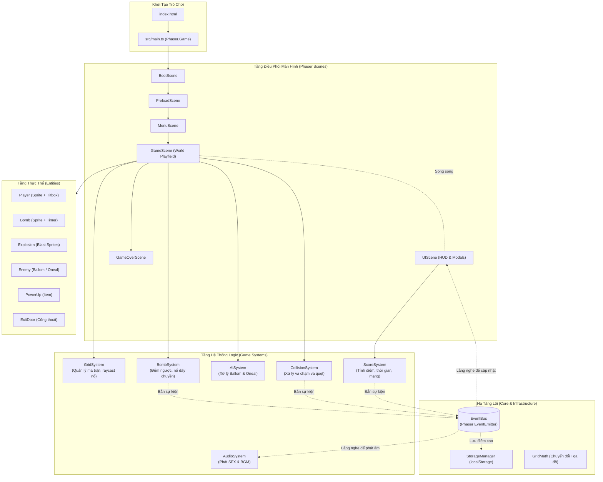
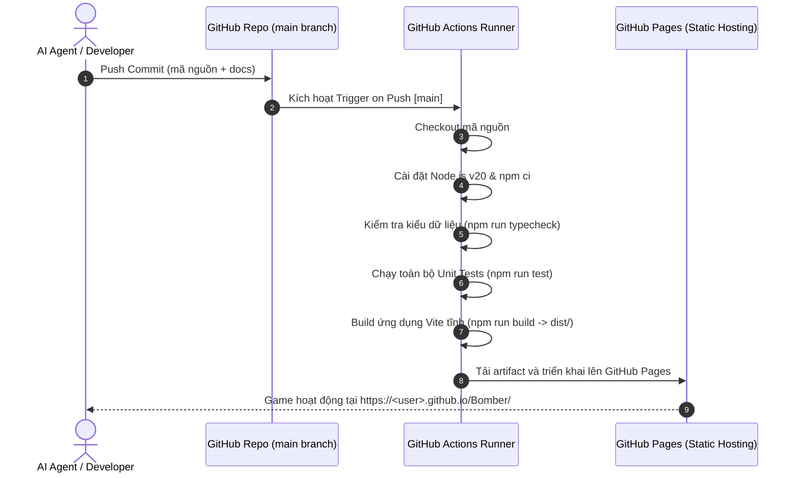

# TÀI LIỆU KIẾN TRÚC PHẦN MỀM (SOFTWARE ARCHITECTURE SPECIFICATION)

---

## 1. NGUYÊN TẮC THIẾT KẾ & TỔNG QUAN KIẾN TRÚC

Dự án **Bomber** áp dụng mô hình **Modular Layered Architecture (Kiến trúc phân tầng mô-đun hóa)** kết hợp với **Event-Driven Communication (Giao tiếp dựa trên sự kiện)**. 

### Các nguyên tắc cốt lõi:
1. **Phân tách hoàn toàn Giao diện (Scene/UI) và Nghiệp vụ (System Logic)**:
   - Scene của Phaser chỉ chịu trách nhiệm điều phối vòng đời (Lifecycle) và gắn kết hình ảnh (Rendering).
   - Toàn bộ thuật toán (Grid raycasting, bomb countdown, AI pathfinding, scoring) được đóng gói trong các System độc lập.
2. **Mô hình Thực thể Hướng đối tượng tinh gọn (Lightweight Entity Pattern)**:
   - Các thực thể kế thừa từ `Phaser.Physics.Arcade.Sprite` nhưng không chứa logic nghiệp vụ phức tạp mà chỉ quản lý trạng thái, hoạt ảnh (Animation) và thuộc tính vật lý của riêng mình.
3. **Mô hình Va chạm Lai (Hybrid Collision Model)**:
   - **Tầng ma trận logic (Discrete Grid Map)**: Ma trận 2D `TileType[][]` quản lý trạng thái tĩnh/động của từng ô lưới, phục vụ tính toán nổ bom (Blast Propagation) và AI tìm đường.
   - **Tầng vật lý liên tục (Continuous Arcade Physics)**: Bounding box thu nhỏ phục vụ di chuyển mượt mà và thuật toán trượt góc (Corner Sliding).

---

## 2. SƠ ĐỒ KIẾN TRÚC TỔNG THỂ (SYSTEM ARCHITECTURE DIAGRAM)



---

## 3. CƠ CHẾ GIAO TIẾP QUA EVENTBUS (EVENT-DRIVEN SPECIFICATION)

Để triệt tiêu phụ thuộc vòng lặp (Circular Dependency), các hệ thống giao tiếp với nhau thông qua `EventBus` toàn cục.

### Danh mục sự kiện chuẩn (Event Catalogue):
| Tên sự kiện (Event Name) | Dữ liệu truyền kèm (Payload) | Bên phát tín hiệu (Emitter) | Bên lắng nghe (Listener) |
| :--- | :--- | :--- | :--- |
| `BOMB_PLACED` | `{ col: number, row: number, power: number }` | `BombSystem` | `AudioSystem` |
| `BOMB_EXPLODED` | `{ col: number, row: number, power: number }` | `BombSystem` | `GridSystem`, `AudioSystem` |
| `BLOCK_DESTROYED` | `{ col: number, row: number }` | `GridSystem` | `ScoreSystem`, `PowerUpSystem` |
| `POWERUP_SPAWNED` | `{ col: number, row: number, type: PowerUpType }` | `GridSystem` | `GameScene` |
| `POWERUP_COLLECTED` | `{ type: PowerUpType, player: Player }` | `CollisionSystem` | `ScoreSystem`, `AudioSystem`, `Player` |
| `ENEMY_KILLED` | `{ enemy: Enemy, score: number }` | `CollisionSystem` | `ScoreSystem`, `AudioSystem`, `AISystem` |
| `ALL_ENEMIES_DEFEATED` | `void` | `AISystem` | `GridSystem` (Kích hoạt mở Cửa) |
| `PLAYER_HIT` | `{ remainingLives: number }` | `CollisionSystem` | `Player`, `UIScene`, `AudioSystem` |
| `PLAYER_DIED` | `void` | `ScoreSystem` | `GameScene` -> Chuyển `GameOverScene` |
| `STAGE_CLEARED` | `{ stage: number, finalScore: number }` | `GameScene` | `UIScene`, `AudioSystem` |
| `SCORE_CHANGED` | `{ currentScore: number, highScore: number }` | `ScoreSystem` | `UIScene` |
| `TIMER_TICK` | `{ remainingSeconds: number }` | `ScoreSystem` | `UIScene` |

---

## 4. HỆ THỐNG KIỂU DỮ LIỆU & HỢP ĐỒNG (DATA CONTRACTS & TYPESCRIPT INTERFACES)

Mọi tệp tin phải sử dụng các hợp đồng dữ liệu chuẩn hóa trong `src/types/`:

```typescript
// src/types/Grid.types.ts
export enum TileType {
  EMPTY = 0,
  HARD_WALL = 1,
  SOFT_BRICK = 2,
  BOMB = 3,
  EXIT_DOOR_LOCKED = 4,
  EXIT_DOOR_OPEN = 5,
}

export interface IGridCoord {
  col: number; // 0 -> 14
  row: number; // 0 -> 12
}

export interface IWorldPosition {
  x: number;
  y: number;
}

// src/types/PowerUp.types.ts
export enum PowerUpType {
  BOMB_UP = 'BOMB_UP',
  FIRE_UP = 'FIRE_UP',
  SPEED_UP = 'SPEED_UP',
}

// src/types/Enemy.types.ts
export enum EnemyType {
  BALLOM = 'BALLOM',
  ONEAL = 'ONEAL',
}

export interface IEnemyConfig {
  type: EnemyType;
  speed: number;
  scoreValue: number;
  initialCoord: IGridCoord;
}

// src/types/Bomb.types.ts
export interface IBomb {
  id: string;
  coord: IGridCoord;
  power: number;
  fuseTimer: Phaser.Time.TimerEvent;
}

export interface IBlastRayResult {
  affectedCells: Array<{
    coord: IGridCoord;
    isTerminator: boolean; // Điểm cuối của tia lửa
    destroyedBrick: boolean;
  }>;
}
```

---

## 5. THUẬT TOÁN TÍNH TOÁN VỤ NỔ LAN TRUYỀN (BLAST RAYCASTING ALGORITHM)

Thuật toán lan truyền tia lửa nổ được triển khai trong `GridSystem`:

```typescript
/**
 * Tính toán các ô bị ảnh hưởng bởi vụ nổ từ tâm ô bom
 * Lan truyền theo 4 hướng: Lên (Up), Xuống (Down), Trái (Left), Phải (Right)
 */
calculateBlastArea(center: IGridCoord, power: number): IBlastRayResult {
  const directions = [
    { x: 0, y: -1 }, // Up
    { x: 0, y: 1 },  // Down
    { x: -1, y: 0 }, // Left
    { x: 1, y: 0 },  // Right
  ];

  const affectedCells = [{ coord: center, isTerminator: false, destroyedBrick: false }];

  for (const dir of directions) {
    for (let step = 1; step <= power; step++) {
      const targetCol = center.col + dir.x * step;
      const targetRow = center.row + dir.y * step;
      const targetCoord = { col: targetCol, row: targetRow };

      // 1. Kiểm tra biên bản đồ
      if (!this.isValidCoord(targetCoord)) break;

      const tile = this.getTile(targetCoord);

      // 2. Chặn hoàn toàn bởi Tường cứng
      if (tile === TileType.HARD_WALL) {
        break; 
      }

      // 3. Phá vỡ Gạch mềm và DỪNG LẠI
      if (tile === TileType.SOFT_BRICK) {
        affectedCells.push({ coord: targetCoord, isTerminator: true, destroyedBrick: true });
        break; // Tia nổ không xuyên qua gạch mềm tiếp theo
      }

      // 4. Ô trống hoặc quái/người chơi/item -> Tiếp tục lan
      const isEnd = (step === power);
      affectedCells.push({ coord: targetCoord, isTerminator: isEnd, destroyedBrick: false });
    }
  }

  return { affectedCells };
}
```

---

## 6. THUẬT TOÁN HỖ TRỢ TRƯỢT GÓC (CORNER SLIDING / AUTO-STEERING)

Để đảm bảo trải nghiệm điều khiển "mượt mà chuẩn arcade" mà không bị gián đoạn khi va vào mép tường:

1. **Hitbox thu nhỏ**: Player có kích thước hiển thị 48x48 pixel, nhưng Hitbox Arcade Physics là `28 x 28 pixel`, thụt vào 10px từ mỗi cạnh.
2. **Xử lý trượt góc**:
   - Khi nhấn sang PHẢI, nếu đỉnh trên của Hitbox chạm vào mép dưới của Hard Wall một khoảng `< 14 pixel`, vận tốc chiều dọc `$v_y$` tự động được bù dương (đẩy nhẹ xuống dưới).
   - Ngược lại, nếu đáy dưới của Hitbox chạm vào mép trên của Hard Wall một khoảng `< 14 pixel`, `$v_y$` tự động được bù âm (đẩy nhẹ lên trên).
   - Cơ chế này biến cảm giác điều khiển từ "bị mắc kẹt khó chịu" thành "trượt góc cực kỳ êm ái".

---

## 7. KIẾN TRÚC CI/CD VÀ TRIỂN KHAI (GITHUB ACTIONS & GITHUB PAGES)



---

## 8. PHÂN TÍCH RỦI RO KỸ THUẬT & GIẢI PHÁP PHÒNG NGỪA (TECHNICAL RISKS & MITIGATIONS)

| Rủi ro kỹ thuật | Mức độ | Khả năng xảy ra | Tác động | Giải pháp kiến trúc phòng ngừa (Mitigation) |
| :--- | :---: | :---: | :--- | :--- |
| **1. Kẹt góc di chuyển (Corner Sticking)** | Cao | Rất cao | Trải nghiệm điều khiển ức chế, nhân vật vấp vào góc tường khi đổi hướng rẽ. | Áp dụng thuật toán **Corner Sliding** và thu nhỏ Hitbox Arcade Body xuống `28x28` pixel (so với tile 48x48). Tự động nắn tọa độ trượt vào hành lang nếu độ lệch < 14px. |
| **2. Bất đồng bộ Lưới & Vật lý (Grid vs Continuous Physics Desync)** | Trung bình | Trung bình | Bom đặt lệch ô, tia lửa nổ sai tọa độ, quái xuyên qua gạch. | Phân tách nghiêm ngặt: Logic bản đồ dùng ma trận nguyên `TileType[13][15]`. Khi đặt bom, dùng `GridMath.snapToGrid()` ép chặt tọa độ vào tâm ô lưới logic. |
| **3. Rò rỉ bộ nhớ qua Sự kiện (Memory Leak via Event Listeners)** | Cao | Trung bình | Lag giật, tụt FPS sau khi người chơi restart màn nhiều lần. | Đăng ký sự kiện hủy dọn dẹp: Mọi Scene và System đều phải hủy lắng nghe `EventBus.off()` trong sự kiện `Phaser.Scenes.Events.SHUTDOWN`. |
| **4. Nổ bom dây chuyền gây tràn ngăn xếp (Stack Overflow on Chain Reaction)** | Trung bình | Thấp | Trình duyệt bị đơ khi nhiều quả bom kích nổ nhau đồng thời. | Sử dụng hàng đợi BFS (Breadth-First Search Queue) để xử lý kích nổ tuần tự thay vì đệ quy sâu trực tiếp. |
| **5. Gián đoạn âm thanh do Autoplay Policy** | Thấp | Cao | Âm thanh không phát được ở lần đầu người chơi mở web. | Xử lý mở khóa Audio Context của Phaser ngay khi người chơi click chuột hoặc nhấn phím bất kỳ tại `MenuScene`. |

