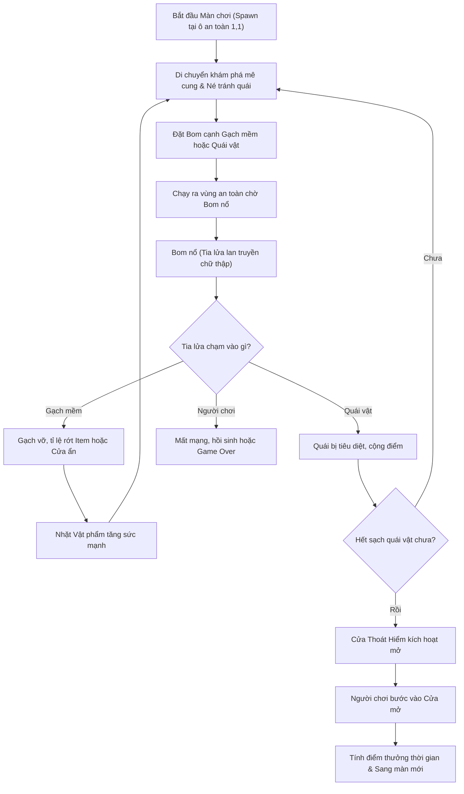

# TÀI LIỆU THIẾT KẾ GAME (GAME DESIGN DOCUMENT - GDD)

---

## 1. VÒNG LẶP TRÒ CHƠI CỐT LÕI (CORE GAME LOOP)



---

## 2. QUY CHUẨN KHÔNG GIAN BẢN ĐỒ & LƯỚI TỌA ĐỘ (GRID SYSTEM)

### 2.1. Thông số lưới (Grid Specifications)
- **Kích thước ma trận**: 15 cột x 13 hàng (Chuẩn kinh điển của Bomberman arcade).
- **Kích thước mỗi ô (Tile Size)**: 48 x 48 pixel.
- **Kích thước vùng sàn chơi (Playfield Size)**: 720 x 624 pixel.
- **Kích thước thanh trạng thái (HUD Bar)**: 720 x 48 pixel (nằm phía trên bản đồ).
- **Tổng kích thước khung hiển thị (Canvas Resolution)**: 720 x 672 pixel.

```text
       0   1   2   3   4   5   6   7   8   9  10  11  12  13  14  (Cột X)
   ┌───┬───┬───┬───┬───┬───┬───┬───┬───┬───┬───┬───┬───┬───┬───┐
 0 │ W │ W │ W │ W │ W │ W │ W │ W │ W │ W │ W │ W │ W │ W │ W │
 1 │ W │ P │ . │ B │ B │ B │ B │ B │ B │ B │ B │ B │ B │ B │ W │  P = Player Spawn (1,1)
 2 │ W │ . │ W │ B │ W │ B │ W │ B │ W │ B │ W │ B │ W │ B │ W │  . = Vùng an toàn trống
 3 │ W │ B │ B │ B │ B │ B │ B │ B │ B │ B │ B │ B │ B │ B │ W │  W = Tường cứng (Hard Wall)
 4 │ W │ B │ W │ B │ W │ B │ W │ B │ W │ B │ W │ B │ W │ B │ W │  B = Gạch mềm (Soft Brick)
 5 │ W │ B │ B │ B │ B │ B │ B │ B │ B │ B │ B │ B │ B │ B │ W │
 6 │ W │ B │ W │ B │ W │ B │ W │ B │ W │ B │ W │ B │ W │ B │ W │
 7 │ W │ B │ B │ B │ B │ B │ B │ B │ B │ B │ B │ B │ B │ B │ W │
 8 │ W │ B │ W │ B │ W │ B │ W │ B │ W │ B │ W │ B │ W │ B │ W │
 9 │ W │ B │ B │ B │ B │ B │ B │ B │ B │ B │ B │ B │ B │ B │ W │
10 │ W │ B │ W │ B │ W │ B │ W │ B │ W │ B │ W │ B │ W │ B │ W │
11 │ W │ B │ B │ B │ B │ B │ B │ B │ B │ B │ B │ B │ B │ B │ W │
12 │ W │ W │ W │ W │ W │ W │ W │ W │ W │ W │ W │ W │ W │ W │ W │
(Hàng Y)
```

### 2.2. Quy tắc cấu trúc địa hình
1. **Tường bao quanh (Perimeter Border)**: Hàng `0`, Hàng `12`, Cột `0`, Cột `14` luôn là Tường cứng không thể phá hủy (Hard Wall).
2. **Trụ cột cố định (Fixed Pillars)**: Tất cả các ô có chỉ số chẵn cả hàng và cột (`x % 2 == 0 && y % 2 == 0`) đều là Tường cứng.
3. **Khu vực xuất phát an toàn (Safe Zone)**:
   - Các ô `(1, 1)` [vị trí Player], `(1, 2)` và `(2, 1)` luôn được giữ trống hoàn toàn (Empty Tile), không bao giờ sinh gạch mềm để đảm bảo người chơi không bị kẹt ngay khi bắt đầu.
4. **Gạch mềm ngẫu nhiên (Soft Bricks)**: Phân bố ngẫu nhiên trên các ô trống còn lại tùy theo cấu hình của từng màn chơi.

---

## 3. CƠ CHẾ CHI TIẾT CỦA CÁC THỰC THỂ (ENTITIES)

### 3.1. Nhân vật Người chơi (Player)
- **Tốc độ di chuyển cơ bản (Base Speed)**: 120 pixel/giây.
- **Hộp va chạm vật lý (Hitbox / Physics Body)**:
  - Kích thước Tile là 48x48 pixel, nhưng Hitbox của Player được thu nhỏ về **28 x 28 pixel**, căn giữa ở nửa dưới nhân vật.
  - **Lý do**: Giúp di chuyển không bị "dính" vào góc tường và hỗ trợ thuật toán **Corner Sliding**.
- **Cơ chế trượt góc (Corner Sliding Algorithm)**:
  - Khi người chơi di chuyển theo một hướng (ví dụ: sang Phải) và va vào mép của một khối tường nhưng lệch tâm dưới 14 pixel:
  - Hệ thống tự động đẩy nhẹ nhân vật theo phương vuông góc (Lên hoặc Xuống) để trượt mượt mà vào hành lang trống thay vì chặn đứng chuyển động.
- **Mạng sống (Lives)**: Bắt đầu với 3 mạng. Khi bị dính lửa nổ hoặc quái vật chạm trúng, nhân vật rơi vào trạng thái tử nạn (Death Animation trong 1.5 giây), sau đó hồi sinh tại ô `(1, 1)` nếu còn mạng.

### 3.2. Quả Bom (Bomb)
- **Căn chỉnh lưới (Grid Snapping)**: Bom luôn được đặt tại tâm của ô lưới `(col * 48 + 24, row * 48 + 24)`.
- **Số lượng tối đa (Capacity)**: Mặc định 1 quả cùng lúc (tăng lên khi nhặt vật phẩm Bomb Up).
- **Thời gian nổ (Fuse Duration)**: 3.0 giây đếm ngược. Trong 3 giây này quả bom có hoạt ảnh phồng xẹp (pulse scale 1.0 -> 1.15) với nhịp độ tăng dần.
- **Tính chất va chạm & Cơ chế đi xuyên (Pass-through)**: 
  - Áp dụng cơ chế **Spatial Disjoint AABB (ADR-013)** thay cho quy tắc đếm giờ 0.2s cũ (bãi bỏ hoàn toàn).
  - Người chơi vừa đặt bom được phép tự do đi xuyên qua quả bom đó cho đến khi toàn bộ AABB Hitbox của nhân vật không còn giao cắt với ô chứa bom (bước hoàn toàn ra ngoài ô bom).
  - Ngay thời điểm bước hoàn toàn ra ngoài, quả bom lập tức hóa rắn (`isWalkable = false`), người chơi không thể đi ngược trở lại ô đó khi bom vẫn còn tồn tại.
  - Quyền đi xuyên được quản lý độc lập theo từng Player và từng Quả bom (`playerBombPassThrough: Map<playerId, Set<bombId>>`). Các thực thể khác (quái vật, người chơi khác) bị chặn cứng ngay từ đầu.
- **Hồi phục số lượng bom (Capacity Restoration)**: Ngay thời điểm quả bom phát nổ (`EXPLODING`), số lượng bom khả dụng của Player được hồi lại ngay lập tức (không cần đợi hết 0.4s tia lửa nổ biến mất).

### 3.3. Vụ Nổ & Tia Lửa (Explosion & Blast Waves)
- **Hình dạng**: Lan truyền 4 hướng trực giao (Lên, Xuống, Trái, Phải) từ tâm quả bom.
- **Độ dài tia lửa (Blast Range)**: Bắt đầu từ 1 ô (tăng lên khi nhặt Fire Up).
- **Quy tắc chặn tia lửa (Raycasting Block Rules)**:
  - **Gặp Tường cứng (Hard Wall)**: Tia lửa bị chặn hoàn toàn tại ô đó và không lan tiếp.
  - **Gặp Gạch mềm (Soft Brick)**: Tia lửa phá hủy khối gạch đó, tạo hoạt ảnh vỡ vụn và **DỪNG LẠI**, không lan tiếp ra các ô phía sau.
  - **Gặp Quả bom khác**: Kích nổ ngay lập tức quả bom đó (Chain Reaction), và tia lửa tiếp tục lan qua ô chứa quả bom đó nếu vẫn còn tầm nổ (theo DECISION 2 & ADR-013).
  - **Gặp Vật phẩm (Power-up)**: Thiêu rụi và xóa bỏ vật phẩm đó.
  - **Gặp Player hoặc Enemy**: Gây sát thương và tiêu diệt đối tượng.
- **Thời gian tồn tại của tia lửa (Duration)**: 0.4 giây. Trong thời gian này, Hitbox của tia lửa hoạt động liên tục để quét va chạm.
- **Gộp hiển thị tia lửa (Visual Stacking - DECISION 3)**: Khi nhiều vụ nổ cùng quét qua một ô lưới, hệ thống gộp hiển thị (render representation) theo ô để tránh chói lóa và tối ưu hiệu năng, nhưng quản lý độc lập từng contribution để không làm mất trạng thái gameplay. Tia lửa chỉ biến mất khi toàn bộ các vụ nổ trên ô đó kết thúc.

---

## 4. HỆ THỐNG VẬT PHẨM BỔ TRỢ (POWER-UP SYSTEM)

Tỷ lệ xuất hiện: Mỗi khối gạch mềm khi bị phá hủy có **30% cơ hội** sinh ra một vật phẩm hoặc Cửa thoát hiểm.

| Biểu tượng | Tên Vật Phẩm | Tỷ lệ xuất hiện | Tác dụng | Giới hạn tối đa (Cap) |
| :---: | :--- | :---: | :--- | :--- |
| 💣 | **Bomb Up** | 40% | Tăng số lượng bom có thể đặt cùng lúc thêm +1. | Tối đa 6 quả. |
| 🔥 | **Fire Up** | 40% | Tăng tầm lan truyền của tia lửa nổ thêm +1 ô. | Tối đa 6 ô. |
| 👟 | **Speed Up** | 20% | Tăng tốc độ chạy của nhân vật thêm +20 pixel/giây. | Tối đa 220 px/s (5 lần nhặt). |

---

## 5. HỆ THỐNG QUÁI VẬT & TRÍ TUỆ NHÂN TẠO (ENEMY AI)

### 5.1. Quái vật Ballom (Bóng cam)
- **Đặc tính**: Chậm chạp, vô định, cơ bản.
- **Tốc độ**: 60 pixel/giây (bằng 50% tốc độ cơ bản của người chơi).
- **Hành vi AI**:
  - Di chuyển thẳng theo hướng hiện tại cho đến khi va chạm với Tường cứng, Gạch mềm hoặc Bom.
  - Khi va chạm hoặc khi đến tâm của một ngã ba/ngã tư: Lựa chọn ngẫu nhiên một hướng đi hợp lệ tiếp theo (ưu tiên không quay ngược đầu 180 độ trừ khi rơi vào ngõ cụt).

### 5.2. Quái vật Oneal (Hành xanh)
- **Đặc tính**: Thông minh, nhanh nhẹn, săn lùng.
- **Tốc độ**: 95 pixel/giây.
- **Hành vi AI**:
  - Ở trạng thái bình thường (Patrol): Di chuyển tương tự Ballom nhưng tốc độ nhanh hơn.
  - Cơ chế dò tìm đường ngắm (Line of Sight - LOS):
    - Kiểm tra xem Player có đang nằm trên cùng hàng (Row) hoặc cùng cột (Col) hay không.
    - Nếu khoảng cách `dist <= 4 ô` và giữa hai bên KHÔNG có Tường cứng, Gạch mềm hoặc Bom: Oneal chuyển sang trạng thái Săn đuổi (Chase Mode), tăng tốc lên 110 px/s và lao thẳng về phía Player.

---

## 6. HỆ THỐNG CỬA THOÁT HIỂM & ĐIỀU KIỆN QUA MÀN

- **Cửa Thoát Hiểm (Exit Door)**:
  - Ẩn dưới một khối gạch mềm ngẫu nhiên trong màn chơi (được xác định ngay khi khởi tạo bản đồ).
  - Khi gạch mềm bị phá hủy, cánh cửa lộ diện nhưng ở trạng thái **ĐÓNG (Locked)**.
  - Khi toàn bộ quái vật trong màn chơi bị tiêu diệt hết: Cửa phát sáng và chuyển sang trạng thái **MỞ (Unlocked)**.
  - Nếu người chơi dẫm vào Cửa khi đang Mở: Hoàn thành màn chơi, phát âm thanh chiến thắng và tải màn tiếp theo.
  - *Cảnh báo kinh điển*: Nếu tia lửa bom quét trúng Cửa Thoát Hiểm, cửa sẽ phát sinh thêm quái vật phụ phạt người chơi (tùy chọn mở rộng).

---

## 7. CẤU HÌNH ĐỘ KHÓ 3 MÀN CHƠI (LEVEL PROGRESSION - MVP)

| Màn chơi | Số Gạch Mềm | Quái Ballom | Quái Oneal | Thời gian giới hạn |
| :---: | :---: | :---: | :---: | :---: |
| **Stage 1** | 30 | 3 | 0 | 200 giây |
| **Stage 2** | 42 | 3 | 2 | 180 giây |
| **Stage 3** | 50 | 2 | 4 | 150 giây |

---

## 8. CÔNG THỨC TÍNH ĐIỂM (SCORING MATRIX)

- Phá hủy 1 khối Gạch mềm: `+10 điểm`.
- Thu thập 1 Vật phẩm Power-up: `+50 điểm`.
- Tiêu diệt quái vật Ballom: `+100 điểm`.
- Tiêu diệt quái vật Oneal: `+200 điểm`.
- Hoàn thành màn chơi (Stage Clear): `+1,000 điểm` + `(Thời gian còn lại x 10 điểm)`.

---

## 9. THIẾT KẾ GIAO DIỆN & ÂM THANH (UI & AUDIO)

### 9.1. Giao diện người dùng (UI)
- **Top HUD**:
  - `SCORE: 001250` (Căn trái)
  - `TIME: 185` (Căn giữa)
  - `LIVES: ♥ ♥ ♥` (Căn phải)
- **Màn hình Menu**: Nút "BẮT ĐẦU CHƠI", Bảng hướng dẫn phím bấm, Điểm cao nhất (HIGH SCORE).
- **Màn hình Tạm dừng (Pause)**: Nút "TIẾP TỤC", "CHƠI LẠI", "VỀ MENU".
- **Màn hình Kết thúc (Game Over & Victory)**: Điểm chung cuộc, Thông báo đạt Kỷ lục mới (nếu có), Nút "CHƠI LẠI".

### 9.2. Danh mục âm thanh (Sound FX)
1. `sfx_bomb_drop`: Tiếng đặt bom xuống sàn (bụp nhẹ).
2. `sfx_fuse_loop`: Tiếng ngòi nổ xì xì đếm ngược.
3. `sfx_explosion`: Tiếng nổ rền vang khi bom kích hoạt.
4. `sfx_powerup`: Tiếng chuông leng keng vui nhộn khi nhặt vật phẩm.
5. `sfx_player_die`: Tiếng u sầu khi người chơi mất mạng.
6. `sfx_enemy_die`: Tiếng quái vật bị biến mất.
7. `sfx_stage_clear`: Nhạc chuông chiến thắng rộn ràng.
8. `bgm_stage`: Nhạc nền retro 8-bit lặp lại tạo nhịp điệu hồi hộp.
