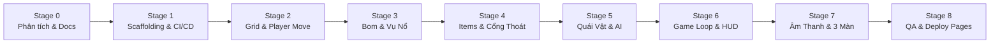

# LỘ TRÌNH TRIỂN KHAI DỰ ÁN (IMPLEMENTATION ROADMAP)

> **QUY TẮC BẮT BUỘC**: Mỗi Stage chỉ được coi là hoàn thành khi đáp ứng đầy đủ tất cả **Tiêu chí nghiệm thu (Acceptance Criteria)**. AI Agent **PHẢI DỪNG LẠI (HALT)** ở cuối mỗi Stage để báo cáo kết quả và chỉ bắt đầu Stage kế tiếp khi người dùng phê duyệt rõ ràng.

---

## TỔNG QUAN CÁC GIAI ĐOẠN

---

## 📌 STAGE 0: PHÂN TÍCH, THIẾT KẾ KIẾN TRÚC & TÀI LIỆU HÓA (HIỆN TẠI)

- **Mục tiêu**: Thiết lập toàn bộ khung kiến trúc, tài liệu đặc tả, cơ chế gameplay và chỉ dẫn cho AI Agent trước khi viết bất kỳ dòng mã nguồn game nào.
- **Sản phẩm bàn giao**:
  - `README.md`
  - `GEMINI.md`
  - `Agents/PRODUCT_REQUIREMENTS.md`
  - `Agents/GAME_DESIGN_DOCUMENT.md`
  - `Agents/ARCHITECTURE.md`
  - `Agents/IMPLEMENTATION_ROADMAP.md`
  - `Agents/TEST_STRATEGY.md`
  - `Agents/DECISION_LOG.md`
- **Tiêu chí nghiệm thu (Acceptance Criteria)**:
  1. [x] Toàn bộ 8 tài liệu bắt buộc đã được tạo và viết bằng Tiếng Việt chi tiết, mạch lạc.
  2. [x] Không có bất kỳ tệp mã nguồn game nào (`src/`) được tạo sớm.
  3. [x] Cấu trúc thư mục và trách nhiệm từng mô-đun được phân định rõ ràng.
  4. [x] Lộ trình chi tiết từng Stage có tiêu chí nghiệm thu rõ ràng.
  5. [x] Đã trình bày toàn bộ kết quả để Tech Lead / User xem xét và phê duyệt.

---

## 📌 STAGE 1: KHỞI TẠO HẠ TẦNG DỰ ÁN (SCAFFOLDING & CI/CD PIPELINE)

- **Mục tiêu**: Thiết lập môi trường dự án với Vite, TypeScript, Phaser 3, Vitest và quy trình CI/CD GitHub Actions sẵn sàng cho việc triển khai tự động.
- **Nhiệm vụ cụ thể**:
  - Khởi tạo `package.json` với các dependency: `phaser` (v3.80+), `typescript`, `vite`, `vitest`.
  - Cấu hình `tsconfig.json` với chế độ strict mode.
  - Cấu hình `vite.config.ts` hỗ trợ asset bundling và base path phù hợp với GitHub Pages.
  - Tạo trang `index.html` căn giữa khung canvas màn hình.
  - Tạo tệp `.github/workflows/deploy.yml` tự động build và deploy lên GitHub Pages khi có commit đẩy lên nhánh `main`.
  - Tạo cấu trúc thư mục rỗng chuẩn: `src/config/`, `src/core/`, `src/entities/`, `src/systems/`, `src/scenes/`, `src/ui/`, `src/utils/`, `src/types/`.
  - Thiết lập `BootScene` và `PreloadScene` cơ bản hiển thị màn hình khởi động đen với dòng chữ "BOMBER GAME V1.0".
- **Tiêu chí nghiệm thu (Acceptance Criteria)**:
  1. [x] Chạy lệnh `npm install` thành công 100%, không xung đột phiên bản.
  2. [x] Lệnh `npm run dev` khởi động dev server mượt mà, mở trình duyệt thấy Canvas hiển thị khung game 720x672.
  3. [x] Lệnh `npm run build` tạo thư mục `dist/` hoàn chỉnh không có cảnh báo kiểu dữ liệu (0 type errors).
  4. [x] File workflow `.github/workflows/deploy.yml` có cú pháp hợp lệ theo chuẩn GitHub Actions.
  5. [x] Báo cáo nghiệm thu chi tiết lưu tại [`Agents/STAGE_1_REPORT.md`](file:///G:/GIT/Bomber/Agents/STAGE_1_REPORT.md).

---

## 📌 STAGE 2: LƯỚI BẢN ĐỒ & DI CHUYỂN NHÂN VẬT MƯỢT MÀ

> **Lưu ý quản trị**: Theo phê duyệt của Tech Lead, Stage 2 được chia nhỏ có kiểm soát:
> - **Stage 2A**: Technical Prerequisites (ĐÃ HOÀN THÀNH & ĐÃ NGHIỆM THU - xem [`Agents/STAGE_2A_REPORT.md`](file:///G:/GIT/Bomber/Agents/STAGE_2A_REPORT.md)).
> - **Stage 2B**: Grid & Map System (ĐÃ HOÀN THÀNH & ĐÃ NGHIỆM THU - xem [`Agents/STAGE_2B_REPORT.md`](file:///G:/GIT/Bomber/Agents/STAGE_2B_REPORT.md)).
> - **Stage 2C**: Player Entity & Smooth Movement với Corner Sliding (ĐÃ HOÀN THÀNH - xem [`Agents/STAGE_2C_REPORT.md`](file:///G:/GIT/Bomber/Agents/STAGE_2C_REPORT.md)).
> - **Stage 2C.1**: Player Movement Polish & Architecture Hardening (ĐÃ HOÀN THÀNH - CHỜ NGHIỆM THU - xem [`Agents/STAGE_2C_1_REPORT.md`](file:///G:/GIT/Bomber/Agents/STAGE_2C_1_REPORT.md)).

### Tiêu chí nghiệm thu Stage 2B (Grid & Map System):
- [x] Tile definitions (`TileType`, `ITileProperties`) được xây dựng rõ ràng, type-safe.
- [x] `GridSystem` hoạt động độc lập 100% với Phaser, xử lý biên an toàn.
- [x] `GameMap` đại diện dữ liệu bản đồ hoàn chỉnh, bảo vệ tính bất biến bằng Deep Copy.
- [x] `MapGenerator` sinh bản đồ 15x13 chuẩn GDD (tường bao, trụ cột, vùng an toàn, số lượng gạch mềm theo Stage).
- [x] `MapGenerator` hỗ trợ PRNG Seed tất định (Deterministic - cùng seed ra cùng map).
- [x] Phân biệt rõ ràng Hard Wall (cố định, không thể phá) và Soft Wall (có thể phá hủy về Empty hoặc lộ diện Exit Door).
- [x] Unit Tests bao phủ đầy đủ (39/39 tests passed).
- [x] `npm run typecheck` (0 errors), `npm run test` (100% pass), `npm run build` thành công.
- [x] Chưa triển khai gameplay ngoài phạm vi (chưa có Player, Bomb, Enemy, Power-up).

### Tiêu chí nghiệm thu Stage 2C (Player Entity & Smooth Movement / Corner Sliding):
- [x] Player Entity triển khai đúng kiến trúc, kế thừa Arcade Physics Sprite.
- [x] Player Spawn lấy trực tiếp từ `GameMap.getPlayerSpawn()`.
- [x] Hitbox chuẩn mực 28x28 pixel căn giữa (offset 10px trên tile 48x48).
- [x] Hỗ trợ đầy đủ phím mũi tên và WASD, xử lý đa phím theo cơ chế Last-Pressed Priority.
- [x] Tự động giải phóng input listener khi Scene shutdown/destroy.
- [x] Di chuyển mượt mà độc lập frame rate (vận tốc 120 px/s theo delta time).
- [x] Không đi xuyên qua Tường cứng, Gạch mềm, hoặc ra ngoài biên bản đồ.
- [x] Thuật toán Corner Sliding mượt mà khi va chạm góc mép tường <= 14px.
- [x] Không xuyên thấu (Tunneling) nhờ kỹ thuật Sub-stepping (tối đa 4px/bước).
- [x] Hoạt ảnh 4 hướng (Idle/Walk) nội suy procedural hoạt động sống động.
- [x] Bộ Unit Tests độc lập gồm 66 bài test (100% pass).
- [x] `npm run typecheck` (0 errors) và `npm run build` thành công.
- [x] Chưa triển khai Bomb, Explosion, Enemy, Power-up ngoài phạm vi.

### Tiêu chí nghiệm thu Stage 2C.1 (Movement Polish & Hardening - Xử lý AUD-01 -> AUD-05):
- [x] **AUD-01**: Xác lập quyền kiểm soát vị trí duy nhất (Single Source of Authority), thiết lập `body.moves = false` trên Arcade Body để trở thành Kinematic Sensor Body, tránh xung đột vật lý và sẵn sàng cho Stage 3/5.
- [x] **AUD-02**: Triển khai cơ chế Corridor Entry Auto-Centering (căn giữa khi vào hành lang hẹp 1 ô) song song với T-Junction Corner Rounding.
- [x] **AUD-03**: Tính toán `forwardCol` / `forwardRow` dựa trên tọa độ đích `targetX` / `targetY` để triệt tiêu hoàn toàn sai số số thực float truncation.
- [x] **AUD-04**: Chặn trần thời gian frame `deltaSeconds = Math.min(Math.max(0, deltaSeconds), 0.1)` ở cả Scene và CollisionSystem, giới hạn tối đa 3 bước sub-stepping, chống freeze/lag spike khi chuyển tab.
- [x] **AUD-05**: Bổ sung bộ Unit Tests đối xứng cho các hướng LEFT, UP, kiểm tra ngưỡng biên 14px/15px và Corridor Entry (tổng 82 tests pass 100%).
- [x] Ghi nhận kiến trúc chi tiết trong `Agents/DECISION_LOG.md` (ADR-012).
- [x] Toàn bộ `npm run typecheck`, `npm run test` (82/82 tests), `npm run build` thành công 100%.

---

## 📌 STAGE 3: HỆ THỐNG ĐẶT BOM & VỤ NỔ LAN TRUYỀN (BLAST SYSTEM)

> **Lưu ý quản trị**: Theo phê chuẩn của Tech Lead, Stage 3 được chia làm các giai đoạn kiểm soát:
> - **Stage 3A**: Technical Design & Architecture Finalization (ĐÃ HOÀN THÀNH & ĐÃ CHỐT 3 QUYẾT ĐỊNH – xem [`Agents/STAGE_3A_TECHNICAL_DESIGN.md`](file:///G:/GIT/Bomber/Agents/STAGE_3A_TECHNICAL_DESIGN.md) và [`Agents/STAGE_3A_REPORT.md`](file:///G:/GIT/Bomber/Agents/STAGE_3A_REPORT.md)).
> - **Stage 3B.1**: Bomb Core System Implementation (ĐÃ HOÀN THÀNH – xem [`Agents/STAGE_3B_1_REPORT.md`](file:///G:/GIT/Bomber/Agents/STAGE_3B_1_REPORT.md)).
> - **Stage 3B.2**: Player Bomb Pass-through & Input Integration (ĐÃ HOÀN THÀNH – CHỜ NGHIỆM THU – xem [`Agents/STAGE_3B_2_REPORT.md`](file:///G:/GIT/Bomber/Agents/STAGE_3B_2_REPORT.md)).
> - **Stage 3B.3**: Explosion System, Raycasting & Chain Reaction (CHỜ CẤP QUYỀN).
> - **Stage 3B.4**: Visuals, Animations & GameScene Wiring (CHỜ CẤP QUYỀN).

### Tiêu chí nghiệm thu Stage 3B.1 (Bomb Core System Implementation):
- [x] Bomb types (`IBombData`, `BombState`, `IPlaceBombOptions`) và config (`BOMB_CONFIG`) độc lập với Phaser.
- [x] `BombSystem` hoạt động Headless 100%, quản lý danh sách bom theo ID và Coord.
- [x] State machine chuẩn xác: `ARMED` -> `EXPLODING` -> `FINISHED` và `ARMED` -> `TRIGGERED` -> `EXPLODING` -> `FINISHED`.
- [x] Quản lý ownership và capacity độc lập theo `ownerId`.
- [x] Giải phóng capacity ngay thời điểm bom phát nổ (`EXPLODING`), không giải phóng 2 lần, không tăng khi `FINISHED`.
- [x] Tích hợp an toàn với `GridSystem`: cập nhật `TileType.BOMB` khi đặt và giải phóng về `TileType.EMPTY` khi nổ (ADR-013).
- [x] Fuse countdown chính xác theo delta time, không đếm đúp, xử lý delta <= 0 an toàn.
- [x] Typed EventBus type-safe (`BOMB_PLACED`, `BOMB_TRIGGERED`, `BOMB_EXPLODING`, `BOMB_EXPLODED`, `BOMB_FINISHED`).
- [x] Bộ 34 Unit Tests bao phủ đầy đủ 5 nhóm (116/116 tests toàn dự án PASS 100%).
- [x] `npm run typecheck` (0 errors) và `npm run build` thành công.
- [x] Tuyệt đối không có scope creep (chưa làm Pass-through, Explosion, Visuals, Enemies).

### Tiêu chí nghiệm thu Stage 3B.2 (Player Bomb Pass-through & Input Integration):
- [x] Spacebar input Single-shot: chỉ kích hoạt đặt bom 1 lần khi nhấn, nhấn giữ không tự động lặp lại (No Auto-repeat), nhả phím và nhấn lại mới kích hoạt lần tiếp.
- [x] Bomb đặt đúng ô Grid theo tọa độ tâm Player (`GridMath.worldToGrid`), snap chính xác và an toàn.
- [x] Triển khai thuật toán Spatial Disjoint AABB (ADR-013): Player được đi xuyên quả bom vừa đặt khi AABB còn giao nhau với cell chứa bom.
- [x] Thu hồi quyền đi xuyên ngay khi toàn bộ AABB của Player rời khỏi cell (`player.right <= cellLeft || player.left >= cellRight || player.bottom <= cellTop || player.top >= cellBottom`). Tiếp xúc đúng biên được coi là disjoint.
- [x] Sau khi thu hồi quyền, Player không thể quay lại ô chứa bom khi bom vẫn tồn tại (ô bom trở thành chướng ngại vật rắn 1x1).
- [x] Quản lý quyền đi xuyên độc lập theo từng Player và từng Bomb: `playerBombPassThrough: Map<playerId, Set<bombId>>`.
- [x] Thực thể khác (Player 2, Enemies tương lai) không có quyền đi xuyên qua bom của Player 1 (`TileType.BOMB` có `isWalkable = false`).
- [x] Bảo toàn trọn vẹn Corner Sliding (Corridor Entry Auto-Centering + T-Junction Rounding), Sub-stepping (4px) và Kinematic Movement (ADR-012).
- [x] Tích hợp trơn tru BombSystem vào `GameScene` (lifecycle, update loop, cleanup khi shutdown/destroy, visual marker tạm thời).
- [x] Bộ 24 Unit Tests Headless độc lập cho Pass-through và Input (nâng tổng số test toàn dự án lên 140/140 tests PASS 100%).
- [x] `npm run typecheck` (0 errors) và `npm run build` thành công (bundle sạch sẽ, không lỗi).
- [x] Giữ phạm vi nghiêm ngặt: Tuyệt đối không triển khai Explosion System, Raycasting, Chain Reaction (thuộc Stage 3B.3).

- **Mục tiêu**: Triển khai cơ chế đặt bom, đếm ngược thời gian nổ, hiệu ứng tia lửa nổ 4 hướng chữ thập, phá vỡ gạch mềm và kích hoạt nổ dây chuyền.
- **Nhiệm vụ cụ thể**:
  - Nhấn phím `Space` để thả bom tại tâm ô lưới người chơi đang đứng.
  - Áp dụng cơ chế **Spatial Disjoint AABB Pass-through (ADR-013)** cho Player khi đặt bom.
  - Tạo thực thể `Bomb.ts`: đếm ngược 3.0 giây, hoạt ảnh phồng xẹp (pulse animation).
  - Triển khai `BombSystem.ts`:
    - Giới hạn số lượng bom đặt cùng lúc theo chỉ số của Player.
    - Quản lý danh sách các quả bom đang hoạt động và danh sách Pass-through.
    - Hồi phục capacity và giải phóng ô lưới trên `GridSystem` ngay thời điểm bom phát nổ (`EXPLODING`).
    - Thuật toán Raycasting tính toán vùng nổ (dừng lại khi gặp Tường cứng, phá hủy Gạch mềm đầu tiên, quét qua ô trống và bom).
    - Phản ứng nổ dây chuyền phi đệ quy (BFS Queue): quả bom nằm trong tầm nổ của quả bom khác sẽ nổ ngay lập tức, không lặp vô hạn.
  - Tạo thực thể `Explosion.ts`:
    - Quản lý theo `CellExplosionTracker`: gộp hiển thị theo ô (Visual Stacking), bảo toàn gameplay state của từng contribution.
    - Render tia nổ tại tâm, các đoạn thân (Body segments) và đầu tia nổ (Tip segments).
    - Hitbox nổ tồn tại trong 0.4 giây rồi tự tiêu biến.
  - Xử lý phá vỡ gạch mềm: phát hoạt ảnh vụn vỡ và xóa ô đó trên ma trận lưới.
- **Tiêu chí nghiệm thu (Acceptance Criteria)**:
  1. Người chơi chỉ đặt được số lượng bom tối đa cho phép.
  2. Bom tự động căn chỉnh ngay ngắn vào tâm ô lưới.
  3. Người chơi đi xuyên bom vừa đặt cho đến khi bước hẳn ra ngoài; khi đã ra ngoài thì bom hóa rắn không thể đi ngược lại (ADR-013).
  4. Bom nổ sau 3 giây; tia lửa nổ lan theo 4 hướng hình chữ thập.
  5. Tia lửa không xuyên qua Tường cứng; phá hủy Gạch mềm đầu tiên và chặn lại.
  6. Bom kích nổ quả bom khác ngay tức thì khi bị tia lửa chạm vào; tia lửa tiếp tục lan qua ô bom nếu còn tầm nổ.
  7. Gộp visual representation khi nhiều vụ nổ cùng chiếm một ô lưới mà không làm mất trạng thái gameplay.

---

## 📌 STAGE 4: HỆ THỐNG VẬT PHẨM (POWER-UPS) & CỬA THOÁT HIỂM

- **Mục tiêu**: Khi gạch mềm vỡ, sinh ngẫu nhiên vật phẩm tăng sức mạnh hoặc Cửa thoát hiểm; người chơi có thể nhặt và nâng cấp chỉ số.
- **Nhiệm vụ cụ thể**:
  - Tạo `PowerUp.ts` với 3 loại:
    - `Bomb Up`: Tăng số lượng bom tối đa thêm +1.
    - `Fire Up`: Tăng tầm lan truyền tia lửa nổ thêm +1 ô.
    - `Speed Up`: Tăng tốc độ di chuyển của nhân vật thêm +20px/s.
  - Cập nhật `GridSystem.ts`: khi gạch mềm vỡ, 30% tỷ lệ sinh Power-up.
  - Tia lửa bom nếu quét trúng Power-up sẽ phá hủy luôn Power-up đó.
  - Tạo `ExitDoor.ts`:
    - Ẩn dưới một khối gạch mềm duy nhất trong màn chơi.
    - Trạng thái ban đầu: Khóa (Locked).
    - Khi quái vật bị diệt hết: Chuyển sang Mở (Unlocked).
- **Tiêu chí nghiệm thu (Acceptance Criteria)**:
  1. Phá gạch mềm có tỷ lệ rớt Item chuẩn xác.
  2. Người chơi đi qua nhặt được Item, chỉ số (tầm nổ, số bom, tốc độ) tăng ngay lập tức.
  3. Tia lửa bom thiêu rụi được Item nếu chạm phải.
  4. Cửa thoát hiểm lộ diện khi gạch vỡ và hiển thị đúng trạng thái Đóng/Mở.

---

## 📌 STAGE 5: QUÁI VẬT & TRÍ TUỆ NHÂN TẠO (ENEMY AI)

- **Mục tiêu**: Xây dựng 2 loại quái vật cổ điển (Ballom và Oneal) với logic AI tự hành, va chạm gây sát thương và bị tiêu diệt bởi vụ nổ.
- **Nhiệm vụ cụ thể**:
  - Tạo lớp cơ sở `Enemy.ts` kế thừa Sprite có thanh máu/trạng thái.
  - Tạo `Ballom.ts`:
    - Tốc độ chậm (60 px/s).
    - AI: Di chuyển thẳng cho đến khi gặp tường/gạch/bom thì chọn hướng ngẫu nhiên tại ngã rẽ.
  - Tạo `Oneal.ts`:
    - Tốc độ bình thường (95 px/s).
    - AI: Quét đường ngắm trực giao (Line of Sight); nếu thấy Player trong khoảng cách 4 ô mà không có vật cản thì tăng tốc lao tới.
  - Triển khai `CollisionSystem.ts`:
    - Quái vật chạm trúng Player -> Player mất 1 mạng, phát hoạt ảnh tử nạn.
    - Tia lửa bom chạm trúng Quái vật -> Quái vật chết, phát hoạt ảnh biến mất và cộng điểm.
    - Khi quái vật cuối cùng chết -> Phát sự kiện `ALL_ENEMIES_DEFEATED` để mở Cửa thoát hiểm.
- **Tiêu chí nghiệm thu (Acceptance Criteria)**:
  1. Quái vật Ballom tuần tra tự động, đổi hướng hợp lý khi chạm vật cản.
  2. Quái vật Oneal kích hoạt trạng thái săn lùng khi nhìn thấy Player.
  3. Quái vật bị tiêu diệt khi trúng tia nổ của bom.
  4. Người chơi mất mạng khi chạm vào quái vật.
  5. Cửa thoát hiểm mở ra ngay sau khi con quái cuối cùng bị tiêu diệt.

---

## 📌 STAGE 6: VÒNG LẶP TRÒ CHƠI, GIAO DIỆN HUD & QUY TẮC THẮNG/THUA

- **Mục tiêu**: Hoàn thiện toàn bộ vòng lặp trò chơi từ Menu, HUD hiển thị trực quan (Điểm, Mạng, Thời gian), Pause, Game Over và Victory.
- **Nhiệm vụ cụ thể**:
  - Xây dựng `UIScene.ts` chạy đè song song với `GameScene`:
    - Hiển thị HUD trên cùng: Điểm số, Thời gian đếm ngược (đếm lùi từ 200s), Số mạng (Icons trái tim).
  - Xây dựng `ScoreSystem.ts`:
    - Quản lý điểm số, trừ mạng khi chết, tính điểm thưởng thời gian khi thắng.
    - Quản lý lưu trữ Kỷ lục (High Score) vào `localStorage`.
  - Màn hình `MenuScene`: Nút Bắt đầu chơi, Hướng dẫn phím bấm, Điểm cao nhất.
  - Cửa sổ Tạm dừng (`PauseModal`): Phím `P` hoặc `ESC` để dừng/tiếp tục.
  - Màn hình Kết thúc (`GameOverScene` & `VictoryScene`): Hiển thị tổng kết điểm và nút Chơi lại.
- **Tiêu chí nghiệm thu (Acceptance Criteria)**:
  1. HUD hiển thị chính xác và cập nhật theo thời gian thực (Real-time).
  2. Hết thời gian hoặc hết mạng dẫn đến Game Over chuẩn xác.
  3. Vào Cửa mở dẫn đến màn hình Chiến thắng và tính điểm thưởng.
  4. Tạm dừng game hoạt động hoàn hảo, không bị trôi thời gian hay chuyển động vật lý.
  5. Kỷ lục điểm số được lưu trữ bền vững qua các lần tải lại trang.

---

## 📌 STAGE 7: ÂM THANH, HIỆU ỨNG HÌNH ẢNH (POLISH) & 3 MÀN CHƠI

- **Mục tiêu**: Tích hợp toàn bộ âm thanh retro (SFX & BGM), hiệu ứng hạt (Particle effects), rung màn hình khi nổ bom và luân chuyển qua 3 màn chơi có độ khó tăng dần.
- **Nhiệm vụ cụ thể**:
  - Triển khai `AudioSystem.ts`:
    - Quản lý bật/tắt tiếng (Mute toggle).
    - Phát âm thanh nổ bom, đặt bom, nhặt item, quái chết, người chết, nhạc nền BGM.
  - Thêm hiệu ứng hình ảnh (VFX):
    - Hạt bụi khi gạch mềm vỡ vụn.
    - Rung màn hình nhẹ (Camera Shake) khi bom phát nổ gần người chơi.
    - Hoạt ảnh chữ "STAGE CLEAR" / "HURRY UP" khi thời gian còn dưới 30 giây.
  - Thiết lập luồng chuyển tiếp 3 màn chơi (Stage 1 -> Stage 2 -> Stage 3):
    - Tăng số lượng gạch mềm và bổ sung quái Oneal theo đúng bảng thiết kế GDD.
- **Tiêu chí nghiệm thu (Acceptance Criteria)**:
  1. Mọi hành động chính (đặt bom, nổ, nhặt đồ, chết, thắng) đều có âm thanh tương ứng sống động.
  2. Nút tắt/bật âm thanh hoạt động chuẩn trên thanh HUD.
  3. Hoàn thành Stage 1 tự động chuyển sang Stage 2 với cấu hình độ khó tăng lên.
  4. Vượt qua Stage 3 sẽ hiển thị màn hình Phá Đảo (Game Cleared).

---

## 📌 STAGE 8: KIỂM THỬ TOÀN DIỆN, ĐẢM BẢO CHẤT LƯỢNG & PHÁT HÀNH GITHUB PAGES

- **Mục tiêu**: Viết bộ Unit Test kiểm tra logic toán học/ma trận, kiểm thử thủ công tất cả các trường hợp biên, tối ưu hiệu năng và phát hành chính thức lên GitHub Pages.
- **Nhiệm vụ cụ thể**:
  - Viết Unit Tests (Vitest) cho:
    - Quy đổi tọa độ `GridMath` (WorldToGrid, GridToWorld).
    - Thuật toán Raycasting vụ nổ bom (chặn tường cứng, phá gạch mềm).
    - Tính điểm thưởng và máy trạng thái vòng đời.
  - Thực hiện Manual Test Checklist theo tài liệu `TEST_STRATEGY.md`.
  - Tối ưu hóa bundle và tài nguyên: Đảm bảo FPS đạt 60, không bị memory leak khi chơi lại nhiều lần.
  - Đẩy mã nguồn lên GitHub, kích hoạt GitHub Actions workflow và xác thực game chạy hoàn hảo trên URL GitHub Pages công khai.
- **Tiêu chí nghiệm thu (Acceptance Criteria)**:
  1. 100% Unit Tests đều Pass (`npm run test`).
  2. Không có bất kỳ cảnh báo hoặc lỗi TypeScript (`npm run typecheck`).
  3. Game chạy mượt mà 60 FPS trên Chrome, Firefox, Safari và Edge.
  4. Đường link GitHub Pages hoạt động trơn tru cho người dùng trải nghiệm thực tế.
