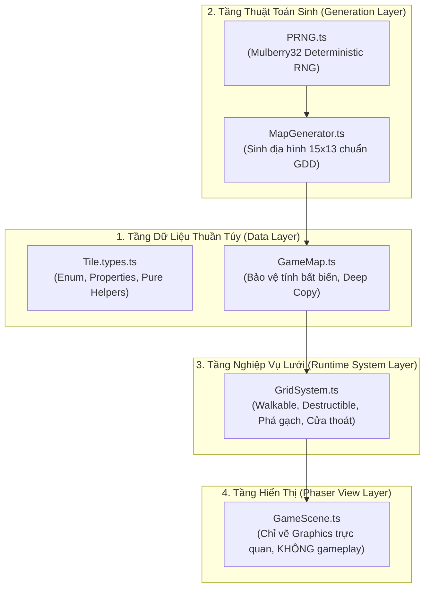

# BÁO CÁO HOÀN THÀNH STAGE 2B: GRID & MAP SYSTEM

- **Dự án**: Bomber Game
- **Giai đoạn**: Stage 2B – Grid & Map System
- **Ngày hoàn thành**: 2026-11-07
- **Người thực hiện**: AI Coding Agent (Senior Software Architect & Technical Lead)
- **Trạng thái**: Hoàn thành 100% – Chờ phê duyệt nghiệm thu trước khi chuyển sang giai đoạn tiếp theo

---

## 1. TỔNG QUAN TRIỂN KHAI (OVERVIEW)

Stage 2B đã thiết lập trọn vẹn nền tảng Lưới và Bản đồ cho trò chơi, tuân thủ nghiêm ngặt các nguyên tắc Clean Architecture:
- Phân tách tuyệt đối 3 tầng: **Data Representation (`GameMap`)**, **Business Logic (`GridSystem`, `MapGenerator`)**, và **Visual Rendering (`GameScene`)**.
- Toàn bộ logic ma trận độc lập 100% với Phaser API, cho phép kiểm thử tự động Headless siêu tốc (toàn bộ 39 tests hoàn thành trong 32ms).
- Triển khai bộ sinh số giả ngẫu nhiên có kiểm soát (`PRNG` Mulberry32) đảm bảo tính tất định (Deterministic) trong việc sinh địa hình bản đồ theo Seed.
- Tuân thủ tuyệt đối phạm vi kiểm soát: **KHÔNG triển khai Player, Player Movement, Bomb, Explosion, Enemy, Power-up**.

---

## 2. DANH SÁCH FILE TẠO MỚI & CHỈNH SỬA

### 2.1. File tạo mới:
1. [`src/types/Tile.types.ts`](file:///G:/GIT/Bomber/src/types/Tile.types.ts): Định nghĩa interface `ITileProperties`, bảng ánh xạ `TILE_PROPERTIES` (`isWalkable`, `isDestructible`, `blocksBlast`) và các helper kiểm tra hành vi.
2. [`src/types/Map.types.ts`](file:///G:/GIT/Bomber/src/types/Map.types.ts): Định nghĩa interface `IGameMapData` và `IMapGeneratorOptions`.
3. [`src/utils/PRNG.ts`](file:///G:/GIT/Bomber/src/utils/PRNG.ts): Bộ sinh số giả ngẫu nhiên tất định thuật toán Mulberry32 kết hợp FNV-1a hash hỗ trợ cả chuỗi và số nguyên seed.
4. [`src/core/GameMap.ts`](file:///G:/GIT/Bomber/src/core/GameMap.ts): Lớp đại diện dữ liệu bản đồ bất biến (Map Representation), bảo vệ tính toàn vẹn trạng thái nội bộ bằng Deep Copy.
5. [`src/systems/MapGenerator.ts`](file:///G:/GIT/Bomber/src/systems/MapGenerator.ts): Thuật toán sinh ma trận địa hình 15x13 chuẩn GDD (tường bao, trụ cột chẵn, vùng an toàn, gạch mềm theo stage, ẩn cửa thoát hiểm).
6. [`src/systems/GridSystem.ts`](file:///G:/GIT/Bomber/src/systems/GridSystem.ts): Hệ thống quản lý lưới runtime, kiểm tra Walkable, Destructible, phá hủy gạch mềm, mở khóa cửa.
7. [`src/scenes/GameScene.ts`](file:///G:/GIT/Bomber/src/scenes/GameScene.ts): Màn hình Phaser tối thiểu hiển thị bản đồ phục vụ xác thực trực quan (Visual Verification), không có gameplay.
8. [`tests/GridSystem.test.ts`](file:///G:/GIT/Bomber/tests/GridSystem.test.ts): 11 kịch bản Unit Test cho GridSystem.
9. [`tests/MapGenerator.test.ts`](file:///G:/GIT/Bomber/tests/MapGenerator.test.ts): 8 kịch bản Unit Test cho thuật toán MapGenerator và tính tất định.
10. [`tests/GameMap.test.ts`](file:///G:/GIT/Bomber/tests/GameMap.test.ts): 5 kịch bản Unit Test kiểm tra tính bất biến và serialization của GameMap.

### 2.2. File chỉnh sửa:
1. [`src/config/GameConfig.ts`](file:///G:/GIT/Bomber/src/config/GameConfig.ts): Đăng ký `GameScene` vào mảng scene khởi tạo của Phaser.
2. [`src/scenes/PreloadScene.ts`](file:///G:/GIT/Bomber/src/scenes/PreloadScene.ts): Chuyển tiếp luồng hiển thị sang `GameScene`.
3. [`Agents/ARCHITECTURE.md`](file:///G:/GIT/Bomber/Agents/ARCHITECTURE.md): Cập nhật sơ đồ phân tầng và mô tả chi tiết phân hệ Grid & Map.
4. [`Agents/IMPLEMENTATION_ROADMAP.md`](file:///G:/GIT/Bomber/Agents/IMPLEMENTATION_ROADMAP.md): Cập nhật bảng kiểm tra hoàn thành Stage 2B.
5. [`Agents/TEST_STRATEGY.md`](file:///G:/GIT/Bomber/Agents/TEST_STRATEGY.md): Cập nhật danh mục 39 bài test tự động.
6. [`Agents/DECISION_LOG.md`](file:///G:/GIT/Bomber/Agents/DECISION_LOG.md): Ghi nhận quyết định kiến trúc mới ADR-010.

---

## 3. MÔ TẢ KIẾN TRÚC PHÂN HỆ GRID & MAP

Hệ thống được tổ chức theo 4 tầng trách nhiệm rõ ràng:



### Đặc tính nổi bật:
- **Tính đóng gói và bất biến (Encapsulation & Immutability)**:
  `GameMap` sao chép sâu (Deep Copy) toàn bộ ma trận khi khởi tạo và chỉ trả về bản sao qua `cloneTiles()` hoặc `getTilesSnapshot()`. Không module nào từ bên ngoài có thể làm sai lệch dữ liệu mảng nội bộ.
- **Phân định rõ ràng Hard Wall vs Soft Wall**:
  - `HARD_WALL`: `isWalkable = false`, `isDestructible = false`, `blocksBlast = true`. Cố định trên bản đồ.
  - `SOFT_BRICK`: `isWalkable = false`, `isDestructible = true`, `blocksBlast = true`. Khi bị phá (`destroySoftWall`), chuyển thành `EMPTY` hoặc lộ diện `EXIT_DOOR_LOCKED`.

---

## 4. CƠ CHẾ HOẠT ĐỘNG CỦA MAPGENERATOR & TÍNH TẤT ĐỊNH (PRNG SEED)

### 4.1. Quy trình sinh bản đồ:
1. **Khởi tạo**: Tạo ma trận 15 cột x 13 hàng toàn bộ là `EMPTY`.
2. **Tường bao quanh (Perimeter)**: Hàng `0`, `12` và cột `0`, `14` luôn được gán `HARD_WALL`.
3. **Trụ cột cố định (Fixed Pillars)**: Tất cả các ô chẵn cả hàng và cột (`col % 2 === 0 && row % 2 === 0`) được gán `HARD_WALL`.
4. **Bảo vệ vùng an toàn (Safe Zone)**:
   - Các ô `(1, 1)` [vị trí Spawn], `(1, 2)` và `(2, 1)` luôn được bảo vệ, không bao giờ được đặt gạch mềm.
5. **Thu thập ứng viên & Xáo trộn PRNG**:
   - Thu thập toàn bộ các ô `EMPTY` còn lại (ngoài vùng an toàn).
   - Xáo trộn danh sách bằng thuật toán Fisher-Yates sử dụng `PRNG(seed)`.
6. **Đặt Gạch Mềm (Soft Walls)**:
   - Lấy số lượng gạch theo cấu hình Stage (Stage 1: 30, Stage 2: 42, Stage 3: 50).
   - Gán `SOFT_BRICK` vào các vị trí đã chọn.
7. **Ẩn Cửa Thoát Hiểm (Exit Door)**:
   - Chọn ngẫu nhiên 1 trong các ô gạch mềm vừa đặt để làm vị trí ẩn Cửa thoát hiểm.

### 4.2. Tính tất định (Deterministic):
- Nhờ lớp `PRNG` (Mulberry32), cùng một `seed` (ví dụ `12345` hoặc chuỗi ký tự `'STAGE_1_SEED'`) sẽ sinh ra ma trận tường và vị trí cửa thoát hiểm **giống hệt nhau 100%** trên mọi máy và mọi trình duyệt.
- Cho phép viết Unit Test kiểm tra tính tái lập và phục vụ lưu trữ replay hoặc chia sẻ màn chơi sau này.

---

## 5. CÁC QUYẾT ĐỊNH KIẾN TRÚC MỚI (ADR)

Đã ghi nhận **ADR-010** vào [`Agents/DECISION_LOG.md`](file:///G:/GIT/Bomber/Agents/DECISION_LOG.md):
- **Bối cảnh**: Cần cấu trúc dữ liệu bản đồ và thuật toán sinh ma trận độc lập hoàn toàn với Phaser, hỗ trợ kiểm thử Headless và tính tất định.
- **Quyết định**: Tách riêng `GameMap` (Data), `GridSystem` (Logic) và `MapGenerator` kèm `PRNG` (Mulberry32).
- **Hệ quả**: Đảm bảo 100% Headless testing, không có lỗi rò rỉ trạng thái hay phụ thuộc vòng tròn.

---

## 6. DANH SÁCH UNIT TESTS & KẾT QUẢ KIỂM THỬ

Toàn bộ **39 kịch bản Unit Tests** trên 5 test suites đều chạy thành công 100%:

```text
 RUN  v1.6.1 G:/GIT/Bomber

 ✓ tests/GridMath.test.ts      (11 tests) 5ms
 ✓ tests/EventBus.test.ts      (4 tests)  7ms
 ✓ tests/GameMap.test.ts       (5 tests)  5ms
 ✓ tests/GridSystem.test.ts    (11 tests) 6ms
 ✓ tests/MapGenerator.test.ts  (8 tests)  9ms

 Test Files  5 passed (5)
      Tests  39 passed (39)
   Duration  441ms (Kiểm thử thực thi chỉ 32ms)
```

### Chi tiết các nhóm test mới trong Stage 2B:
- **`tests/GameMap.test.ts` (5 tests)**: Khởi tạo hợp lệ, bảo vệ tính bất biến constructor, tính bất biến cloneTiles, serialization toData/fromData, từ chối tọa độ ngoài biên.
- **`tests/GridSystem.test.ts` (11 tests)**: Khởi tạo 15x13, truy xuất hợp lệ/âm/ngoài biên, cập nhật tile an toàn, kiểm tra isWalkable, kiểm tra isDestructible, phá hủy gạch mềm về EMPTY, phá gạch lộ diện Exit Door (LOCKED), mở khóa cửa (OPEN), snapshot immutability.
- **`tests/MapGenerator.test.ts` (8 tests)**: Kích thước 15x13, tính tất định cùng seed, tính đa dạng khác seed, tường bao 100% Hard Wall, trụ cột chẵn 100% Hard Wall, vùng an toàn (1,1), (1,2), (2,1) luôn EMPTY, số lượng gạch mềm chuẩn xác theo Stage (30/42/50), cửa thoát hiểm ẩn dưới gạch mềm.

---

## 7. KẾT QUẢ BIÊN DỊCH & PRODUCTION BUILD

### 7.1. TypeScript Strict Typecheck (`npm run typecheck`)
```text
> bomber-game@0.1.0 typecheck
> tsc --noEmit
(Hoàn thành xuất sắc: 0 lỗi, 0 cảnh báo - TypeScript Strict Mode)
```

### 7.2. Production Build (`npm run build`)
```text
> bomber-game@0.1.0 build
> tsc --noEmit && vite build

vite v5.4.21 building for production...
✓ 20 modules transformed.
dist/index.html                     1.84 kB │ gzip:   0.86 kB
dist/assets/index-Bil7UkpT.js       8.73 kB │ gzip:   3.47 kB │ map:     37.76 kB
dist/assets/phaser-DGOJFvlN.js  1,478.62 kB │ gzip: 337.77 kB │ map: 10,169.94 kB
✓ built in 11.58s
```

---

## 8. ĐỐI CHIẾU TIÊU CHÍ NGHIỆM THU (ACCEPTANCE CRITERIA)

| Tiêu chí | Trạng thái | Đánh giá thực tế |
| :--- | :---: | :--- |
| 1. Tile definitions được xây dựng rõ ràng, type-safe | **ĐẠT** | `src/types/Tile.types.ts` với bảng thuộc tính chuẩn. |
| 2. GridSystem hoạt động độc lập với Phaser | **ĐẠT** | 100% pure TypeScript, không import Phaser Scene. |
| 3. Map Representation hoàn chỉnh | **ĐẠT** | `GameMap.ts` đóng gói dữ liệu và bảo vệ bất biến. |
| 4. MapGenerator tạo được Map hợp lệ chuẩn GDD | **ĐẠT** | 15x13, tường bao quanh, trụ cột chẵn, vùng an toàn rỗng. |
| 5. MapGenerator hỗ trợ Seed deterministic | **ĐẠT** | Cùng seed cho kết quả giống hệt 100% (Mulberry32). |
| 6. Hard Wall và Soft Wall được phân biệt đúng | **ĐẠT** | Khác biệt rõ về khả năng phá hủy và chuyển trạng thái. |
| 7. Grid boundary được xử lý an toàn | **ĐẠT** | Tọa độ âm và vượt biên trả về null/false, không ném ngoại lệ. |
| 8. Unit Tests bao phủ các chức năng quan trọng | **ĐẠT** | 39 bài test tự động bao phủ toàn diện. |
| 9. Không phá vỡ tests hiện có | **ĐẠT** | Tests từ Stage 1 & 2A đều tiếp tục pass 100%. |
| 10. `npm run typecheck` thành công | **ĐẠT** | 0 compile errors. |
| 11. `npm run test` thành công | **ĐẠT** | 39/39 tests passed. |
| 12. `npm run build` thành công | **ĐẠT** | Build production hoàn tất không lỗi. |
| 13. Tài liệu kiến trúc được cập nhật | **ĐẠT** | Đã cập nhật ARCHITECTURE, ROADMAP, TEST_STRATEGY, ADR-010. |
| 14. Báo cáo `STAGE_2B_REPORT.md` được tạo đầy đủ | **ĐẠT** | File báo cáo đầy đủ, chi tiết. |

---

## 9. VẤN ĐỀ TỒN TẠI
- Hiện tại **không có bất kỳ lỗi hay vấn đề kỹ thuật nào tồn đọng**. Nền tảng Grid & Map System hoạt động hoàn hảo và sẵn sàng tích hợp với thực thể Player.

---

## 10. ĐỀ XUẤT GIAI ĐOẠN TIẾP THEO

Sau khi Stage 2B được nghiệm thu, đề xuất triển khai **Stage 2C: Player Entity & Smooth Movement (Corner Sliding)**:
- Xây dựng lớp thực thể `Player.ts` kế thừa Arcade Sprite.
- Tích hợp điều khiển bàn phím (Arrow Keys / WASD).
- Cấu hình Hitbox thu nhỏ `28x28` pixel căn giữa (trên tile 48x48).
- Triển khai thuật toán trượt góc (Corner Sliding) sử dụng dữ liệu từ `GridSystem`.
- Tạo hoạt ảnh bước chân 4 hướng.
