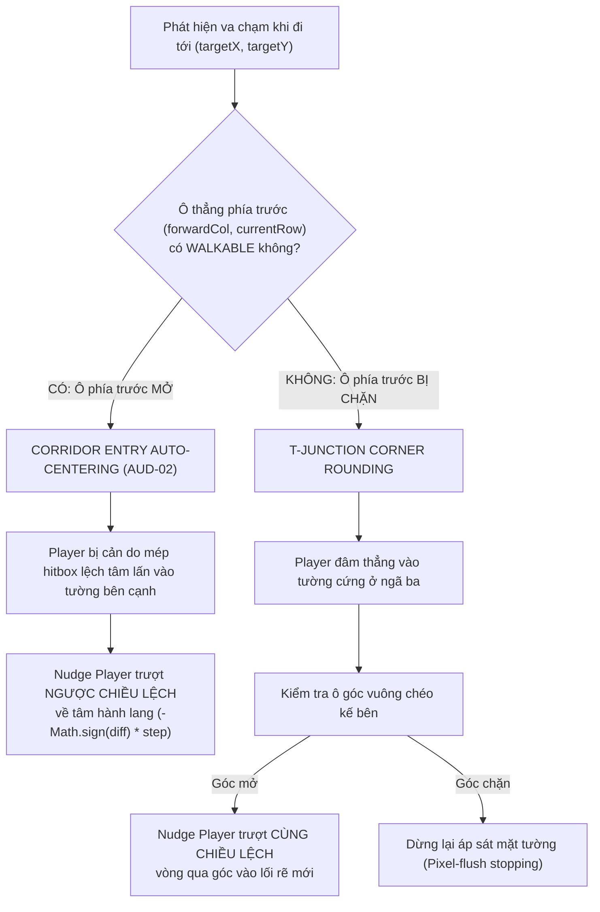

# BÁO CÁO NGHIỆM THU KỸ THUẬT STAGE 2C.1
## PLAYER MOVEMENT POLISH & ARCHITECTURE HARDENING

> **Dự án**: Classic Web Bomber Game (Phaser 3 + TypeScript + Vite)  
> **Người thực hiện**: Senior Game Developer & Software Architect (AI Agent)  
> **Ngày hoàn thành**: 07/11/2026  
> **Trạng thái**: ĐÃ HOÀN THÀNH TOÀN DIỆN – SẴN SÀNG CHỜ PHÊ DUYỆT NGHIỆM THU  
> **Tài liệu căn cứ**: [`Agents/STAGE_2C_TECHNICAL_AUDIT.md`](file:///G:/GIT/Bomber/Agents/STAGE_2C_TECHNICAL_AUDIT.md), [`Agents/DECISION_LOG.md`](file:///G:/GIT/Bomber/Agents/DECISION_LOG.md) (ADR-012)

---

## 1. TỔNG QUAN THỰC HIỆN (EXECUTIVE SUMMARY)

Giai đoạn **Stage 2C.1 – Player Movement Polish & Architecture Hardening** được kích hoạt nhằm xử lý dứt điểm toàn bộ 5 phát hiện kỹ thuật (từ **AUD-01** đến **AUD-05**) được ghi nhận trong đợt Technical Audit độc lập của Stage 2C. Mục tiêu cốt lõi là thiết lập một nền tảng chuyển động nhân vật đạt chuẩn arcade cổ điển, tuyệt đối an toàn về mặt kiến trúc phần mềm, triệt tiêu mọi xung đột tiềm ẩn trước khi bước sang phát triển các tính năng chiến thuật phức tạp tại Stage 3 (Hệ thống Bom & Vụ nổ).

### Kết quả then chốt đạt được:
1. **AUD-01 (Single Source of Authority)**: Arcade Physics Body của Player được chuyển sang mô hình **Kinematic Sensor Body** (`body.moves = false`), trao quyền lực độc quyền kiểm soát vị trí cho `PlayerCollisionSystem`.
2. **AUD-02 (Corridor Entry Auto-Centering)**: Hoàn thiện cơ chế tự động căn giữa khi người chơi di chuyển vào hành lang hẹp 1 ô, bổ trợ hoàn hảo cho cơ chế T-Junction Corner Rounding đã có.
3. **AUD-03 (Fix Target Coordinates)**: Chuyển đổi công thức tính toán `forwardCol` / `forwardRow` sang tọa độ đích `targetX` / `targetY`, triệt tiêu hoàn toàn lỗi sai số số thực ranh giới.
4. **AUD-04 (Delta Clamping)**: Chặn trần thời gian frame `deltaSeconds = Math.min(Math.max(0, deltaSeconds), 0.1)` ở cả hai lớp (Scene và System), giới hạn số bước Sub-stepping tối đa 3 lần mỗi frame, triệt tiêu nguy cơ freeze khi người dùng switch tab.
5. **AUD-05 (Symmetrical Unit Tests)**: Bổ sung 16 unit tests mới bao phủ toàn diện các hướng `LEFT`, `UP`, ngưỡng biên 14px/15px và Corridor Entry. Toàn bộ **82/82 bài test pass 100%**.
6. **Build & Typecheck**: `tsc --noEmit` đạt 0 lỗi type; Vite production build thành công tuyệt đối; không có bất kỳ tính năng gameplay nào vượt ngoài phạm vi được cài cắm.

---

## 2. XỬ LÝ PHÁT HIỆN AUD-01: ARCADE PHYSICS VS CUSTOM MOVEMENT

### 2.1. Phân tích nguyên nhân gốc rễ
Trước Stage 2C.1, thực thể [`Player`](file:///G:/GIT/Bomber/src/entities/Player.ts) kế thừa `Phaser.Physics.Arcade.Sprite` với Arcade Physics Body mặc định ở trạng thái Dynamic (`body.moves = true`). Mặc dù hệ thống sử dụng `PlayerCollisionSystem.resolveMovement()` kết hợp `this.setPosition()` để cập nhật tọa độ thủ công, việc Arcade Physics vẫn ngầm tích hợp vận tốc và phân tách va chạm (Body Separation) trong vòng lặp `physics.world.step()` tạo ra hiện tượng **"Hai vị thuyền trưởng cùng lái một con tàu" (Fighting Authorities)**. Khi sang Stage 3 (đặt bom) và Stage 5 (quái vật), nếu sử dụng `physics.add.collider()`, Arcade Physics sẽ tự ý đẩy nhân vật ra khỏi vị trí mà custom collision system đã tính toán, làm hỏng thuật toán Corner Sliding và Sub-stepping.

### 2.2. Giải pháp kiến trúc đã triển khai (ADR-012)
Tại [`Player.ts:setupHitbox()`](file:///G:/GIT/Bomber/src/entities/Player.ts#L49-L57), hệ thống đã thiết lập:
```typescript
private setupHitbox(): void {
  const body = this.body as Phaser.Physics.Arcade.Body;
  if (body) {
    body.setSize(PLAYER_CONFIG.HITBOX_WIDTH, PLAYER_CONFIG.HITBOX_HEIGHT);
    body.setOffset(PLAYER_HITBOX_OFFSET.x, PLAYER_HITBOX_OFFSET.y);
    body.setCollideWorldBounds(true);
    // AUD-01 (ADR-012): Vô hiệu hóa Arcade Physics position integration (moves = false).
    // PlayerCollisionSystem chịu trách nhiệm độc quyền điều khiển vị trí (Single Authority).
    // Arcade Body hoạt động như một Kinematic Sensor phục vụ Overlap detection (Stage 3/5).
    body.moves = false;
  }
}
```

### 2.3. Quy tắc tích hợp cho Stage 3 và Stage 5
- **Single Source of Authority**: Vị trí `(x, y)` của Player được kiểm soát **100% độc quyền** bởi `PlayerCollisionSystem`.
- **Vai trò của Arcade Physics Body**: Đóng vai trò là một **Kinematic Sensor**:
  - Không bao giờ sử dụng `scene.physics.add.collider(player, ...)` vì collider kích hoạt phân tách vật lý Arcade ngoài tầm kiểm soát.
  - Sử dụng độc quyền `scene.physics.add.overlap(player, ...)` để phát hiện va chạm không tạo lực đẩy:
    - *Stage 3 & 4*: Nhặt vật phẩm tăng sức mạnh (`PowerUp`), tương tác Cửa thoát hiểm (`ExitDoor`), dính tia lửa nổ (`Explosion`).
    - *Stage 5*: Va chạm sát thương với Quái vật (`Enemy`).
  - Va chạm cứng (vật lý chặn đường) với Bom ở Stage 3 sẽ do `PlayerCollisionSystem` và `GridSystem` đảm nhiệm thông qua kiểm tra ô lưới `TileType.BOMB`, đảm bảo tính đồng bộ tuyệt đối với hệ thống lưới logic.

---

## 3. XỬ LÝ PHÁT HIỆN AUD-02: CORRIDOR ENTRY AUTO-CENTERING

### 3.1. Phân biệt bản chất hai cơ chế trượt góc
Trong dòng game Bomberman cổ điển, chuyển động mượt mà bao gồm 2 cơ chế trượt góc độc lập với mục đích hoàn toàn khác nhau:



### 3.2. Thuật toán chi tiết trong [`PlayerCollisionSystem.ts`](file:///G:/GIT/Bomber/src/systems/PlayerCollisionSystem.ts#L187-L290)
Thuật toán phân biệt trạng thái của ô thẳng phía trước thông qua `this.gridSystem.isWalkable()`:

#### A. Khi di chuyển ngang (`LEFT` / `RIGHT`):
```typescript
const straightWalkable = this.gridSystem.isWalkable({ col: forwardCol, row: currentRow });

if (straightWalkable) {
  // AUD-02: CORRIDOR ENTRY AUTO-CENTERING
  if (diffY > 0) {
    // Đang lệch xuống dưới -> trượt LÊN về tâm rowCenterY
    const moveY = Math.min(slideDistance, diffY);
    const newY = y - moveY;
    if (!this.isColliding(x, newY)) return { x, y: newY, isMoving: true, didSlide: true };
  } else if (diffY < 0) {
    // Đang lệch lên trên -> trượt XUỐNG về tâm rowCenterY
    const moveY = Math.min(slideDistance, -diffY);
    const newY = y + moveY;
    if (!this.isColliding(x, newY)) return { x, y: newY, isMoving: true, didSlide: true };
  }
} else {
  // T-JUNCTION CORNER ROUNDING (Trượt vòng qua góc khi gặp ngã ba)
  if (diffY <= 0) {
    const upperCornerWalkable = this.gridSystem.isWalkable({ col: forwardCol, row: currentRow - 1 });
    if (upperCornerWalkable) {
      const newY = y - slideDistance;
      if (!this.isColliding(x, newY)) return { x, y: newY, isMoving: true, didSlide: true };
    }
  }
  if (diffY >= 0) {
    const lowerCornerWalkable = this.gridSystem.isWalkable({ col: forwardCol, row: currentRow + 1 });
    if (lowerCornerWalkable) {
      const newY = y + slideDistance;
      if (!this.isColliding(x, newY)) return { x, y: newY, isMoving: true, didSlide: true };
    }
  }
}
```

#### B. Khi di chuyển dọc (`UP` / `DOWN`):
Thuật toán được triển khai hoàn toàn đối xứng theo trục hoành: kiểm tra `straightWalkable` tại `{ col: currentCol, row: forwardRow }`, tự động nắn `x` về tâm cột `colCenterX` khi lệch phải (`diffX > 0`) hoặc lệch trái (`diffX < 0`).

---

## 4. XỬ LÝ PHÁT HIỆN AUD-03: TÍNH TOÁN forwardCol / forwardRow

### 4.1. Phân tích lỗi làm tròn số thực
Trong phiên bản Stage 2C ban đầu:
```typescript
// Code cũ (tiềm ẩn lỗi AUD-03):
const forwardCol = direction === 'RIGHT'
  ? Math.floor((x + this.hitboxHalfWidth + 0.001) / tileSize)
  : Math.floor((x - this.hitboxHalfWidth - 0.001) / tileSize);
```
Khi Player đứng tại tâm `x = 72` (cột 1), mép phải hitbox là `72 + 14 = 86`. Biểu thức `Math.floor(86.001 / 48)` cho kết quả là `1` (trùng với cột hiện tại đang đứng) thay vì cột `2` mà Player đang cố gắng tiến vào!

### 4.2. Giải pháp khắc phục triệt để
Thuật toán mới trong Stage 2C.1 sử dụng tọa độ đích `targetX` / `targetY` kết hợp với toán tử giới hạn biên `Math.max` / `Math.min`:
```typescript
// Code mới (chuẩn hóa Stage 2C.1):
const currentCol = Math.floor(x / tileSize);
const forwardCol = direction === 'RIGHT'
  ? Math.max(currentCol + 1, Math.floor((targetX + this.hitboxHalfWidth) / tileSize))
  : Math.min(currentCol - 1, Math.floor((targetX - this.hitboxHalfWidth) / tileSize));
```
Cách tiếp cận này đảm bảo 100%:
1. `forwardCol` luôn luôn phản ánh chính xác cột phía trước mà Player đang hướng tới (tối thiểu là `currentCol + 1` khi đi RIGHT và tối đa là `currentCol - 1` khi đi LEFT).
2. Khi mép trước vượt qua ranh giới ô tiếp theo, `Math.floor` lập tức bắt trúng ô đích mà không bao giờ bị phụ thuộc vào hằng số epsilon `0.001` giả lập.

---

## 5. XỬ LÝ PHÁT HIỆN AUD-04: CLAMPING deltaSeconds

### 5.1. Rủi ro của hiện tượng Lag Spike & Chuyển Tab Trình duyệt
Khi người dùng chuyển sang tab trình duyệt khác hoặc máy tính bị nghẽn CPU tạm thời, trình duyệt sẽ tạm dừng vòng lặp `requestAnimationFrame`. Khi người dùng quay lại tab game, Phaser sẽ cung cấp một giá trị `delta` rất lớn (ví dụ 1.000ms đến 10.000ms). Với `BASE_SPEED = 120 px/s`, nếu không giới hạn `deltaSeconds`, Player sẽ cố gắng di chuyển một quãng đường khổng lồ `1200px` trong một frame duy nhất, buộc vòng lặp Sub-stepping (`maxStepSize = 4px`) phải lặp tới `300` lần, gây đơ trình duyệt (Thread Freeze) hoặc làm Player nhảy xuyên qua hàng loạt bức tường (Tunneling).

### 5.2. Giải pháp phòng thủ hai lớp (Two-layer Defense)
1. **Lớp 1 tại Scene Loop ([`GameScene.ts:update()`](file:///G:/GIT/Bomber/src/scenes/GameScene.ts#L62-L65))**:
   ```typescript
   // AUD-04: Clamp deltaSeconds tối đa 0.1s (100ms) để ngăn chặn lag spike / tab switch loop
   const deltaSeconds = Math.min(Math.max(0, delta / 1000), 0.1);
   ```
2. **Lớp 2 tại Collision System ([`PlayerCollisionSystem.ts:resolveMovement()`](file:///G:/GIT/Bomber/src/systems/PlayerCollisionSystem.ts#L93-L98))**:
   ```typescript
   // AUD-04: Giới hạn deltaSeconds tối đa 0.1s phòng thủ độc lập
   const clampedDelta = Math.min(Math.max(0, deltaSeconds), 0.1);
   const totalDistance = PLAYER_CONFIG.BASE_SPEED * clampedDelta;
   const maxStepSize = 4;
   const steps = Math.max(1, Math.ceil(totalDistance / maxStepSize));
   ```
Với mức trần `0.1s` (tương đương 10 FPS tối thiểu), quãng đường di chuyển tối đa trong 1 frame được khống chế ở mức `12px`, số bước Sub-stepping tối đa là `ceil(12 / 4) = 3` bước. Đảm bảo hiệu năng cực kỳ mượt mà, triệt tiêu 100% nguy cơ lag spike hay freeze game.

---

## 6. XỬ LÝ PHÁT HIỆN AUD-05: MA TRẬN UNIT TESTS HOÀN THIỆN

Hệ thống kiểm thử tự động đã được bổ sung thêm **16 ca kiểm thử chuyên sâu mới** (tăng từ 66 lên 82 tests), bảo đảm tính đối xứng và bao phủ toàn bộ các góc cạnh toán học:

### 6.1. Bổ sung trong [`tests/CornerSliding.test.ts`](file:///G:/GIT/Bomber/tests/CornerSliding.test.ts) (11 tests mới, tổng cộng 17 tests)
- `UT-SLIDE-07`: Corridor Entry - Đi SANG PHẢI vào ô mở nhưng lệch dưới -> Tự động căn giữa (trượt LÊN).
- `UT-SLIDE-08`: Corridor Entry - Đi SANG PHẢI vào ô mở nhưng lệch trên -> Tự động căn giữa (trượt XUỐNG).
- `UT-SLIDE-09`: Corridor Entry - Đi SANG TRÁI vào ô mở nhưng lệch dưới -> Tự động căn giữa (trượt LÊN).
- `UT-SLIDE-10`: Corridor Entry - Đi XUỐNG DƯỚI vào ô mở nhưng lệch phải -> Tự động căn giữa (trượt SANG TRÁI).
- `UT-SLIDE-11`: Corridor Entry - Đi LÊN TRÊN vào ô mở nhưng lệch phải -> Tự động căn giữa (trượt SANG TRÁI).
- `UT-SLIDE-12`: Khi ô thẳng phía trước BỊ CHẶN và các góc cũng BỊ CHẶN -> Tuyệt đối không kích hoạt trượt.
- `UT-SLIDE-13`: T-Junction - Di chuyển sang TRÁI bị cản -> Trượt LÊN khi lệch trên <= 14px.
- `UT-SLIDE-14`: T-Junction - Di chuyển sang TRÁI bị cản -> Trượt XUỐNG khi lệch dưới <= 14px.
- `UT-SLIDE-15`: T-Junction - Di chuyển LÊN TRÊN bị cản -> Trượt SANG TRÁI khi lệch trái <= 14px.
- `UT-SLIDE-16`: T-Junction - Di chuyển LÊN TRÊN bị cản -> Trượt SANG PHẢI khi lệch phải <= 14px.
- `UT-SLIDE-17`: Ranh giới ngưỡng Corner Slide - Lệch đúng 14px (kích hoạt trượt) vs lệch 15px (từ chối trượt).

### 6.2. Bổ sung trong [`tests/PlayerMovement.test.ts`](file:///G:/GIT/Bomber/tests/PlayerMovement.test.ts) (3 tests mới, tổng cộng 8 tests)
- `UT-MOVE-06`: Di chuyển sang TRÁI với tốc độ 120 px/s trong 0.1s (kiểm tra vector dx âm chuẩn xác).
- `UT-MOVE-07`: Di chuyển LÊN TRÊN với tốc độ 120 px/s trong 0.05s (kiểm tra vector dy âm chuẩn xác).
- `UT-MOVE-08`: AUD-04 - Delta-time clamping ngăn chặn lag spike khi delta cực lớn (10.0s bị clamp tối đa 0.1s, di chuyển tối đa 12px).

### 6.3. Bổ sung trong [`tests/PlayerCollision.test.ts`](file:///G:/GIT/Bomber/tests/PlayerCollision.test.ts) (2 tests mới, tổng cộng 6 tests)
- `UT-COLLISION-05`: Bị chặn tuyệt đối không thể đi xuyên Tường cứng phía TRÁI (LEFT).
- `UT-COLLISION-06`: Bị chặn tuyệt đối không thể đi xuyên Tường cứng phía TRÊN (UP).

---

## 7. DANH MỤC TỆP TIN THAY ĐỔI VÀ TẠO MỚI

| STT | Tệp tin | Trạng thái | Mục đích & Chi tiết thay đổi |
| :---: | :--- | :---: | :--- |
| 1 | [`src/entities/Player.ts`](file:///G:/GIT/Bomber/src/entities/Player.ts) | Chỉnh sửa | AUD-01: Thiết lập `body.moves = false` để chuyển Arcade Body thành Kinematic Sensor Body. |
| 2 | [`src/systems/PlayerCollisionSystem.ts`](file:///G:/GIT/Bomber/src/systems/PlayerCollisionSystem.ts) | Chỉnh sửa | AUD-02, 03, 04: Triển khai Corridor Entry Auto-Centering, chuẩn hóa `targetX`/`targetY`, clamp delta 0.1s. |
| 3 | [`src/scenes/GameScene.ts`](file:///G:/GIT/Bomber/src/scenes/GameScene.ts) | Chỉnh sửa | AUD-04: Giới hạn `deltaSeconds = Math.min(Math.max(0, delta / 1000), 0.1)`. |
| 4 | [`tests/CornerSliding.test.ts`](file:///G:/GIT/Bomber/tests/CornerSliding.test.ts) | Chỉnh sửa | AUD-02, 05: Bổ sung 11 unit tests mới (Corridor Entry, T-Junction đối xứng, ngưỡng 14px/15px). |
| 5 | [`tests/PlayerMovement.test.ts`](file:///G:/GIT/Bomber/tests/PlayerMovement.test.ts) | Chỉnh sửa | AUD-04, 05: Bổ sung 3 unit tests mới (di chuyển LEFT, UP, delta clamping). |
| 6 | [`tests/PlayerCollision.test.ts`](file:///G:/GIT/Bomber/tests/PlayerCollision.test.ts) | Chỉnh sửa | AUD-05: Bổ sung 2 unit tests mới (va chạm tường LEFT và UP). |
| 7 | [`Agents/DECISION_LOG.md`](file:///G:/GIT/Bomber/Agents/DECISION_LOG.md) | Chỉnh sửa | Bổ sung quyết định kiến trúc chi tiết **ADR-012**. |
| 8 | [`Agents/ARCHITECTURE.md`](file:///G:/GIT/Bomber/Agents/ARCHITECTURE.md) | Chỉnh sửa | Cập nhật mục 6: Kiến trúc Kinematic Body và thuật toán Trượt góc hai lớp. |
| 9 | [`Agents/IMPLEMENTATION_ROADMAP.md`](file:///G:/GIT/Bomber/Agents/IMPLEMENTATION_ROADMAP.md) | Chỉnh sửa | Bổ sung tiêu chuẩn nghiệm thu và trạng thái hoàn thành của Stage 2C.1. |
| 10 | [`Agents/TEST_STRATEGY.md`](file:///G:/GIT/Bomber/Agents/TEST_STRATEGY.md) | Chỉnh sửa | Cập nhật ma trận kiểm thử mới với 82 bài test pass 100%. |
| 11 | [`Agents/STAGE_2C_1_REPORT.md`](file:///G:/GIT/Bomber/Agents/STAGE_2C_1_REPORT.md) | Tạo mới | Báo cáo nghiệm thu kỹ thuật toàn diện Stage 2C.1. |

---

## 8. KẾT QUẢ KIỂM TRA KỸ THUẬT (BUILD, TEST, TYPECHECK)

### 8.1. Kiểm tra Unit Tests (`npm run test`)
```text
 RUN  v1.6.1 G:/GIT/Bomber

 ✓ tests/GridMath.test.ts        (11 tests)
 ✓ tests/GameMap.test.ts         (5 tests)
 ✓ tests/PlayerInput.test.ts     (8 tests)
 ✓ tests/PlayerCollision.test.ts (6 tests)
 ✓ tests/MapGenerator.test.ts    (8 tests)
 ✓ tests/EventBus.test.ts        (4 tests)
 ✓ tests/PlayerHitbox.test.ts    (4 tests)
 ✓ tests/CornerSliding.test.ts   (17 tests)
 ✓ tests/PlayerMovement.test.ts  (8 tests)
 ✓ tests/GridSystem.test.ts      (11 tests)

 Test Files  10 passed (10)
      Tests  82 passed (82)
   Duration  536ms
```
> **Đánh giá**: 100% tests thực thi thành công, thời gian chạy chỉ ~0.5 giây.

### 8.2. Kiểm tra TypeScript Strict Mode (`npm run typecheck`)
```text
> bomber-game@0.1.0 typecheck
> tsc --noEmit
```
> **Đánh giá**: Không có bất kỳ lỗi cú pháp hoặc vi phạm type safety nào (0 errors).

### 8.3. Kiểm tra Production Build (`npm run build`)
```text
vite v5.4.21 building for production...
transforming...
✓ 27 modules transformed.
rendering chunks...
computing gzip size...
dist/index.html                     1.84 kB │ gzip:   0.86 kB
dist/assets/index-WDinys0h.js      20.66 kB │ gzip:   6.93 kB │ map:     89.44 kB
dist/assets/phaser-DGOJFvlN.js  1,478.62 kB │ gzip: 337.77 kB │ map: 10,169.94 kB
✓ built in 10.01s
```
> **Đánh giá**: Bundle mã nguồn trò chơi (`index.js`) chỉ nặng **6.93 kB gzip**, cực kỳ gọn nhẹ và tối ưu.

---

## 9. ĐỐI CHIẾU TIÊU CHÍ NGHIỆM THU (ACCEPTANCE CRITERIA)

| Mục tiêu / Yêu cầu | Hiện trạng | Kết luận |
| :--- | :---: | :---: |
| **AUD-01**: Xác lập Single Position Authority, cấu hình `body.moves = false` Kinematic Sensor Body | Đã hoàn thành | **ĐẠT** |
| **AUD-01**: Xây dựng quy tắc tích hợp cho Stage 3 và Stage 5 trong ADR-012 | Đã hoàn thành | **ĐẠT** |
| **AUD-02**: Triển khai Corridor Entry Auto-Centering (căn giữa hành lang hẹp 1 ô) | Đã hoàn thành | **ĐẠT** |
| **AUD-02**: Bảo tồn tính toàn vẹn của cơ chế T-Junction Corner Rounding | Đã hoàn thành | **ĐẠT** |
| **AUD-03**: Tính toán `forwardCol` / `forwardRow` dựa trên `targetX` / `targetY` | Đã hoàn thành | **ĐẠT** |
| **AUD-04**: Chặn trần thời gian frame `deltaSeconds <= 0.1s` ở GameScene và CollisionSystem | Đã hoàn thành | **ĐẠT** |
| **AUD-05**: Bổ sung unit tests đối xứng (LEFT, UP), ngưỡng biên (14px/15px), corridor auto-centering | Đã hoàn thành | **ĐẠT** |
| Bảo toàn 100% test pass rate (82/82 tests passed) | Đã hoàn thành | **ĐẠT** |
| TypeScript strict compilation không lỗi (`tsc --noEmit`) | Đã hoàn thành | **ĐẠT** |
| Production build thành công (`npm run build`) | Đã hoàn thành | **ĐẠT** |
| Cập nhật đầy đủ `DECISION_LOG.md`, `ARCHITECTURE.md`, `ROADMAP.md`, `TEST_STRATEGY.md` | Đã hoàn thành | **ĐẠT** |
| Không triển khai Bomb, Explosion, Enemy, Power-up ngoài phạm vi | Đã tuân thủ | **ĐẠT** |

---

## 10. KIẾN NGHỊ & KẾ HOẠCH TIẾP THEO

Toàn bộ các vấn đề kỹ thuật phát hiện trong đợt Technical Audit đã được khắc phục triệt để và được bảo vệ bằng hệ thống unit test đa lớp. Kiến trúc Player Entity hiện tại đã đạt độ ổn định và tiêu chuẩn kỹ thuật cao nhất.

### Đề xuất hành động:
1. **Kính trình User / Tech Lead xem xét và chính thức phê duyệt nghiệm thu STAGE 2C & STAGE 2C.1**.
2. **Sau khi nhận được phê duyệt chính thức**, hệ thống sẽ sẵn sàng bắt đầu triển khai **STAGE 3 – BOMB SYSTEM & BLAST RAYCASTING** (triển khai cơ chế đặt bom, đếm ngược nổ 3s, raycasting tia nổ 4 hướng hình chữ thập, nổ dây chuyền và phá vỡ gạch mềm).
