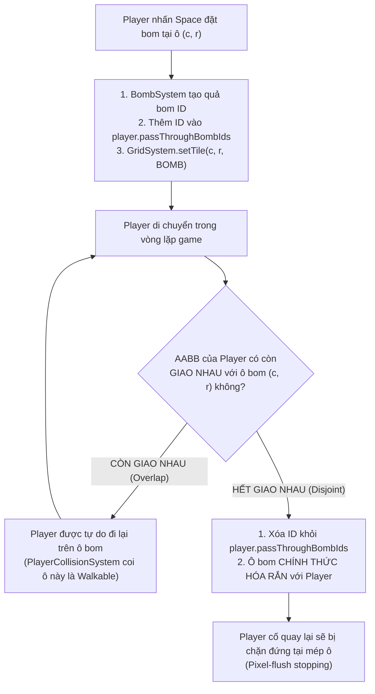

# TÀI LIỆU THIẾT KẾ KỸ THUẬT (TECHNICAL DESIGN DOCUMENT)
## STAGE 3A.1 – BOMB & EXPLOSION SYSTEM ARCHITECTURE FINALIZATION

> **Dự án**: Classic Web Bomber Game (Phaser 3 + TypeScript + Vite)  
> **Chịu trách nhiệm**: Senior Game Architect & Technical Lead  
> **Giai đoạn**: Stage 3A.1 – Architectural Design Finalization (DESIGN ONLY – KHÔNG viết code gameplay)  
> **Ngày phê chuẩn**: 07/11/2026  
> **Trạng thái**: ĐÃ CHỐT 100% QUYẾT ĐỊNH THIẾT KẾ (APPROVED theo ADR-013)  
> **Tài liệu tham chiếu**:  
> - [`GEMINI.md`](file:///G:/GIT/Bomber/GEMINI.md)  
> - [`Agents/GAME_DESIGN_DOCUMENT.md`](file:///G:/GIT/Bomber/Agents/GAME_DESIGN_DOCUMENT.md) (Mục 3.2, 3.3)  
> - [`Agents/ARCHITECTURE.md`](file:///G:/GIT/Bomber/Agents/ARCHITECTURE.md) (Mục 5, 6)  
> - [`Agents/DECISION_LOG.md`](file:///G:/GIT/Bomber/Agents/DECISION_LOG.md) (ADR-012, ADR-013)  
> - [`Agents/STAGE_3A_REPORT.md`](file:///G:/GIT/Bomber/Agents/STAGE_3A_REPORT.md)

---

## 1. ĐÁNH GIÁ HIỆN TRẠNG KIẾN TRÚC (CURRENT ARCHITECTURE ASSESSMENT)

Toàn bộ mã nguồn thực tế đã được rà soát trước khi chốt thiết kế phân hệ Bom & Vụ nổ:

### 1.1. Hệ thống Lưới Bản Đồ (`GridSystem` & `GameMap`)
- [`GameMap`](file:///G:/GIT/Bomber/src/core/GameMap.ts) quản lý ma trận 15 cột x 13 hàng, bảo vệ tính bất biến bằng Deep Copy.
- [`GridSystem`](file:///G:/GIT/Bomber/src/systems/GridSystem.ts) cung cấp các API runtime: `getTile()`, `setTile()`, `isWalkable()`, `isDestructible()`, `blocksBlast()`, `destroySoftWall()`.
- [`Tile.types.ts`](file:///G:/GIT/Bomber/src/types/Tile.types.ts) đã định nghĩa sẵn:
  ```typescript
  [TileType.BOMB]: {
    isWalkable: false,
    isDestructible: true, // Kích nổ dây chuyền khi bị tia lửa chạm vào
    blocksBlast: false,   // Tia lửa tiếp tục lan qua ô bom nếu còn tầm nổ (DECISION 2)
  }
  ```

### 1.2. Thực Thể Người Chơi (`Player`) & Va Chạm (`PlayerCollisionSystem`)
- [`Player`](file:///G:/GIT/Bomber/src/entities/Player.ts) hoạt động theo mô hình **Kinematic Sensor Body** (`body.moves = false` theo ADR-012), trao quyền kiểm soát vị trí duy nhất cho `PlayerCollisionSystem`.
- [`PlayerCollisionSystem`](file:///G:/GIT/Bomber/src/systems/PlayerCollisionSystem.ts) kiểm tra va chạm bằng thuật toán AABB 28x28 quét qua các ô lưới bằng `this.gridSystem.isWalkable()`.
- **Cơ chế phối hợp**: `PlayerCollisionSystem` sẽ tiếp nhận `Pass-through Context` từ `Player` để cho phép người chơi đi lại trên ô chứa quả bom mình vừa đặt cho đến khi bước hoàn toàn ra ngoài (Spatial Disjoint AABB theo DECISION 1 & ADR-013).

---

## 2. YÊU CẦU CHỨC NĂNG & QUY TẮC GAMEPLAY (FUNCTIONAL REQUIREMENTS & RULES)

### 2.1. Bomb Ownership & Quy tắc Giải Phóng Capacity
- Mỗi Player sở hữu các thuộc tính:
  - `bombCapacity: number`: Số bom tối đa được phép đặt cùng lúc (mặc định: 1 quả, tăng khi nhặt `Bomb Up`).
  - `activeBombCount: number`: Số bom hiện đang hoạt động trên sàn đấu (mặc định: 0 quả).
- **Quy tắc giải phóng Capacity**:
  - Khi đặt bom thành công: `activeBombCount` tăng thêm 1.
  - **Thời điểm giải phóng**: Ngay thời điểm quả bom **PHÁT NỔ** (chuyển sang trạng thái `EXPLODING`), `activeBombCount` giảm đi 1 ngay lập tức.
  - Người chơi **KHÔNG CẦN CHỜ** 0.4s tia lửa nổ biến mất mới được đặt quả bom tiếp theo. Đây là chuẩn mực kinh điển của dòng game Bomberman.
  - Mỗi quả bom lưu trữ `ownerId: string`. Khi bom nổ, `BombSystem` thông báo chính xác cho `owner` tương ứng, bảo đảm tương thích 100% khi mở rộng chế độ nhiều người chơi (Multiplayer).

### 2.2. Thời Điểm Giải Phóng Ô Lưới Chứa Bom trên GridSystem
- Khi bom được đặt: `GridSystem.setTile(coord, TileType.BOMB)` được gọi.
- **Thời điểm giải phóng ô lưới**:
  - Ngay khi quả bom phát nổ (`EXPLODING`): `GridSystem.setTile(coord, TileType.EMPTY)` được kích hoạt ngay lập tức.
  - **Lý do kiến trúc**: Khối bom vật lý đã bị hủy diệt. Tại ô đó, một thực thể `Explosion` tâm nổ sẽ xuất hiện. Ô lưới phải trở về `TileType.EMPTY` để tia lửa nổ từ các hướng khác có thể quét qua mà không bị nghẽn, và các thực thể có thể di chuyển qua ô đó (dù có thể chịu sát thương nếu chạm lửa).

---

## 3. THUẬT TOÁN PLAYER BOMB PASS-THROUGH (SPATIAL DISJOINT AABB - DECISION 1)

> **Phê chuẩn DECISION 1 (ADR-013)**: Bãi bỏ hoàn toàn quy tắc đếm giờ 0.2s trong GDD cũ. Áp dụng cơ chế **Spatial Disjoint AABB**.



### 3.1. Thuật toán Toán học & Điều kiện Biên (Boundary Conditions)
Cho ô bom tại tọa độ lưới `coord = { col, row }`:
- Phạm vi không gian của ô bom (Bounding Box 48x48 pixel):
  ```typescript
  const cellLeft   = coord.col * GAME_DIMENSIONS.TILE_SIZE;                     // x min
  const cellRight  = (coord.col + 1) * GAME_DIMENSIONS.TILE_SIZE;                 // x max
  const cellTop    = GAME_DIMENSIONS.HUD_HEIGHT + coord.row * GAME_DIMENSIONS.TILE_SIZE;       // y min
  const cellBottom = GAME_DIMENSIONS.HUD_HEIGHT + (coord.row + 1) * GAME_DIMENSIONS.TILE_SIZE; // y max
  ```
- Hitbox AABB của Player (28x28 pixel) tại vị trí `(x, y)`:
  ```typescript
  const playerAABB = {
    left: x - 14,
    right: x + 14,
    top: y - 14,
    bottom: y + 14,
  };
  ```
- **Điều kiện Giao cắt (Overlap Condition)**:
  Hai hình chữ nhật giao nhau khi và chỉ khi có phần bù diện tích chung:
  ```typescript
  const isOverlapping = (
    playerAABB.left < cellRight &&
    playerAABB.right > cellLeft &&
    playerAABB.top < cellBottom &&
    playerAABB.bottom > cellTop
  );
  ```
- **Điều kiện Rời hoàn toàn (Spatial Disjoint)**:
  `isDisjoint = !isOverlapping`:
  ```typescript
  const isDisjoint = (
    playerAABB.right <= cellLeft ||
    playerAABB.left >= cellRight ||
    playerAABB.bottom <= cellTop ||
    playerAABB.top >= cellBottom
  );
  ```

### 3.2. Xử lý các trường hợp biên toán học:
1. **Trường hợp tiếp xúc mép ranh giới (`playerAABB.right === cellLeft`)**:
   - Mép phải Player chạm đúng đường ranh giới của cell bom (ví dụ `x = 48.0`).
   - Lúc này không còn diện tích giao nhau (`isDisjoint = true`).
   - Quyền pass-through bị thu hồi ngay tức khắc.
2. **Trường hợp Player cố tình lùi lại sau khi vừa thoát ra**:
   - Ở frame tiếp theo, Player di chuyển sang phải (vận tốc dương): `playerAABB.right` sẽ thành `48.1 > cellLeft`.
   - `PlayerCollisionSystem` kiểm tra ô `coord` thấy `TileType.BOMB` và Player không còn quyền pass-through -> Thuật toán `getFlushPosition` chặn đứng Player chính xác tại `playerAABB.right = 48.0` (áp sát mặt bom, không lấn dù chỉ 1 pixel).
3. **Quản lý đa thực thể (Multi-entity isolation)**:
   - Danh sách pass-through lưu theo dạng `Map<playerId, Set<bombId>>`.
   - Quái vật hoặc Player khác không sở hữu `bombId` trong tập hợp của mình, do đó bị `isWalkable = false` chặn cứng ngay từ frame đầu tiên.

---

## 4. MÁY TRẠNG THÁI VÒNG ĐỜI BOM (BOMB LIFECYCLE)

```mermaid
stateDiagram-v2
    [*] --> PLACED: Player nhấn Space hợp lệ
    
    state "PLACED" as PLACED {
        [*] --> PASS_THROUGH: Đăng ký bombId vào passThroughBombIds của owner
        PASS_THROUGH --> SOLID: Player AABB rời hẳn khỏi cell (Spatial Disjoint)
    }
    
    PLACED --> TICKING: Khởi động bộ đếm 3.0s
    
    state "TICKING" as TICKING {
        direction LR
        PulseSlow --> PulseMedium: Còn 2.0s
        PulseMedium --> PulseFast: Còn 1.0s
    }
    
    TICKING --> TRIGGERED: Hết 3.0s HOẶC Tia lửa nổ chạm trúng (Chain Reaction)
    
    state "TRIGGERED" as TRIGGERED {
        note right of TRIGGERED
            ĐÁNH DẤU TỨC THÌ:
            1. bomb.state = 'TRIGGERED'
            2. processedChainBombIds.add(bomb.id)
            3. Đưa vào explosionQueue (BFS)
            -> Triệt tiêu nguy cơ duyệt lặp
        end note
    }
    
    TRIGGERED --> EXPLODING: BombSystem giải phóng bom & Chuyển sang ExplosionSystem
    
    state "EXPLODING" as EXPLODING {
        note right of EXPLODING
            1. owner.activeBombCount-- (HỒI CAPACITY NGAY)
            2. GridSystem.setTile(coord, EMPTY) (GIẢI PHÓNG CELL)
            3. Kích hoạt raycast & tạo Explosion
        end note
    }
    
    EXPLODING --> DESTROYED: Dọn dẹp Sprite & bộ nhớ
    DESTROYED --> [*]
```

---

## 5. THUẬT TOÁN KÍCH NỔ DÂY CHUYỀN PHI ĐỆ QUY (BFS CHAIN REACTION - DECISION 2)

> **Phê chuẩn DECISION 2 (ADR-013)**: 
> - Bom bị tia lửa chạm trúng nổ ngay lập tức.
> - Tia lửa **TIẾP TỤC LAN QUA CELL CHỨA BOM** nếu còn tầm nổ (`TileType.BOMB.blocksBlast = false`).
> - Thuật toán hàng đợi BFS loại bỏ 100% rủi ro đệ quy sâu (Stack Overflow).

### 5.1. Thời Điểm Đánh Dấu Bom Kích Hoạt Chain Reaction
- Khi một quả bom phát nổ, thuật toán Raycasting duyệt các ô trong phạm vi `power`.
- Nếu tại ô `coord` phát hiện có quả bom B (`bombB`):
  - Kiểm tra điều kiện: `bombB.state === 'TICKING'` và `!processedChainBombIds.has(bombB.id)`.
  - **ĐÁNH DẤU NGAY LẬP TỨC**:
    ```typescript
    bombB.state = 'TRIGGERED';
    processedChainBombIds.add(bombB.id);
    explosionQueue.push(bombB);
    ```
  - Việc chuyển trạng thái và gán vào `Set` ngay lập tức ngăn chặn mọi tia nổ khác trong cùng frame duyệt lại quả bom B.

### 5.2. Thuật toán BFS Queue:
```typescript
public processChainExplosions(initialBomb: BombData): void {
  const explosionQueue: BombData[] = [];
  const processedBombIds = new Set<string>();

  // 1. Đưa quả bom gốc vào hàng đợi
  initialBomb.state = 'TRIGGERED';
  processedBombIds.add(initialBomb.id);
  explosionQueue.push(initialBomb);

  // 2. Vòng lặp duyệt tuần tự theo chiều rộng (BFS)
  while (explosionQueue.length > 0) {
    const currentBomb = explosionQueue.shift()!;
    currentBomb.state = 'EXPLODING';

    // 2.1. Giải phóng Capacity cho chủ sở hữu & Giải phóng cell trên Grid
    this.releaseBombResources(currentBomb);

    // 2.2. Tính toán Raycasting 4 hướng cho currentBomb
    const blastResult = this.explosionSystem.calculateBlast(currentBomb.coord, currentBomb.power);

    // 2.3. Duyệt các quả bom bị tia nổ quét trúng
    for (const neighborBomb of blastResult.triggeredBombs) {
      if (neighborBomb.state === 'TICKING' && !processedBombIds.has(neighborBomb.id)) {
        neighborBomb.state = 'TRIGGERED';
        processedBombIds.add(neighborBomb.id);
        explosionQueue.push(neighborBomb); // Đưa vào hàng đợi xử lý tiếp
      }
    }

    // 2.4. Thực thi vụ nổ trên ExplosionSystem (tạo tia lửa, phá gạch)
    this.explosionSystem.executeBlast(blastResult);
  }
}
```

---

## 6. QUẢN LÝ VỤ NỔ THEO Ô & GỘP HIỂN THỊ (CELL EXPLOSION TRACKING - DECISION 3)

> **Phê chuẩn DECISION 3 (ADR-013)**: 
> - Gộp hiển thị (visual representation) theo ô để tối ưu render và tránh chói lóa.
> - Quản lý độc lập từng contribution để không làm mất trạng thái gameplay.
> - Tia lửa chỉ biến mất khi **TOÀN BỘ** các vụ nổ trên ô đó kết thúc.

### 6.1. Cấu Trúc `CellExplosionTracker`
Hệ thống sử dụng bảng băm theo tọa độ ô: `Map<string, ICellExplosionState>` với key là `"col,row"`.

```typescript
export interface IExplosionContribution {
  readonly explosionId: string;
  readonly direction: BlastDirection; // 'CENTER' | 'UP' | 'DOWN' | 'LEFT' | 'RIGHT'
  readonly isTip: boolean;
  remainingTime: number; // 0.4s đếm lùi
}

export interface ICellExplosionState {
  readonly coord: IGridCoord;
  readonly contributions: Map<string, IExplosionContribution>; // explosionId -> Contribution
  visualSprite?: Phaser.GameObjects.Sprite; // Sprite hiển thị gộp duy nhất trên ô
}
```

### 6.2. Quy Tắc Gộp Hiển Thị (Visual Representation Rule)
Khi một hoặc nhiều vụ nổ quét qua ô `(col, row)`:
- Nếu có contribution dạng `CENTER`: Render texture **Tâm nổ (`EXPLOSION_CENTER`)**.
- Nếu có cả contribution chiều ngang (`LEFT`/`RIGHT`) và chiều dọc (`UP`/`DOWN`): Render texture **Giao nhau chữ thập (`EXPLOSION_CROSS`)**.
- Nếu chỉ có chiều ngang:
  - Nếu có `isTip = true`: Render texture **Đầu mút ngang (`EXPLOSION_TIP_LEFT` / `EXPLOSION_TIP_RIGHT`)**.
  - Nếu là đoạn thân: Render texture **Thân ngang (`EXPLOSION_BODY_HORIZ`)**.
- Nếu chỉ có chiều dọc:
  - Nếu có `isTip = true`: Render texture **Đầu mút dọc (`EXPLOSION_TIP_UP` / `EXPLOSION_TIP_DOWN`)**.
  - Nếu là đoạn thân: Render texture **Thân dọc (`EXPLOSION_BODY_VERT`)**.

### 6.3. Quy Tắc Đồng Bộ Thời Gian & Dọn Dẹp
1. Trong mỗi frame `update(deltaSeconds)`:
   - Mỗi contribution tự giảm: `contribution.remainingTime -= deltaSeconds`.
   - Nếu `contribution.remainingTime <= 0`: Xóa contribution khỏi `cellState.contributions`.
2. **Thời điểm xóa Visual Sprite**:
   - Nếu `cellState.contributions.size > 0`: Cập nhật lại texture hiển thị phù hợp với các contribution còn lại.
   - Khi `cellState.contributions.size === 0`: Toàn bộ các vụ nổ trên ô đã tắt -> Xóa `visualSprite` khỏi Phaser Scene, giải phóng ô khỏi `CellExplosionTracker`.
3. **Gameplay Damage Zone**:
   - Vùng sát thương gây đòn cho Player/Quái vật duy trì liên tục chừng nào `cellState.contributions.size > 0`.
   - Player chạm vào nhận sát thương và kích hoạt trạng thái bất tử tạm thời (Invulnerability) để không bị mất nhiều mạng lặp lại.

---

## 7. CẤU TRÚC DỮ LIỆU & INTERFACES HOÀN THIỆN

```typescript
// src/types/Bomb.types.ts

export type BombState = 'PLACED' | 'TICKING' | 'TRIGGERED' | 'EXPLODING' | 'DESTROYED';
export type BlastDirection = 'CENTER' | 'UP' | 'DOWN' | 'LEFT' | 'RIGHT';

export interface IBombConfig {
  readonly FUSE_DURATION: number;       // 3.0 giây
  readonly EXPLOSION_DURATION: number;  // 0.4 giây
  readonly DEFAULT_POWER: number;       // 1 ô
  readonly DEFAULT_CAPACITY: number;    // 1 quả
}

export interface IBombData {
  readonly id: string;
  readonly coord: IGridCoord;
  readonly power: number;
  readonly ownerId: string;
  fuseTimer: number;
  state: BombState;
}

export interface IBlastSegment {
  readonly coord: IGridCoord;
  readonly direction: BlastDirection;
  readonly isTip: boolean;
  readonly destroyedBrick: boolean;
}

export interface IBlastRayResult {
  readonly segments: IBlastSegment[];
  readonly triggeredBombs: IBombData[];
}
```

---

## 8. CHIẾN LƯỢC KIỂM THỬ ĐƠN VỊ HOÀN THIỆN (UNIT TEST MATRIX)

Bổ sung đầy đủ các kịch bản kiểm thử cho 3 quyết định đã chốt (dự kiến ~28 bài tests):

### 8.1. Nhóm Đặt Bom & Spatial Disjoint Pass-Through (`DECISION 1`)
- `UT-PASS-01`: Player vừa đặt bom có quyền đi lại tự do trên ô bom miễn là AABB còn giao cắt.
- `UT-PASS-02`: Player bước hoàn toàn ra ngoài ô bom (AABB disjoint) -> bom hóa rắn ngay tức thì.
- `UT-PASS-03`: Sau khi hóa rắn, Player cố tình đi ngược lại bị chặn đứng chính xác tại mép ô bom (áp sát pixel-flush).
- `UT-PASS-04`: Thực thể khác không sở hữu quyền pass-through bị chặn đứng ngay từ frame đầu tiên.
- `UT-PASS-05`: Player đứng sát góc ô bom, chỉ cần 1 góc AABB còn giao nhau thì vẫn giữ quyền pass-through.
- `UT-PASS-06`: Player đặt bom nhưng đứng yên suốt 3 giây -> không bị kẹt di chuyển, sau 3 giây bom nổ gây sát thương.
- `UT-BOMB-01`: Đặt bom hợp lệ trừ capacity, từ chối khi ô có bom/tường/gạch hoặc hết capacity.
- `UT-BOMB-02`: Giải phóng capacity cho Player ngay thời điểm bom phát nổ (`EXPLODING`).
- `UT-BOMB-03`: Giải phóng ô lưới về `TileType.EMPTY` ngay thời điểm bom phát nổ (`EXPLODING`).

### 8.2. Nhóm Raycasting & Nổ Dây Chuyền BFS (`DECISION 2`)
- `UT-RAY-01`: Raycasting 4 hướng dừng trước Tường cứng, phá vỡ Gạch mềm đầu tiên.
- `UT-RAY-02`: Tia nổ quét trúng ô chứa Quả bom khác -> bom bị kích nổ ngay, và tia nổ TIẾP TỤC LAN qua ô đó nếu còn range.
- `UT-CHAIN-01`: Chuỗi 5 quả bom thẳng hàng kích nổ dây chuyền tuần tự theo BFS.
- `UT-CHAIN-02`: Ma trận 2x2 bom nổ không tạo vòng lặp vô hạn và không xử lý một bom 2 lần.
- `UT-CHAIN-03`: Quả bom kích nổ dây chuyền bảo toàn bán kính `power` độc lập của chính nó.

### 8.3. Nhóm Quản Lý Vụ Nổ Theo Ô & Visual Stacking (`DECISION 3`)
- `UT-STACK-01`: Hai vụ nổ cùng quét qua 1 ô -> ô nhận 2 contributions và gộp visual representation.
- `UT-STACK-02`: Vụ nổ A hết 0.4s biến mất, vụ nổ B còn 0.2s -> visual sprite của ô vẫn duy trì hiển thị cho đến khi vụ nổ B kết thúc.
- `UT-STACK-03`: Ô nhận cả tia ngang và tia dọc hiển thị texture hình chữ thập giao nhau (`CROSS`).
- `UT-DMG-01`: Player chạm vào ô nổ nhận sát thương và rơi vào trạng thái bất tử tạm thời (không mất nhiều mạng liên tiếp).

---

## 9. KẾ HOẠCH TRIỂN KHAI CHO STAGE 3B (4 BƯỚC)

- **Bước 1: Data Structures & Headless Logic Systems**:
  - Tạo `Bomb.types.ts`, `BombConfig.ts`.
  - Triển khai `BombSystem.ts` và `ExplosionSystem.ts` (Headless).
  - Viết và pass toàn bộ Unit Tests cho Placement, Spatial Disjoint Pass-through, Raycasting, BFS Chain Reaction.
- **Bước 2: Player & Collision Integration**:
  - Mở rộng `Player.ts` lưu `passThroughBombIds: Set<string>` và hàm kiểm tra AABB disjoint.
  - Tích hợp Pass-through context vào `PlayerCollisionSystem.ts`.
  - Gán phím `Space` vào `PlayerInputSystem.ts`.
- **Bước 3: Visual Presentation & Procedural Textures**:
  - Tạo `BombTextureGenerator.ts` sinh pixel art quả bom (pulse animation) và tia lửa nổ 4 hướng.
  - Tạo `Bomb.ts` và `Explosion.ts` (Phaser Game Objects).
- **Bước 4: GameScene Wiring & E2E Verification**:
  - Tích hợp vào `GameScene.ts`.
  - Kiểm tra `typecheck`, `test`, `build`, và test thủ công gameplay trên trình duyệt.

---

## 10. GHI NHẬN CÁC QUYẾT ĐỊNH ĐÃ PHÊ CHUẨN (DECISIONS RECORDED)

Toàn bộ 3 quyết định kỹ thuật đã được Technical Lead phê chuẩn và ghi nhận chính thức vào hệ thống tài liệu dự án:

1. **DECISION 1**: Phê chuẩn cơ chế **Spatial Disjoint AABB Pass-through** (ADR-013), bãi bỏ hoàn toàn quy tắc timer 0.2s cũ trong GDD mục 3.2.
2. **DECISION 2**: Phê chuẩn cơ chế **Penetrating Blast on Bombs & BFS Chain Reaction** (ADR-013). Tia lửa quét qua bom kích nổ tức thì và tiếp tục lan nếu còn range.
3. **DECISION 3**: Phê chuẩn cơ chế **Cell-based Visual Stacking & State Contribution Tracking** (ADR-013). Gộp visual representation theo ô, duy trì hiển thị cho đến khi tất cả các vụ nổ trên ô kết thúc.

> **Trạng thái hiện tại**: Thiết kế kỹ thuật đã hoàn tất 100%. Sẵn sàng chờ lệnh bắt đầu triển khai Stage 3B.
