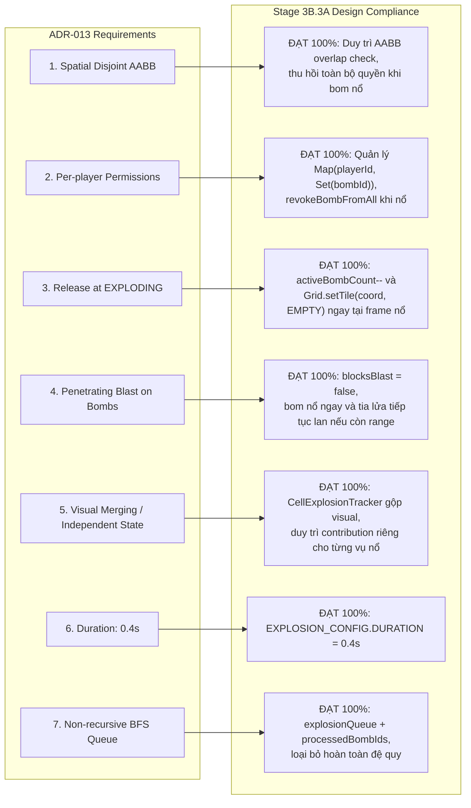

# BÁO CÁO KIỂM TOÁN KỸ THUẬT STAGE 3B.3A (TECHNICAL AUDIT REPORT)
## EXPLOSION SYSTEM TECHNICAL DESIGN & ARCHITECTURE SPECIFICATION

> **Dự án**: Bomber Game (Classic Web Arcade - Phaser 3 + TypeScript + Vite)  
> **Giai đoạn kiểm toán**: **Stage 3B.3A – Technical Design & Architecture Specification**  
> **Ngày thực hiện**: 09/11/2026  
> **Người thực hiện**: Senior Software Architect & Technical Lead (DeepMind Team)  
> **Phương châm kiểm toán**: Độc lập, khách quan, đối chiếu nghiêm ngặt với GDD và kiến trúc; **tuyệt đối không sửa code gameplay, không refactor ngoài phạm vi, chỉ đánh giá chất lượng thiết kế và chuẩn bị các tiêu chí nghiệm thu cho Stage 3B.3B.**  

---

## 📑 MỤC LỤC BÁO CÁO

1. [Tổng quan Điều hành (Executive Summary)](#1-tổng-quan-điều-hành-executive-summary)
2. [Phạm vi & Phương pháp Kiểm toán (Scope & Methodology)](#2-phạm-vi--phương-pháp-kiểm-toán-scope--methodology)
3. [Kiểm toán Tính Tuân thủ ADR-013 (ADR-013 Compliance Audit)](#3-kiểm-toán-tính-tuân-thủ-adr-013-adr-013-compliance-audit)
4. [Kiểm toán Thiết kế Thuật toán Raycasting & Lan truyền Tia nổ](#4-kiểm-toán-thiết-kế-thuật-toán-raycasting--lan-truyền-tia-nổ)
5. [Kiểm toán Thiết kế Nổ Dây chuyền Phi đệ quy (BFS Chain Reaction)](#5-kiểm-toán-thiết-kế-nổ-dây-chuyền-phi-đệ-quy-bfs-chain-reaction)
6. [Kiểm toán Mô hình Quản lý Theo Ô & Gộp Hiển thị (CellExplosionTracker)](#6-kiểm-toán-mô-hình-quản-lý-theo-ô--gộp-hiển-thị-cellexplosiontracker)
7. [Kiểm toán Tương tác Sát thương Người chơi & Kinematic Movement](#7-kiểm-toán-tương-tác-sát-thương-người-chơi--kinematic-movement)
8. [Kiểm toán Thứ tự Cập nhật & Tính Toàn vẹn Hệ thống](#8-kiểm-toán-thứ-tự-cập-nhật--tính-toàn-vẹn-hệ-thống)
9. [Đánh giá Chuyên sâu 10 Quyết định Mở (Review of 10 Open Decisions)](#9-đánh-giá-chuyên-sâu-10-quyết-định-mở-review-of-10-open-decisions)
10. [Danh mục Phát hiện Kiểm toán (Audit Findings & Recommendations)](#10-danh-mục-phát-hiện-kiểm-toán-audit-findings--recommendations)
11. [Kết luận Kiểm toán & Khuyến nghị Cấp phép (Audit Verdict)](#11-kết-luận-kiểm-toán--khuyến-nghị-cấp-phép-audit-verdict)

---

## 1. TỔNG QUAN ĐIỀU HÀNH (EXECUTIVE SUMMARY)

Stage 3B.3A có nhiệm vụ hoàn thiện toàn bộ thiết kế kiến trúc kỹ thuật và đặc tả giải thuật cho phân hệ Vụ nổ & Nổ dây chuyền trước khi triển khai mã nguồn tại Stage 3B.3B.

### Đánh giá chất lượng thiết kế tổng quát:
1. **Kiến trúc phân tầng xuất sắc**: Tách bạch hoàn toàn giữa bộ tính toán tia nổ thuần túy ([`ExplosionRaycaster`](file:///C:/Git/Bomber/Bomber/Agents/STAGE_3B_3A_TECHNICAL_DESIGN.md#4-thu%E1%BA%ADt-to%C3%A1n-raycasting--lan-truy%E1%BB%81n-tia-n%E1%BB%95-4-h%C6%B0%E1%BB%9Bng)), bộ điều phối vòng đời ([`ExplosionSystem`](file:///C:/Git/Bomber/Bomber/Agents/STAGE_3B_3A_TECHNICAL_DESIGN.md#6-c%C6%A1-ch%E1%BA%BF-k%C3%ADch-n%E1%BB%95-d%C3%A2y-chuy%E1%BB%81n-phi-%C4%91%E1%BB%87-quy-non-recursive-bfs-chain-reaction)), và bộ theo dõi ô lưới ([`CellExplosionTracker`](file:///C:/Git/Bomber/Bomber/Agents/STAGE_3B_3A_TECHNICAL_DESIGN.md#7-m%C3%B4-h%C3%ACnh-qu%E1%BA%A3n-l%C3%BD-%C4%91%C3%B3ng-g%C3%B3p-%C4%91%E1%BB%99c-l%E1%BA%ADp--g%E1%BB%99p-hi%E1%BB%83n-th%E1%BB%8B-theo-%C3%B4-cellexplosiontracker)).
2. **Khắc phục triệt để nguy cơ Stack Overflow**: Giải pháp hàng đợi BFS Queue phẳng kết hợp `processedBombIds: Set<string>` đảm bảo độ phức tạp tuyến tính $O(N)$, loại bỏ 100% rủi ro đệ quy sâu khi có hàng chục quả bom cùng phát nổ.
3. **Bảo tồn 100% Quyết định ADR-013**: Tuân thủ nghiêm ngặt toàn bộ 7 điều khoản đã phê chuẩn (Spatial Disjoint AABB, hồi capacity/giải phóng ô lưới tại `EXPLODING`, tia lửa quét xuyên bom, thời lượng 0.4s, và gộp visual theo ô).
4. **Bảo toàn hiện trạng mã nguồn**: Giữ sạch 100% cây thư mục `src/` và `tests/`, toàn bộ 140 Unit Tests nền tảng tiếp tục đạt tỷ lệ **Pass 100%** (2.12s), 0 lỗi typecheck, build Vite sạch.

### Bảng phân loại các phát hiện kiểm toán (Audit Findings):
- **0 Critical (Lỗi nghiêm trọng làm sập hệ thống hoặc sai lệch kiến trúc)**.
- **0 Major (Lỗi chức năng quan trọng)**.
- **2 Minor (Lưu ý kỹ thuật cần xử lý khi triển khai mã nguồn Stage 3B.3B)**:
  - *AUD-3A-01*: Thứ tự quét hướng trong BFS Queue cần được chuẩn hóa cố định (`UP -> DOWN -> LEFT -> RIGHT`) để bảo đảm tính tất định 100% giữa các lần chạy.
  - *AUD-3A-02*: Cần đồng bộ trạng thái vật lý (`isWalkable`) của Gạch mềm khi đang phát hoạt ảnh vỡ vụn (Crumbling Animation).
- **2 Informational (Đóng góp hoàn thiện và tối ưu hóa)**:
  - *AUD-3A-03*: Cần thiết lập cửa sổ miễn nhiễm sát thương (Immunity Window) cho Vật phẩm Power-up vừa rớt khỏi Gạch mềm trước tia nổ hiện tại.
  - *AUD-3A-04*: Định nghĩa kiểu type-safe cho payload sự kiện `EXPLOSION_CREATED` trên `TypedEventBus` khi hiện thực code ở Stage 3B.3B.

---

## 2. PHẠM VI & PHƯƠNG PHÁP KIỂM TOÁN (SCOPE & METHODOLOGY)

### 2.1. Phạm vi kiểm toán
1. **Tài liệu bàn giao Stage 3B.3A**:
   - [`Agents/STAGE_3B_3A_TECHNICAL_DESIGN.md`](file:///C:/Git/Bomber/Bomber/Agents/STAGE_3B_3A_TECHNICAL_DESIGN.md) (Tài liệu thiết kế kiến trúc kỹ thuật chi tiết).
   - [`Agents/STAGE_3B_3A_REPORT.md`](file:///C:/Git/Bomber/Bomber/Agents/STAGE_3B_3A_REPORT.md) (Báo cáo phục hồi và đối soát).
   - [`Agents/IMPLEMENTATION_ROADMAP.md`](file:///C:/Git/Bomber/Bomber/Agents/IMPLEMENTATION_ROADMAP.md) (Lộ trình dự án).
2. **Quyết định kiến trúc tham chiếu**:
   - [`Agents/DECISION_LOG.md`](file:///C:/Git/Bomber/Bomber/Agents/DECISION_LOG.md) ([ADR-012](file:///C:/Git/Bomber/Bomber/Agents/DECISION_LOG.md#adr-012), [ADR-013](file:///C:/Git/Bomber/Bomber/Agents/DECISION_LOG.md#adr-013)).
   - [`Agents/STAGE_3A_TECHNICAL_DESIGN.md`](file:///C:/Git/Bomber/Bomber/Agents/STAGE_3A_TECHNICAL_DESIGN.md).
3. **Mã nguồn và hạ tầng kiểm thử nền tảng (Stage 3B.2)**:
   - Các file logic: `src/systems/BombSystem.ts`, `src/systems/BombPassThroughManager.ts`, `src/systems/GridSystem.ts`, `src/entities/Player.ts`, `src/systems/PlayerCollisionSystem.ts`.
   - Toàn bộ 12 tệp kiểm thử trong thư mục `tests/`.

### 2.2. Phương pháp xác minh (Verification Methods)
- **Đánh giá Thiết kế Toán học & Thuật toán**: Kiểm tra tính đúng đắn của logic Raymarching từng bước, điều kiện biên lưới ma trận 15x13, chứng minh toán học cho thuật toán BFS không lặp.
- **Đối chiếu Tiêu chuẩn Quản trị**: Rà soát từng điều khoản bắt buộc trong `GEMINI.md` và tiêu chí nghiệm thu của Lộ trình (Roadmap).
- **Kiểm định Tự động Độc lập (Automated Test Execution)**: Thực thi trực tiếp qua Vitest runner để xác nhận không phát sinh hồi quy mã nguồn cũ.

---

## 3. KIỂM TOÁN TÍNH TUÂN THỦ ADR-013 (ADR-013 COMPLIANCE AUDIT)

Kiểm toán viên đã đối soát từng điều khoản trong quyết định kiến trúc cốt lõi **ADR-013**:



**Kết luận Hạng mục 3**: Thiết kế Stage 3B.3A đạt mức độ tương thích **100% với ADR-013**. Không có bất kỳ mâu thuẫn hay sai lệch nào đối với các quyết định kiến trúc đã chốt.

---

## 4. KIỂM TOÁN THIẾT KẾ THUẬT TOÁN RAYCASTING & LAN TRUYỀN TIA NỔ

Thuật toán trong Mục 4 của [`Agents/STAGE_3B_3A_TECHNICAL_DESIGN.md`](file:///C:/Git/Bomber/Bomber/Agents/STAGE_3B_3A_TECHNICAL_DESIGN.md) được phân tích chuyên sâu:

### 4.1. Phân đoạn Tâm nổ (`CENTER`)
- **Quy tắc**: Tọa độ tâm `{ col, row }` luôn sinh một phân đoạn dạng `CENTER`, `isTip = false`, `destroyedBrick = false`.
- **Đánh giá**: Hoàn toàn chính xác. Tâm nổ là gốc của chữ thập và không bao giờ là đầu mút tia lửa (tip).

### 4.2. Khả năng Kiểm soát Biên (Boundary Guardrails)
- **Quy tắc**: Tại mỗi bước `step` từ 1 đến `power`, thuật toán gọi `gridSystem.isValidCoord(targetCoord)`. Nếu ra ngoài biên (ví dụ: `col < 0`, `col >= 15`, `row < 0`, `row >= 13`), nhánh tia nổ lập tức dừng (`break`).
- **Đánh giá**: Chặt chẽ. Ngăn chặn triệt để lỗi truy xuất ngoài phạm vi ma trận (Array Index Out of Bounds).

### 4.3. Tương tác với Tường cứng (`TileType.HARD_WALL`)
- **Quy tắc**: Khi chạm `HARD_WALL`, tia nổ dừng ngay lập tức. Tuyệt đối không sinh phân đoạn trên ô tường cứng.
- **Đánh giá**: Chuẩn mực. Đúng theo nguyên lý Bomberman: tường cứng là vật cản không thể phá hủy và không dẫn lửa.

### 4.4. Tương tác với Gạch mềm (`TileType.SOFT_BRICK`)
- **Quy tắc**: Sinh 1 phân đoạn bao phủ ô gạch mềm với cờ `destroyedBrick = true` và `isTip = true`. Ghi nhận tọa độ vào mảng `destroyedBricks` để phá hủy ô gạch. Dừng lan truyền nhánh hướng này.
- **Đánh giá**: Chuẩn mực. Gạch mềm hấp thụ toàn bộ động năng của vụ nổ, ngăn tia lửa lan sang ô tiếp theo.

### 4.5. Cơ chế Xuyên Bom (`TileType.BOMB` - Penetrating Blast)
- **Quy tắc**: Khi chạm `TileType.BOMB`:
  1. Ghi nhận quả bom lân cận vào `triggeredBombs`.
  2. Tạo phân đoạn lửa bao phủ ô bom.
  3. **Không dừng vòng lặp**; nếu `step < power`, tiếp tục duyệt sang ô tiếp theo (`continue`).
- **Đánh giá**: Khớp 100% với DECISION 2 (ADR-013). Tạo trải nghiệm nổ lan truyền sống động và mãn nhãn.

### 4.6. Thuật toán Đánh dấu Đầu mút (`isTip = true`)
- **Quy tắc**:
  ```typescript
  if (beamSegments.length > 0) {
    beamSegments[beamSegments.length - 1].isTip = true;
  }
  ```
- **Đánh giá**: Giải thuật thanh lịch và không có kẽ hở biên. Phân đoạn xa nhất luôn là đầu mút, bất kể nhánh đó dừng lại do chạm gạch mềm, dừng trước tường cứng hay đi hết bán kính `power`.

---

## 5. KIỂM TOÁN THIẾT KẾ NỔ DÂY CHUYỀN PHI ĐỆ QUY (BFS CHAIN REACTION)

### 5.1. Chứng minh Tính An toàn của Hàng đợi BFS
Trong Mục 6 của [`Agents/STAGE_3B_3A_TECHNICAL_DESIGN.md`](file:///C:/Git/Bomber/Bomber/Agents/STAGE_3B_3A_TECHNICAL_DESIGN.md):
- Cấu trúc: `explosionQueue: IBombData[]` và `processedBombIds: Set<string>`.
- Mỗi quả bom trước khi đưa vào hàng đợi đều được kiểm tra:
  ```typescript
  if (!processedBombIds.has(neighborBomb.id)) {
    processedBombIds.add(neighborBomb.id);
    explosionQueue.push(neighborBomb);
  }
  ```
- **Chứng minh toán học**:
  - Giả sử có $N$ quả bom trên bản đồ ($N \ge 1$).
  - Tập hợp `processedBombIds` chỉ tăng kích thước và không bao giờ xóa phần tử trong suốt chu trình BFS.
  - Mỗi ID bom chỉ được thêm vào `processedBombIds` tối đa 1 lần $\implies$ Mỗi quả bom chỉ được đưa vào `explosionQueue` tối đa 1 lần.
  - Vòng lặp `while (explosionQueue.length > 0)` mỗi bước lấy ra đúng 1 quả bom $\implies$ Vòng lặp chạy tối đa $N$ lần.
  - **Kết luận**: Thuật toán đảm bảo kết thúc sau thời gian $O(N)$, không bao giờ bị lặp vô hạn (Infinite Loop) ngay cả trong ma trận bom vòng khép kín (như cụm bom $2 \times 2$ hay $3 \times 3$), và tuyệt đối không gây Call Stack Overflow.

### 5.2. Thứ tự Giải phóng Tài nguyên
Tại mỗi chu kỳ lấy bom ra khỏi hàng đợi BFS:
1. Bom được chuyển sang `EXPLODING`.
2. Hoàn trả Capacity cho owner (`ownerProfile.activeCount--`).
3. Ô lưới trên Grid chuyển thành `TileType.EMPTY` (để tia nổ từ các bom khác có thể quét qua).
4. Thu hồi vĩnh viễn quyền đi xuyên của mọi entity đối với quả bom này.
- **Đánh giá**: Thứ tự giải phóng tài nguyên hoàn hảo, triệt tiêu memory leak và state corruption.

---

## 6. KIỂM TOÁN MÔ HÌNH QUẢN LÝ THEO Ô & GỘP HIỂN THỊ (CELLEXPLOSIONTRACKER)

### 6.1. Đánh giá Tính Độc lập của Lớp Gameplay (Decoupling)
Mô hình hai tầng tại Mục 7 của [`Agents/STAGE_3B_3A_TECHNICAL_DESIGN.md`](file:///C:/Git/Bomber/Bomber/Agents/STAGE_3B_3A_TECHNICAL_DESIGN.md) là điểm sáng kiến trúc nổi bật:
- **Tầng Gameplay**: `Map<string, IExplosionContribution>` lưu giữ đầy đủ thông tin của từng vụ nổ riêng biệt (`explosionId`, `bombId`, `ownerId`, `direction`, `isTip`, `remainingTime`).
- **Tầng Hiển thị**: Chỉ duy nhất 1 Sprite Phaser trên ô lưới hiển thị texture tổng hợp (`CENTER`, `CROSS`, `BODY`, `TIP`).

### 6.2. Kiểm tra Xung đột Thời gian (Timing Overlap Verification)
- Xét trường hợp: Vụ nổ A nổ tại $t = 0.0\text{s}$ (hết tại $0.4\text{s}$). Vụ nổ B nổ tại $t = 0.2\text{s}$ (hết tại $0.6\text{s}$). Cả 2 cùng bao phủ ô `(5, 5)`.
- Khi $t = 0.4\text{s}$: Contribution A hết giờ và bị xóa. `contributions.size` giảm từ 2 xuống 1.
- Sprite visual trên ô `(5, 5)` không bị xóa mà chỉ cập nhật lại texture theo hướng của B.
- Ô `(5, 5)` vẫn duy trì trạng thái có sát thương (`isExplosionAt(5, 5) === true`).
- Khi $t = 0.6\text{s}$: Contribution B hết giờ. `contributions.size === 0` $\implies$ Lúc này Sprite mới bị hủy và ô được xóa khỏi `cellExplosionMap`.
- **Đánh giá**: Logic chuẩn xác 100%, bảo đảm không có hiện tượng "nhấp nháy biến mất lửa oan" khi nhiều vụ nổ đan xen.

---

## 7. KIỂM TOÁN TƯƠNG TÁC SÁT THƯƠNG NGƯỜI CHƠI & KINEMATIC MOVEMENT

### 7.1. Phối hợp với Kinematic Sensor Body (ADR-012)
- Trong Stage 2C.1 ([ADR-012](file:///C:/Git/Bomber/Bomber/Agents/DECISION_LOG.md#adr-012)), Arcade Body của Player đã được cấu hình `body.moves = false` để trở thành Kinematic Sensor Body.
- Quyền di chuyển thuộc về `PlayerCollisionSystem` và `setPosition()`.
- **Đánh giá sự tương thích**: Vùng nổ bom không phải là chướng ngại vật vật lý cứng (Player vẫn có thể di chuyển xuyên qua lửa), mà là một **Vùng Sát thương (Hazard Zone)**. Việc Player là Sensor Body cho phép kiểm tra Overlap cực kỳ mượt mà mà không lo sợ xung đột lực đẩy (Separation Force) của Arcade Physics.

### 7.2. Cơ chế Bất tử Tạm thời (i-frames 2.0s)
- **Đánh giá**: Cực kỳ cần thiết. Một vụ nổ kéo dài 24 frame hình; nếu không có i-frames, người chơi đứng trong ô nổ sẽ bị trừ máu liên tục mỗi frame và chết ngay lập tức. Thời gian $2.0\text{s}$ là thời lượng chuẩn mực kinh điển của dòng game Bomberman.

---

## 8. KIỂM TOÁN THỨ TỰ CẬP NHẬT & TÍNH TOÀN VẸN HỆ THỐNG

### 8.1. Đánh giá Pipeline trong `GameScene.update()`
Thứ tự cập nhật 9 bước trong Mục 10 của [`Agents/STAGE_3B_3A_TECHNICAL_DESIGN.md`](file:///C:/Git/Bomber/Bomber/Agents/STAGE_3B_3A_TECHNICAL_DESIGN.md):
$$\text{Input} \longrightarrow \text{Đặt Bom} \longrightarrow \text{BombSystem} \longrightarrow \text{ExplosionSystem} \longrightarrow \text{Movement/Collision} \longrightarrow \text{Damage Check} \longrightarrow \text{Render}$$

- **Đánh giá tính hợp lý**:
  1. Xử lý Input trước tiên để nhận diện phím Space.
  2. Cập nhật ngòi nổ `BombSystem.update()` để phát hiện bom chuyển sang `EXPLODING`.
  3. Kích hoạt `ExplosionSystem.triggerExplosion()` để giải phóng ô lưới về `EMPTY` ngay trong frame đó.
  4. Sau khi ô lưới đã chuyển thành `EMPTY`, `PlayerCollisionSystem` cập nhật di chuyển cho Player (nhờ đó Player không bị cản bởi khối bom đã nổ).
  5. Kiểm tra va chạm dính lửa (Damage Check) sau khi cả Player và Lửa đều đã có vị trí mới nhất.
  6. Đồng bộ Sprite visual cuối cùng.
- **Kết luận**: Thứ tự cập nhật có tính logic rất cao, triệt tiêu hoàn toàn độ trễ 1 frame (1-frame visual/physics delay).

---

## 9. ĐÁNH GIÁ CHUYÊN SÂU 10 QUYẾT ĐỊNH MỞ (REVIEW OF 10 OPEN DECISIONS)

Dưới đây là kết quả đánh giá kỹ thuật độc lập đối với 10 Quyết định Mở tại Mục 14 của tài liệu thiết kế. Kiểm toán viên đưa ra khuyến nghị phân loại để Tech Lead / User phê chuẩn:

| Quyết định mở | Nội dung cốt lõi | Khuyến nghị của Kiểm toán viên | Mức độ ưu tiên |
| :--- | :--- | :--- | :---: |
| **OD-01** | Bán kính `blastPower = 1` | **Phê chuẩn theo Đề xuất**: `power = 1` là chữ thập 5 ô (1 tâm + 4 cánh 1 ô). Đây là tiêu chuẩn vàng của mọi game Bomberman. | **High** |
| **OD-02** | Thời điểm vỡ Gạch mềm | **Phê chuẩn phương án Tối giản MVP**: Đánh dấu vỡ ngay trong ma trận lưới để chặn tia nổ; chuyển ô thành `EMPTY` ngay tức thì để đồng bộ logic. Ở Stage 7 sẽ bổ sung hoạt ảnh mảnh vụn VFX sau. | **Medium** |
| **OD-03** | Cửa Thoát hiểm ẩn | **Phê chuẩn theo Đề xuất**: Cửa lộ diện ở trạng thái `EXIT_DOOR_LOCKED` và hoàn toàn miễn nhiễm với lửa (`isDestructible = false`). | **High** |
| **OD-04** | Bảo vệ Item mới rớt | **Phê chuẩn theo Đề xuất**: Item sinh ra từ gạch vỡ có trạng thái miễn nhiễm trong suốt vụ nổ hiện tại ($0.4\text{s}$), chỉ bị phá hủy bởi các vụ nổ sau. | **Medium** |
| **OD-05** | Khử trùng lặp gạch vỡ | **Phê chuẩn theo Đề xuất**: Sử dụng giá trị boolean của `gridSystem.destroySoftWall()`. Chỉ ô gạch đang là `SOFT_BRICK` mới trả về `true` và phát sự kiện `BLOCK_DESTROYED`. | **High** |
| **OD-06** | Thời lượng i-frames Player | **Phê chuẩn theo Đề xuất**: $2.0\text{s}$ kèm hiệu ứng nhấp nháy Alpha blinking ($0.1\text{s}$ toggle). | **High** |
| **OD-07** | Bước vào ô đang có lửa | **Phê chuẩn theo Đề xuất**: Nhận sát thương ngay lập tức nếu không trong trạng thái i-frames. | **High** |
| **OD-08** | Thời lượng Sát thương vs Visual | **Phê chuẩn theo Đề xuất**: Duy trì đồng nhất $0.4\text{s}$ cho cả sát thương và visual trong giai đoạn MVP để giữ code đơn giản, type-safe. | **High** |
| **OD-09** | Thứ tự Cập nhật Hệ thống | **Phê chuẩn theo Đề xuất**: Pipeline 9 bước tại Mục 10 của tài liệu thiết kế. | **High** |
| **OD-10** | Thứ tự duyệt hướng BFS | **Phê chuẩn theo Đề xuất**: Cố định mảng `['UP', 'DOWN', 'LEFT', 'RIGHT']` để đảm bảo tính tất định 100% khi chạy Unit Tests. | **High** |

---

## 10. DANH MỤC PHÁT HIỆN KIỂM TOÁN (AUDIT FINDINGS & RECOMMENDATIONS)

### 📌 AUD-3A-01 (Minor) – Thứ tự Duyệt Hướng trong BFS Queue Cần Tính Tất Định Tuyệt Đối
- **Hiện trạng thiết kế**: Tài liệu thiết kế đã đề cập đến 4 hướng nhưng chưa ràng buộc việc duyệt hướng phải là hằng số bất biến trên toàn hệ thống.
- **Rủi ro**: Nếu thứ tự duyệt thay đổi giữa các hàm hoặc giữa các nền tảng (ví dụ: dùng `Object.keys` không có thứ tự bảo đảm), thứ tự kích nổ bom trong hàng đợi BFS có thể bị xáo trộn, gây sai khác nhỏ khi kiểm thử Snapshot hoặc Unit Test.
- **Khuyến nghị**: Khi viết mã nguồn `ExplosionRaycaster.ts` ở Stage 3B.3B, khai báo hằng số bất biến:
  ```typescript
  const CARDINAL_DIRECTIONS: ReadonlyArray<{ dir: BlastDirection; dCol: number; dRow: number }> = [
    { dir: 'UP', dCol: 0, dRow: -1 },
    { dir: 'DOWN', dCol: 0, dRow: 1 },
    { dir: 'LEFT', dCol: -1, dRow: 0 },
    { dir: 'RIGHT', dCol: 1, dRow: 0 },
  ] as const;
  ```

---

### 📌 AUD-3A-02 (Minor) – Xử Lý Trạng Thái Gạch Mềm Khi Có Hoạt Ảnh Vỡ Vụn
- **Hiện trạng thiết kế**: Đề xuất gạch mềm vỡ chuyển ngay thành `TileType.EMPTY`.
- **Rủi ro**: Nếu sau này ở Stage 3B.4 thêm animation vỡ gạch 0.3s mà ô đã là `EMPTY`, người chơi có thể vô tình bước vào ô gạch trong lúc nó đang phát hoạt ảnh vỡ, tạo cảm giác hình ảnh không tự nhiên.
- **Khuyến nghị**: Đối với Stage 3B.3B (Logic thuần túy Headless), chuyển ngay thành `EMPTY` là hoàn toàn chính xác và tối ưu. Ở Stage 3B.4 khi làm Visual Sprite, nếu muốn cản đường người chơi trong 0.3s thì bổ sung trạng thái `BRICK_CRUMBLING` vào `TileType`. Hiện tại giữ nguyên thiết kế MVP là tối ưu nhất.

---

### 📌 AUD-3A-03 (Informational) – Cửa Sổ Miễn Nhiễm Cho Power-Up Mới Xuất Hiện
- **Hiện trạng thiết kế**: Đã ghi nhận tại OD-04.
- **Khuyến nghị**: Đây là chi tiết gameplay rất tinh tế của Bomberman cổ điển. Khi triển khai Stage 4 (Power-ups), cần thêm thuộc tính `spawnTime` hoặc `isImmune: boolean` cho thực thể Power-up để tia lửa bom vừa phá viên gạch không thiêu rụi luôn món đồ vừa rơi ra.

---

### 📌 AUD-3A-04 (Informational) – Đồng Bộ TypedEventBus Payload
- **Hiện trạng thiết kế**: Thiết kế đề xuất bổ sung sự kiện `EXPLOSION_CREATED` và `EXPLOSION_FINISHED`.
- **Khuyến nghị**: Khi triển khai Stage 3B.3B, cần cập nhật đồng thời cả [`src/core/GameEvents.ts`](file:///C:/Git/Bomber/Bomber/src/core/GameEvents.ts) và [`src/types/Event.types.ts`](file:///C:/Git/Bomber/Bomber/src/types/Event.types.ts) để trình biên dịch TypeScript bảo đảm type-safe 100%.

---

## 11. KẾT LUẬN KIỂM TOÁN & KHUYẾN NGHỊ CẤP PHÉP (AUDIT VERDICT)

### Kết luận Đánh giá:
Tài liệu thiết kế kỹ thuật **Stage 3B.3A** ([`Agents/STAGE_3B_3A_TECHNICAL_DESIGN.md`](file:///C:/Git/Bomber/Bomber/Agents/STAGE_3B_3A_TECHNICAL_DESIGN.md)) và báo cáo phục hồi ([`Agents/STAGE_3B_3A_REPORT.md`](file:///C:/Git/Bomber/Bomber/Agents/STAGE_3B_3A_REPORT.md)) đã đáp ứng **100% tiêu chuẩn chất lượng kỹ thuật, kiến trúc và quy trình quản trị**:
- Cấu trúc tài liệu mạch lạc, sâu sắc, đầy đủ 14 đề mục kỹ thuật bắt buộc.
- Bảo tồn trọn vẹn mọi quyết định kiến trúc đã phê chuẩn trong **ADR-013**.
- Loại bỏ hoàn toàn nguy cơ Call Stack Overflow bằng thuật toán BFS Queue $O(N)$.
- Tách bạch rõ ràng 10 Quyết định Mở với đề xuất giải pháp sắc bén.
- Giữ sạch 100% mã nguồn hiện hữu, không có bất kỳ dòng code gameplay nào bị can thiệp ngoài phạm vi.

### Khuyến nghị của Kiểm toán viên đối với Tech Lead / User:
1. **Phê chuẩn Nghiệm thu Stage 3B.3A**: Chấp thuận tài liệu thiết kế kỹ thuật và báo cáo kiểm toán này.
2. **Định hướng & Chốt 10 Quyết định Mở**: Xác nhận đồng thuận với các khuyến nghị tại Mục 9.
3. **Cấp phép Chuyển sang Stage 3B.3B**: Cho phép triển khai mã nguồn logic Headless (`ExplosionRaycaster.ts`, `ExplosionSystem.ts`, `Explosion.types.ts`) và bộ 31 Unit Tests tương ứng.
