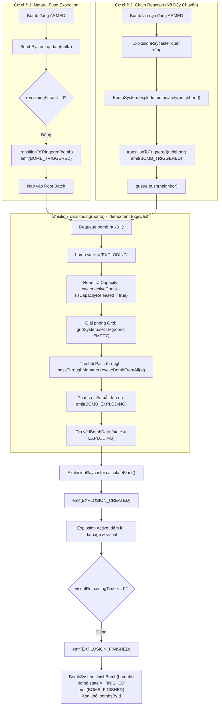
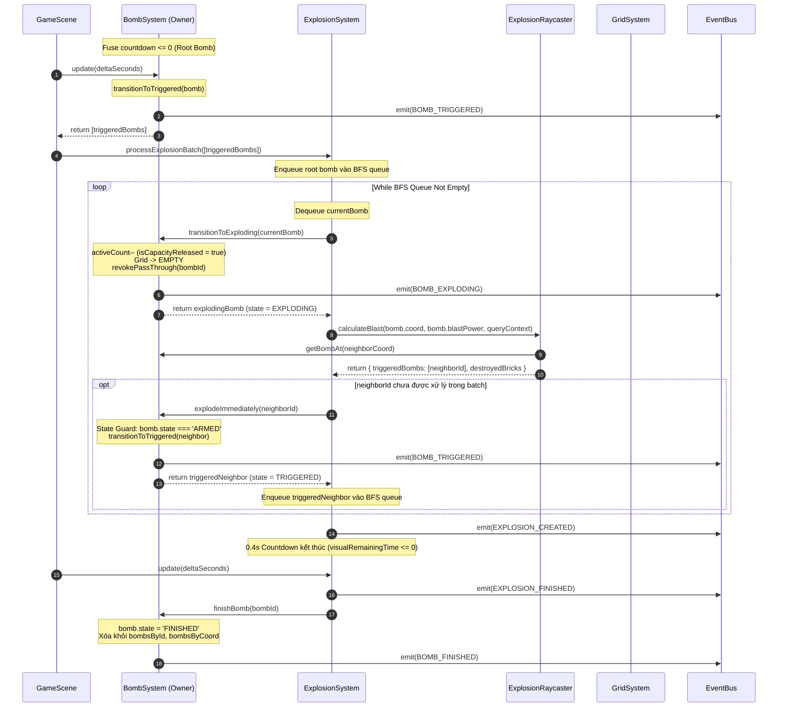
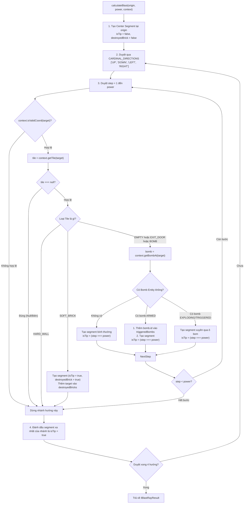
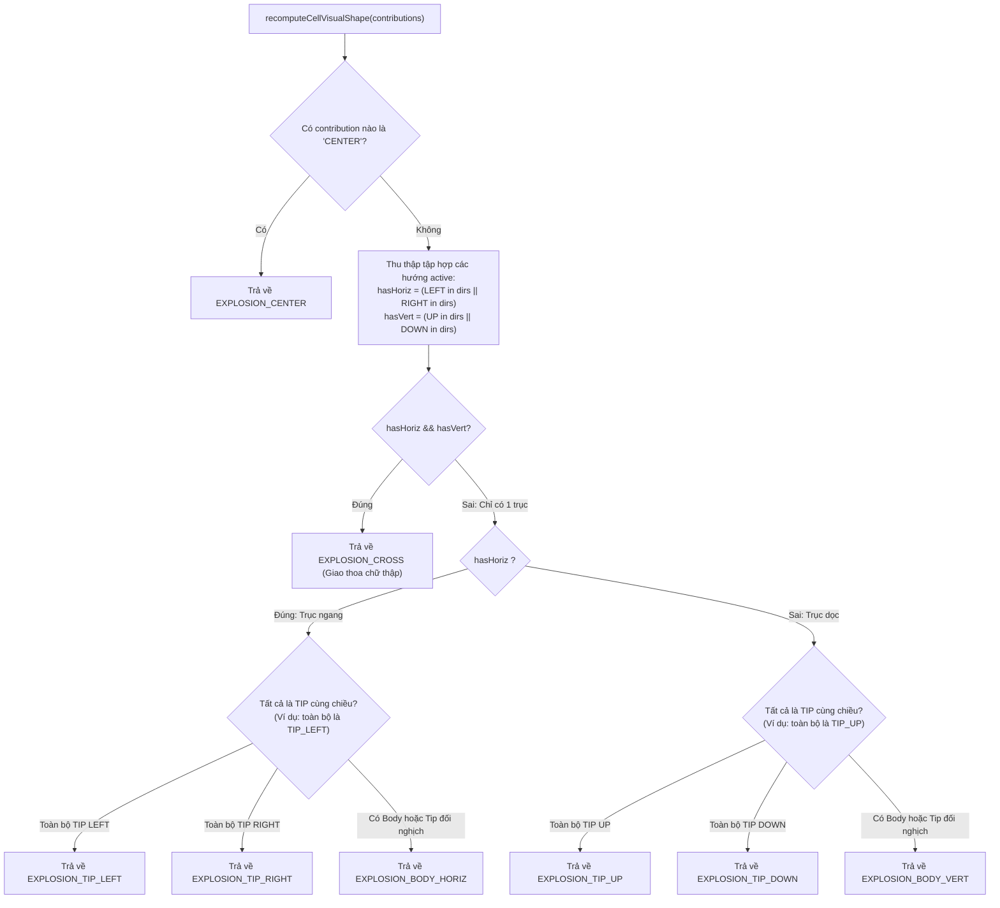
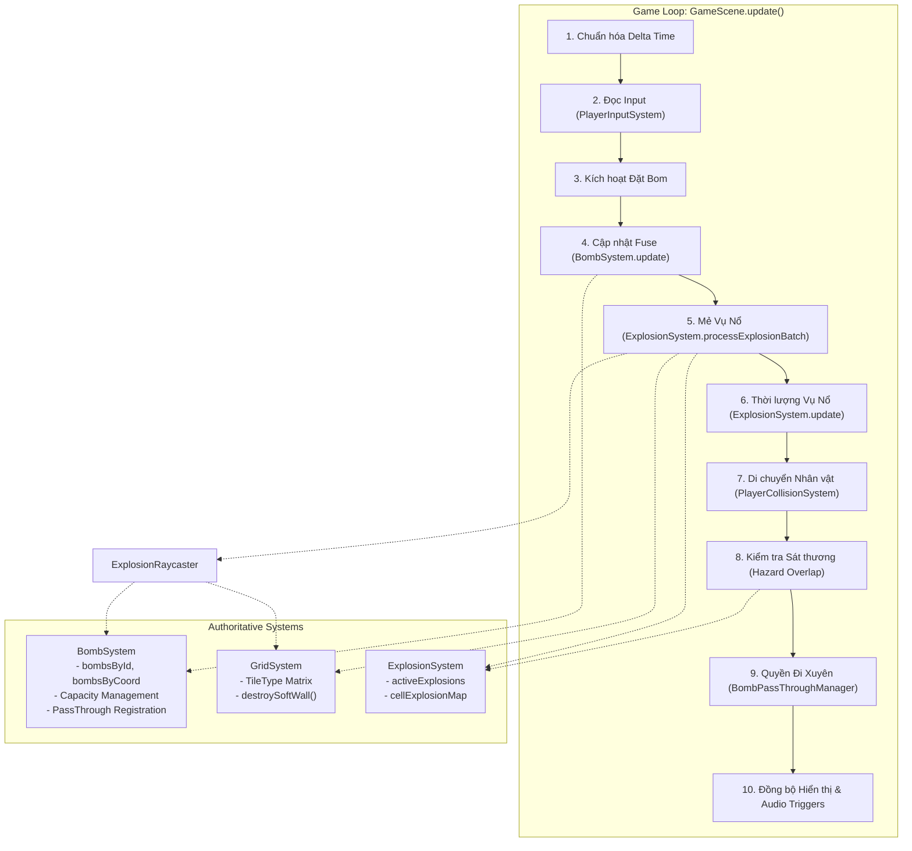

# TÀI LIỆU THIẾT KẾ KỸ THUẬT (TECHNICAL DESIGN DOCUMENT)
## STAGE 3B.3A – EXPLOSION CORE SYSTEM, RAYCASTING & BFS CHAIN REACTION ARCHITECTURE
### BẢN TU CHỈNH TOÀN DIỆN & HOÀN TẤT QUẢN TRỊ KIẾN TRÚC (VERSION 1.4.0)

> **Dự án**: Bomber Game (Classic Bomberman Remake - Phaser 3 + TypeScript + Vite)  
> **Giai đoạn**: **Stage 3B.3A.4 – Final Governance & Technical Consistency Correction**  
> **Phiên bản tài liệu**: **v1.4.0 (Final Architecture Specification)**  
> **Chịu trách nhiệm**: Senior Game Developer & Software Architect (DeepMind Team)  
> **Trạng thái**: **FINAL DESIGN SPECIFICATION – CHỜ USER PHÊ DUYỆT ĐỘC LẬP (PENDING REVIEW / NOT YET APPROVED)**  
> **Phạm vi bắt buộc**: **CHỈ CHỈNH SỬA TÀI LIỆU THIẾT KẾ. TUYỆT ĐỐI KHÔNG VIẾT MÃ NGUỒN GAMEPLAY (`src/`) HOẶC TEST CODE.**  
> **Stage 3B.3B**: **STRICTLY NOT AUTHORIZED / PENDING APPROVAL**  
> **Tài liệu căn cứ & thẩm quyền gốc**:  
> - [`GEMINI.md`](file:///C:/Git/Bomber/Bomber/GEMINI.md) (Chỉ thị tối cao về quản trị kiến trúc)  
> - [`Agents/PRODUCT_REQUIREMENTS.md`](file:///C:/Git/Bomber/Bomber/Agents/PRODUCT_REQUIREMENTS.md) (Mục 3.1, Mục 4: US-02, US-03, US-04, US-05)  
> - [`Agents/GAME_DESIGN_DOCUMENT.md`](file:///C:/Git/Bomber/Bomber/Agents/GAME_DESIGN_DOCUMENT.md) (Mục 2.2, 3.1, 3.2, 3.3, 4, 6)  
> - [`Agents/ARCHITECTURE.md`](file:///C:/Git/Bomber/Bomber/Agents/ARCHITECTURE.md) (Mục 5, 6)  
> - [`Agents/DECISION_LOG.md`](file:///C:/Git/Bomber/Bomber/Agents/DECISION_LOG.md) ([ADR-002](file:///C:/Git/Bomber/Bomber/Agents/DECISION_LOG.md#adr-002), [ADR-012](file:///C:/Git/Bomber/Bomber/Agents/DECISION_LOG.md#adr-012), [ADR-013](file:///C:/Git/Bomber/Bomber/Agents/DECISION_LOG.md#adr-013))  
> - [`Agents/STAGE_3A_TECHNICAL_DESIGN.md`](file:///C:/Git/Bomber/Bomber/Agents/STAGE_3A_TECHNICAL_DESIGN.md) & [`Agents/STAGE_3A_REPORT.md`](file:///C:/Git/Bomber/Bomber/Agents/STAGE_3A_REPORT.md)  
> - [`Agents/IMPLEMENTATION_ROADMAP.md`](file:///C:/Git/Bomber/Bomber/Agents/IMPLEMENTATION_ROADMAP.md)  

---

## 📜 LỊCH SỬ TU CHỈNH (REVISION HISTORY)

| Phiên bản | Ngày | Tác giả | Tóm tắt các thay đổi cốt lõi |
| :---: | :---: | :---: | :--- |
| **v1.0.0** | 09/11/2026 | Architect Team | Khởi tạo dự thảo thiết kế kỹ thuật phân hệ Vụ nổ & Nổ dây chuyền cho Stage 3B.3A. |
| **v1.1.0** | 09/11/2026 | Architect Team | **Tu chỉnh theo kết quả Technical Review (Stage 3B.3A.1)**:<br/>• Xử lý C1 (Single Ownership, Idempotent lifecycle transitions).<br/>• Xử lý C2 (Batch processing cho multiple fuse expirations cùng frame).<br/>• Xử lý C3 (Tách bạch Grid Occupancy vs Bomb Entity qua `IRaycastQueryContext`).<br/>• Xử lý C4 (Phân loại 4 trạng thái Open Decisions).<br/>• Xử lý M1-M5 (Độ phức tạp $O(N \cdot P)$, Head-index queue, Batch scoping, Centralized lifetime, Visual aggregation engine, Test matrix 35 tests). |
| **v1.2.0** | 09/11/2026 | Architect Team | **Chuẩn hóa Truy xuất Nguồn gốc Quyết định (Stage 3B.3A.2 - Decision Traceability Correction)**:<br/>• **Xử lý DT-01 (OD-08)**: Chuyển OD-08 về đúng trạng thái `Proposed Design` (chờ User phê chuẩn), loại bỏ nhãn Approved Decision không có căn cứ.<br/>• **Xử lý DT-02 (Khắc phục trích dẫn phantom)**: Bãi bỏ hoàn toàn các mã ký hiệu tự tạo `ADR-013.6`, `ADR-013.7`. Thay thế bằng trích dẫn chuẩn xác theo cấu trúc gốc của `DECISION_LOG.md` (ADR-013 Quyết định 1, 2, 3) và đồng bộ hóa toàn bộ 35 bài Unit Tests.<br/>• **Xử lý DT-03 (Phân định Ngữ nghĩa Ô lưới & Thực thể)**: Phân định rạch ròi 5 khía cạnh độc lập: Grid Occupancy (`GridSystem`), Bomb Entity Registry (`bombsById`), Spatial Lookup (`getBombAt`), Movement Blocking, và Explosion Contributions (`CellExplosionTracker`).<br/>• **Xử lý DT-04 (Làm rõ Phân tích Độ phức tạp)**: Làm rõ quan hệ giữa phát biểu kiến trúc đồ thị $O(N)$ trong ADR-013 và phân tích cụ thể hóa thao tác vật lý ô lưới $O(N \cdot P)$ trong Technical Design. Bảo toàn 100% quyết định kiến trúc BFS phi đệ quy. |
| **v1.3.0** | 09/11/2026 | Architect Team | **Chuẩn hóa Tính Nhất quán Kỹ thuật Toàn diện (Stage 3B.3A.3 - Technical Design Consistency Correction)**:<br/>• **Xử lý DT-05**: Phân tách sơ khởi `damageRemainingTime` và `visualRemainingTime`.<br/>• **Xử lý DT-06**: Xây dựng bảng trạng thái 6 cột; xác định `TRIGGERED` là trạng thái chuyển giao logic tức thời; trả lời 8 câu hỏi cốt lõi.<br/>• **Xử lý DT-07**: Phân tích sơ khởi $1+4\times P$ không gian mở vs có vật cản.<br/>• **Xử lý DT-08**: Đồng bộ 10 bước pipeline.<br/>• **Xử lý DT-09**: Phân loại 4 nhóm trạng thái sơ khởi.<br/>• **Xử lý DT-10**: Bằng chứng Git sơ khởi. |
| **v1.4.0** | 09/11/2026 | Architect Team | **Hoàn tất Quản trị Kiến trúc & Tính Nhất quán Kỹ thuật (Stage 3B.3A.4 - Final Governance & Consistency Correction)**:<br/>• **Xử lý DT-05 (Single Source of Truth & Phân định Lifetime)**: Xác lập `IExplosionData` là Authoritative Master State duy nhất cho `damageRemainingTime` và `visualRemainingTime`. `IExplosionContribution` loại bỏ dữ liệu trùng lặp, chỉ lưu `explosionId` để tra cứu derived query. Phân định rạch ròi 3 API: `isDamageActiveAt()` (gameplay hazard), `isVisualActiveAt()` (hiển thị), và `isExplosionAt()` (delegate chuẩn tắc sang `isVisualActiveAt()`). Xác nhận GDD 3.3 là baseline requirement hiện hành, OD-08 Phương án B là Proposed Change cần User duyệt.<br/>• **Xử lý DT-06 (Chuẩn hóa Trình tự 12 Bước & Event Ordering)**: Trả lời đầy đủ và chi tiết 12 câu hỏi vòng đời; chuẩn hóa event ordering (`BOMB_TRIGGERED` -> Enqueue BFS -> Dequeue -> `BOMB_EXPLODING` -> `EXPLOSION_CREATED` -> `EXPLOSION_FINISHED` -> `BOMB_FINISHED`), không dùng event hoàn tất ở thời điểm bắt đầu nổ; mô tả rõ cơ chế boolean guard & single-execution bảo đảm Idempotency.<br/>• **Xử lý DT-07 (blastPower Requirement vs Proposed Change)**: Ghi nhận OD-01 Phương án A là cách triển khai khớp 100% với requirement gốc của GDD 3.3 / PRD US-02; ghi nhận Phương án B là Proposed Change làm thay đổi requirement; định nghĩa rõ `blastPower` là bán kính ray mở rộng (không tính ô tâm) và ô tâm luôn luôn được sinh tại `origin`.<br/>• **Xử lý DT-08**: Bảo toàn tuyệt đối Pipeline 10 bước chuẩn tắc, không mở lại finding đã đạt.<br/>• **Xử lý DT-09 (Tách biệt Bản chất ADR vs PRD/GDD trong Governance Framework)**: Giữ nguyên 4 nhóm trạng thái của Governance, phân rã minh bạch nhóm Approved thành: 6 Approved Architectural Decisions (ADR) và 5 Approved Product Requirements (GDD/PRD), không gộp chung gây hiểu lầm thống kê.<br/>• **Xử lý DT-10 (Bằng chứng Git & Bổ sung Hash SHA-256 cho Untracked Files)**: Bổ sung đầy đủ 5 lệnh Git (stat, name-status, cached), kiểm tra hash SHA-256 trước/sau cho các untracked files để chứng minh tính toàn vẹn; nêu rõ giới hạn kiểm chứng thực tế.<br/>• **Sửa Mục 13 (Loại bỏ mâu thuẫn lựa chọn mặc định)**: Loại bỏ triệt để phát biểu "Agent tự ý chọn A làm mặc định", khẳng định tuân thủ baseline requirement của GDD 3.3 cho đến khi User duyệt đề xuất thay đổi. |

---

## 📑 MỤC LỤC

1. [Tổng quan Phạm vi & Mục tiêu Thiết kế Stage 3B.3A (v1.4.0)](#1-tổng-quan-phạm-vi--mục-tiêu-thiết-kế-stage-3b3a-v140)
2. [Ma trận Truy xuất Nguồn gốc Kiến trúc & Yêu cầu Gốc (Traceability Matrix)](#2-ma-trận-truy-xuất-nguồn-gốc-kiến-trúc--yêu-cầu-gốc-traceability-matrix)
3. [Vòng đời Bomb, Single Ownership & Ngăn chặn Double-Release (Xử lý C1 & DT-06)](#3-vòng-đời-bomb-single-ownership--thống-nhất-bomb-lifecycle-xử-lý-c1--dt-06)
4. [Xử lý Nhiều Bomb Hết Fuse Cùng Frame & Batch Processing (Xử lý C2)](#4-xử-lý-nhiều-bomb-hết-fuse-cùng-frame--batch-processing-xử-lý-c2)
5. [Thuật toán Raycasting & Contract Nhận diện Bomb Entity (Xử lý C3, M1 & DT-07)](#5-thuật-toán-raycasting--contract-nhận-diện-bomb-entity-xử-lý-c3--m1)
6. [Tương tác giữa Tia nổ với Địa hình & Thực thể](#6-tương-tác-giữa-tia-nổ-với-địa-hình--thực-thể)
7. [Cơ chế Nổ Dây chuyền BFS Phi đệ quy & Batch Scoping (Xử lý M1 & M2)](#7-cơ-chế-nổ-dây-chuyền-bfs-phi-đệ-quy--batch-scoping-xử-lý-m1--m2)
8. [Quản lý Thời lượng Tập trung & Hợp nhất Đồ họa theo Ô (Xử lý M3, M4 & DT-05)](#8-quản-lý-thời-lượng-tập-trung--hợp-nhất-đồ-họa-theo-ô-xử-lý-m3--m4)
9. [Tương tác Người chơi, Sát thương & Ranh giới Hitbox (Sensor Overlap)](#9-tương-tác-người-chơi-sát-thương--ranh-giới-hitbox-sensor-overlap)
10. [Tích hợp Hệ thống: BombSystem, GridSystem, EventBus & GameScene](#10-tích-hợp-hệ-thống-bombsystem-gridsystem-eventbus--gamescene)
11. [Thứ tự Cập nhật Xác định trong Vòng lặp Game (Deterministic Pipeline Order)](#11-thứ-tự-cập-nhật-xác-định-trong-vòng-lặp-game-deterministic-pipeline-order)
12. [Đặc tả Cấu trúc Dữ liệu & Interface Contracts](#12-đặc-tả-cấu-trúc-dữ-liệu--interface-contracts)
13. [Ma trận Kiểm thử Tự động Chi tiết (Test Matrix - Traceability Aligned)](#13-ma-trận-kiểm-thử-tự-động-chi-tiết-test-matrix---traceability-aligned)
14. [Sổ Đăng ký Quyết định Mở & Khung Quản trị Kiến trúc (Xử lý DT-09)](#14-sổ-đăng-ký-quyết-định-mở--khung-quản-trị-thiết-kế-open-decisions--governance-register---xử-lý-dt-09)

---

## 1. TỔNG QUAN PHẠM VI & MỤC TIÊU THIẾT KẾ STAGE 3B.3A (v1.4.0)

Theo lộ trình phát triển tại [`Agents/IMPLEMENTATION_ROADMAP.md`](file:///C:/Git/Bomber/Bomber/Agents/IMPLEMENTATION_ROADMAP.md), Stage 3B.3 được phân định thành các bước kiểm soát nghiêm ngặt:
- **Stage 3B.3A (Tài liệu này - v1.4.0)**: Đặc tả toàn diện kiến trúc kỹ thuật, thuật toán Raycasting 4 hướng, cơ chế nổ dây chuyền phi đệ quy BFS theo mẻ (Batch Processing), mô hình Single Source of Truth cho quản lý thời lượng tập trung và hợp nhất đồ họa theo ô, phân định ranh giới trách nhiệm giữa các thành phần và sổ đăng ký các quyết định mở có liên kết nguồn gốc rõ ràng. **Tuyệt đối KHÔNG viết mã nguồn gameplay hoặc test code trong giai đoạn này.**
- **Stage 3B.3B**: Triển khai mã nguồn logic Headless (`ExplosionRaycaster.ts`, `ExplosionSystem.ts`, `Explosion.types.ts`) và bộ Unit Tests tương ứng. **Chỉ được kích hoạt sau khi User/Tech Lead phê chuẩn bản thiết kế này.**

### Mục tiêu then chốt của bản hoàn tất v1.4.0 (Final Governance & Consistency):
1. **Xác định Single Source of Truth cho Vòng đời Sát thương và Thị giác (DT-05)**: `IExplosionData` là Authoritative Master State duy nhất, `IExplosionContribution` loại bỏ dữ liệu trùng lặp để ngăn ngừa desync; phân định 3 API `isDamageActiveAt()`, `isVisualActiveAt()`, và `isExplosionAt()`.
2. **Chuẩn hóa Trình tự 12 Thao tác & Event Ordering cho Bomb Lifecycle (DT-06)**: Giải đáp cặn kẽ 12 câu hỏi vòng đời; chuẩn hóa thứ tự phát event (`BOMB_TRIGGERED` -> Enqueue -> Dequeue -> `BOMB_EXPLODING` -> `EXPLOSION_CREATED` -> `EXPLOSION_FINISHED` -> `BOMB_FINISHED`); bảo đảm tính Idempotent với boolean guards.
3. **Phân biệt Requirement Hiện hành và Đề xuất Thay đổi cho `blastPower` (DT-07)**: Ghi nhận OD-01 Phương án A là cách triển khai khớp 100% với GDD 3.3 và PRD US-02; Phương án B là Proposed Change cần User phê duyệt; làm rõ ngữ nghĩa `blastPower` là bán kính ray mở rộng không tính ô tâm.
4. **Phân rã Minh bạch Khung Quản trị 4 Nhóm Trạng thái (DT-09)**: Giữ nguyên 4 nhóm trạng thái của Governance, phân rã nhóm Approved thành 6 Approved Architectural Decisions (ADR) và 5 Approved Product Requirements (PRD/GDD) rõ ràng, không gộp chung gây hiểu lầm.
5. **Cung cấp Bằng chứng Git Toàn diện & Hash SHA-256 cho Untracked Files (DT-10)**: Thu thập đầy đủ 5 lệnh Git và hash SHA-256 trước/sau cho untracked files để chứng minh tính toàn vẹn 0-code-change.
6. **Bảo tồn Tuyệt đối ADR-013 & Pipeline 10 Bước (DT-08)**: Giữ nguyên vẹn 3 quyết định nền tảng của ADR-013 và quy trình 10 bước chuẩn tắc.

---

## 2. MA TRẬN TRUY XUẤT NGUỒN GỐC KIẾN TRÚC & YÊU CẦU GỐC (TRACEABILITY MATRIX)

Dưới đây là ma trận đối soát nguồn gốc chính thống của toàn bộ các yêu cầu kiến trúc và nghiệp vụ liên quan đến phân hệ Bom & Vụ nổ:

| Hạng mục Quy định | Nguồn Thẩm Quyền Gốc | Điều khoản / Nội dung Gốc trong Tài liệu | Hiện thực Hóa trong Thiết kế v1.4.0 |
| :--- | :--- | :--- | :--- |
| **Pass-through AABB** | [ADR-013 (Quyết định 1)](file:///C:/Git/Bomber/Bomber/Agents/DECISION_LOG.md#adr-013) & [GDD Mục 3.2](file:///C:/Git/Bomber/Bomber/Agents/GAME_DESIGN_DOCUMENT.md#32-qu%E1%BA%A3-bom-bomb) | Bãi bỏ timer 0.2s. Áp dụng Spatial Disjoint AABB: Player đi xuyên bom vừa đặt cho đến khi rời hẳn khỏi cell. | Duy trì cơ chế AABB disjoint từ Stage 3B.2. Khi bom nổ sang `EXPLODING`, thu hồi vĩnh viễn quyền đi xuyên của mọi entity (`passThroughManager.revokeBombFromAll`). |
| **Phân quyền độc lập theo thực thể** | [ADR-013 (Quyết định 1)](file:///C:/Git/Bomber/Bomber/Agents/DECISION_LOG.md#adr-013) | Quản lý độc lập theo từng cặp `(playerId, bombId)`. Quái vật và người chơi khác bị cản cứng ngay từ đầu. | `BombPassThroughManager` độc lập. Dọn dẹp sạch sẽ mapping khi bom phát nổ. |
| **Hồi Capacity ngay tại `EXPLODING`** | [ADR-013 (Quyết định 1)](file:///C:/Git/Bomber/Bomber/Agents/DECISION_LOG.md#adr-013) & [GDD Mục 3.2](file:///C:/Git/Bomber/Bomber/Agents/GAME_DESIGN_DOCUMENT.md#32-qu%E1%BA%A3-bom-bomb) | `activeBombCount--` ngay thời điểm bom chuyển sang `EXPLODING`, không cần chờ 0.4s tia lửa nổ tắt. | `BombSystem.transitionToExploding()` thực hiện giảm `activeCount` đúng 1 lần duy nhất, có cờ `isCapacityReleased` bảo vệ idempotent. |
| **Giải phóng Ô lưới ngay tại `EXPLODING`** | [ADR-013 (Quyết định 1)](file:///C:/Git/Bomber/Bomber/Agents/DECISION_LOG.md#adr-013) & [STAGE_3A_DESIGN Mục 2.2](file:///C:/Git/Bomber/Bomber/Agents/STAGE_3A_TECHNICAL_DESIGN.md#22-th%E1%BB%9Di-%C4%91i%E1%BB%83m-gi%E1%BA%A3i-ph%C3%B3ng-%C3%B4-l%C6%B0%E1%BB%9Bi-ch%E1%BB%A9a-bom-tr%C3%AAn-gridsystem) | Khối bom vật lý bị hủy diệt; ô lưới chuyển về `TileType.EMPTY` ngay tại `EXPLODING` để tia lửa quét qua. | `gridSystem.setTile(coord, EMPTY)` kích hoạt ngay trong `transitionToExploding()`. |
| **Kích nổ tức thì bom lân cận** | [ADR-013 (Quyết định 2)](file:///C:/Git/Bomber/Bomber/Agents/DECISION_LOG.md#adr-013) & [GDD Mục 3.3](file:///C:/Git/Bomber/Bomber/Agents/GAME_DESIGN_DOCUMENT.md#33-v%E1%BB%A5-n%E1%BB%95--tia-l%E1%BB%ADa-explosion--blast-waves) | Bom bị tia lửa quét trúng sẽ chuyển ngay sang `TRIGGERED` và nổ tức thì trong cùng frame. | Gọi `BombSystem.explodeImmediately(neighborId)` ngay khi raycast quét trúng, đưa vào hàng đợi BFS. |
| **Penetrating Blast (Quét xuyên bom)** | [ADR-013 (Quyết định 2)](file:///C:/Git/Bomber/Bomber/Agents/DECISION_LOG.md#adr-013) & [GDD Mục 3.3](file:///C:/Git/Bomber/Bomber/Agents/GAME_DESIGN_DOCUMENT.md#33-v%E1%BB%A5-n%E1%BB%95--tia-l%E1%BB%ADa-explosion--blast-waves) | `TileType.BOMB` có `blocksBlast = false`. Tia lửa tiếp tục lan qua ô bom nếu còn tầm nổ (`step < power`). | Raycaster không dừng nhánh khi gặp bom, ghi nhận bom vào `triggeredBombs` và tiếp tục duyệt sang ô tiếp theo. |
| **Hàng đợi BFS phi đệ quy** | [ADR-013 (Quyết định 2)](file:///C:/Git/Bomber/Bomber/Agents/DECISION_LOG.md#adr-013) | Sử dụng hàng đợi BFS kết hợp tập hợp `processedBombIds` để loại bỏ 100% nguy cơ Stack Overflow. | Triển khai hàng đợi BFS trỏ Head Index kết hợp `batchProcessedBombIds: Set<string>` theo mẻ nổ của frame (Mục 4 & 7). |
| **Visual Stacking theo Ô** | [ADR-013 (Quyết định 3)](file:///C:/Git/Bomber/Bomber/Agents/DECISION_LOG.md#adr-013) & [GDD Mục 3.3](file:///C:/Git/Bomber/Bomber/Agents/GAME_DESIGN_DOCUMENT.md#33-v%E1%BB%A5-n%E1%BB%95--tia-l%E1%BB%ADa-explosion--blast-waves) | Gộp hiển thị theo ô qua `CellExplosionTracker` để tránh chói lóa và quá tải render. | Quản lý đóng góp độc lập theo `explosionId`; hàm thuần túy `recomputeCellVisualShape` tự động chọn texture (center, cross, body, tip). |
| **Thời lượng Vụ nổ Chuẩn $0.4\text{s}$** | [GDD Mục 3.3](file:///C:/Git/Bomber/Bomber/Agents/GAME_DESIGN_DOCUMENT.md#33-v%E1%BB%A5-n%E1%BB%95--tia-l%E1%BB%ADa-explosion--blast-waves) & [Roadmap Stage 3](file:///C:/Git/Bomber/Bomber/Agents/IMPLEMENTATION_ROADMAP.md) | "Thời gian tồn tại của tia lửa (Duration): 0.4 giây. Trong thời gian này, Hitbox của tia lửa hoạt động liên tục để quét va chạm." | Hằng số `EXPLOSION_CONFIG.DURATION = 0.4s`. Master record `IExplosionData` đếm lùi và dọn dẹp cell khi chạm $\le 0$. |
| **Bán kính Tia nổ Ban đầu** | [PRD Mục 4 (US-02)](file:///C:/Git/Bomber/Bomber/Agents/PRODUCT_REQUIREMENTS.md#us-02-%C4%91%E1%BA%B7t-bom-v%C3%A0-k%C3%ADch-ho%E1%BA%A1t-v%E1%BB%A5-n%E1%BB%95) & [GDD Mục 3.3](file:///C:/Git/Bomber/Bomber/Agents/GAME_DESIGN_DOCUMENT.md#33-v%E1%BB%A5-n%E1%BB%95--tia-l%E1%BB%ADa-explosion--blast-waves) | "Tia lửa nổ lan truyền theo 4 hướng hình chữ thập (+). Tầm nổ mặc định ban đầu là 1 ô (tính từ tâm)." | `DEFAULT_POWER = 1` sinh 5 ô (1 tâm + 4 cánh 1 ô). |
| **Chặn tia nổ bởi Tường & Gạch** | [PRD Mục 4 (US-02)](file:///C:/Git/Bomber/Bomber/Agents/PRODUCT_REQUIREMENTS.md#us-02-%C4%91%E1%BA%B7t-bom-v%C3%A0-k%C3%ADch-ho%E1%BA%A1t-v%E1%BB%A5-n%E1%BB%95) & [GDD Mục 3.3](file:///C:/Git/Bomber/Bomber/Agents/GAME_DESIGN_DOCUMENT.md#33-v%E1%BB%A5-n%E1%BB%95--tia-l%E1%BB%ADa-explosion--blast-waves) | Tường cứng chặn đứng hoàn toàn; Gạch mềm bị phá hủy và chặn đứng tia nổ không lan tiếp. | Raycaster dừng nhánh ngay khi gặp `HARD_WALL`; sinh tip segment và đánh dấu vỡ gạch khi gặp `SOFT_BRICK`. |
| **Player Kinematic Sensor Body** | [ADR-012](file:///C:/Git/Bomber/Bomber/Agents/DECISION_LOG.md#adr-012) & [GDD Mục 3.1](file:///C:/Git/Bomber/Bomber/Agents/GAME_DESIGN_DOCUMENT.md#31-nh%C3%A2n-v%E1%BA%ADt-bomber-player) | Hitbox 28x28 pixel căn giữa. `body.moves = false`. Arcade Body đóng vai trò là Sensor Trigger cho Overlap detection. | Kiểm tra Overlap giữa AABB Player và ô có lửa, không tạo lực đẩy Arcade Physics. |

---

## 3. VÒNG ĐỜI BOMB, SINGLE OWNERSHIP & THỐNG NHẤT BOMB LIFECYCLE (XỬ LÝ C1 & DT-06)

### 3.1. Phân định Quyền Sở hữu Duy nhất (Single Source of Authority)
Review kỹ thuật phát hiện nguy cơ double-release nếu cả `BombSystem` và `ExplosionSystem` cùng có quyền thay đổi trạng thái hoặc giải phóng tài nguyên của quả bom. Để triệt tiêu rủi ro này, kiến trúc v1.4.0 xác lập nguyên tắc:

> [!IMPORTANT]
> **Quy tắc Single Authority**:  
> `BombSystem` là **đơn vị sở hữu độc quyền (Sole Authority)** đối với vòng đời, trạng thái, capacity của người chơi, quyền pass-through và sự hiện diện trên lưới của toàn bộ Bomb.  
> `ExplosionSystem` tuyệt đối **KHÔNG** tự ý chuyển trạng thái bomb, không tự ý trừ `ownerProfile.activeCount`, không gọi trực tiếp `passThroughManager`, và không tự ý sửa đổi `TileType.BOMB` trên `GridSystem`. Mọi tương tác chuyển trạng thái phải thông qua các API công khai của `BombSystem`.

### 3.2. Bảng Ma Trận Ngữ Nghĩa Trạng Thái Chuẩn Tắc (Canonical Bomb State Semantics - Xử lý DT-06)

Để loại bỏ hoàn toàn các mô tả mâu thuẫn giữa `ARMED`, `TRIGGERED`, `EXPLODING`, và `FINISHED`, bảng trạng thái chuẩn tắc dưới đây xác định chính xác ngữ nghĩa của từng trạng thái trong toàn hệ thống:

| Trạng thái (State) | Ý nghĩa nghiệp vụ | Có tồn tại qua frame? | Có được chain-trigger? | Chiếm dụng Lưới (Grid Occupancy) | Sức chứa (Capacity) |
| :--- | :--- | :---: | :---: | :--- | :--- |
| **`ARMED`** | Quả bom đang đếm ngược fuse thời gian, hoạt động bình thường, chưa phát nổ. | **CÓ** (tồn tại qua nhiều frame đến khi hết fuse hoặc bị kích nổ). | **CÓ** (nếu bị tia lửa quét trúng sẽ bị kích nổ tức thì). | Chiếm ô: `TileType.BOMB` (`isWalkable = false` đối với entity không có pass-through). | Đang chiếm dụng 1 slot (`activeCount` đã tăng). |
| **`TRIGGERED`** | Trạng thái chuyển giao logic tức thời (Transient / In-batch Transition) khi bom nhận lệnh kích nổ sớm từ tia lửa nổ dây chuyền. | **KHÔNG** (trong chuỗi nổ dây chuyền chuẩn Stage 3B, bom nổ tức thì trong cùng call stack của batch, không bao giờ hoãn qua frame). | **KHÔNG** (đã được đánh dấu vào `batchProcessedBombIds`, không trigger lặp). | Chuyển ngay sang `TileType.EMPTY` khi hoàn tất bước sang `EXPLODING` trong cùng thao tác. | Hoàn trả ngay trong bước sang `EXPLODING` của cùng thao tác đồng bộ. |
| **`EXPLODING`** | Quả bom đang trong vòng đời vụ nổ (0.4s). | **CÓ** (tồn tại suốt thời gian vụ nổ đang diễn ra trên sàn đấu). | **KHÔNG** (đang nổ, tia lửa khác quét qua theo luật Penetrating Blast `blocksBlast = false`). | **Giải phóng về `TileType.EMPTY`** (ADR-013 Quyết định 1). | **Đã hoàn trả** đúng 1 lần (`isCapacityReleased = true`). |
| **`FINISHED`** | Vòng đời của quả bom đã kết thúc hoàn toàn sau khi vụ nổ tắt. | **KHÔNG** (thực thể bị xóa khỏi bộ nhớ quản lý `bombsById` và `bombsByCoord` ngay tại frame nổ tắt). | **KHÔNG** (thực thể không còn tồn tại). | Ô lưới tiếp tục là `TileType.EMPTY`. | Đã hoàn trả từ trước, tuyệt đối không hoàn trả lần thứ 2. |

### 3.3. Giải Đáp Chi Tiết 12 Câu Hỏi Cốt Lõi Về Bomb Lifecycle & Event Ordering (DT-06 Analysis)

Để đáp ứng đầy đủ và chuẩn xác các yêu cầu kiểm toán kỹ thuật độc lập, 12 câu hỏi chuẩn tắc về quy trình thao tác và phân định sự kiện được giải đáp chi tiết:

1. **Khi nào bomb được đổi từ `ARMED` sang `TRIGGERED`?**
   - **Fuse tự nhiên**: Trong `BombSystem.update(deltaSeconds)`, khi `remainingFuse <= 0`, bom hết hạn fuse và được chuyển sang `TRIGGERED`.
   - **Nổ dây chuyền**: Trong vòng lặp BFS của `ExplosionSystem.processExplosionBatch()`, khi `ExplosionRaycaster` quét trúng ô chứa bom lân cận có `bomb.state === 'ARMED'`, lệnh `bombSystem.explodeImmediately(neighborBombId)` được gọi, bom lân cận lập tức chuyển sang `TRIGGERED`.
2. **Khi nào phát sự kiện `BOMB_TRIGGERED`?**
   - Sự kiện `BOMB_TRIGGERED` được phát ra **ngay sau khi bom chuyển từ `ARMED` sang `TRIGGERED` thành công** và **trước khi** bom được nạp vào hàng đợi BFS (hoặc danh sách batch). Sự kiện này thông báo cho hệ thống rằng quả bom đã nhận lệnh kích nổ sớm.
3. **Khi nào bomb được đưa vào BFS queue (Enqueue)?**
   - **Root bombs**: Được đưa vào hàng đợi BFS tại đầu mẻ nổ (`queue.push(rootBomb)`).
   - **Chain-triggered bombs**: Ngay sau khi `explodeImmediately()` xác thực chuyển `TRIGGERED` và phát `BOMB_TRIGGERED`, bom được nạp vào hàng đợi (`queue.push(neighborBomb)`).
4. **Nếu enqueue thất bại hoặc bomb đã được xử lý thì sao?**
   - Hệ thống áp dụng **Atomic State Guard**: Trước khi chuyển `TRIGGERED`, phương thức kiểm tra `if (bomb.state !== 'ARMED') return null;`.
   - Nếu bom đã ở trạng thái `TRIGGERED`, `EXPLODING` hoặc `FINISHED` (hoặc đã nằm trong `batchProcessedBombIds`), yêu cầu kích nổ bị từ chối ngay lập tức, không phát event, không nạp vào queue, ngăn chặn triệt để vòng lặp vô hạn và nổ lặp.
5. **Khi nào bomb được dequeue?**
   - Trong vòng lặp `while (head < queue.length)`, bom được lấy ra tại chỉ mục con trỏ đầu: `const currentBomb = queue[head++]`.
6. **Khi nào chuyển sang `EXPLODING`?**
   - Bom được chuyển từ `TRIGGERED` sang `EXPLODING` **ngay khi được dequeue để tiến hành xử lý nổ**, thông qua phương thức nội bộ `transitionToExploding(bomb)`.
7. **Khi nào hoàn trả `bombCapacity`?**
   - Hoàn trả capacity (`ownerProfile.activeCount--`) **ngay bên trong `transitionToExploding(bomb)`**, được kiểm soát chặt chẽ bởi cờ `!bomb.isCapacityReleased`. Tuân thủ tuyệt đối [ADR-013 Quyết định 1](file:///C:/Git/Bomber/Bomber/Agents/DECISION_LOG.md#adr-013).
8. **Khi nào giải phóng Grid cell thành `EMPTY`?**
   - Giải phóng ô lưới về `TileType.EMPTY` **ngay bên trong `transitionToExploding(bomb)`**. Tuân thủ tuyệt đối [ADR-013 Quyết định 1](file:///C:/Git/Bomber/Bomber/Agents/DECISION_LOG.md#adr-013).
9. **Khi nào phát sự kiện `BOMB_EXPLODING`?**
   - Phát `BOMB_EXPLODING` **ngay cuối hàm `transitionToExploding(bomb)`** sau khi capacity đã hoàn trả và ô lưới đã giải phóng. Đây là sự kiện báo hiệu **BẮT ĐẦU PHA NỔ** (Tuyệt đối không phát event hoàn tất ở thời điểm này).
10. **Khi nào phát event báo vụ nổ kết thúc?**
    - Trong `ExplosionSystem.update(deltaSeconds)`, khi thời lượng thị giác của vụ nổ kết thúc (`visualRemainingTime <= 0`), hệ thống phát sự kiện `EXPLOSION_FINISHED { explosionId, bombId, ownerId, affectedCells }`.
11. **Khi nào gọi `finishBomb()`?**
    - Ngay sau khi phát `EXPLOSION_FINISHED`, `ExplosionSystem` gọi `bombSystem.finishBomb(bombId)` để khép lại vòng đời thực thể bom.
12. **Khi nào xóa bomb khỏi registry?**
    - Bên trong `BombSystem.finishBomb(bombId)`, bom chuyển trạng thái sang `FINISHED`, phát sự kiện `BOMB_FINISHED { bombId, ownerId, col, row }`, và được xóa vĩnh viễn khỏi các bảng băm `bombsById` và `bombsByCoord`.

### 3.4. Hợp Nhất Hai Cơ Chế Kích Nổ Vào Một Vòng Đời Chuẩn Tắc (Unified Lifecycle)
Cả hai cơ chế kích nổ trong trò chơi đều hội tụ vào cùng một quy trình chuẩn tắc `transitionToExploding(bomb)`:



### 3.5. Bảng Ma trận Chuyển đổi Trạng thái và Trách nhiệm Method

| Chuyển trạng thái | Kịch bản kích hoạt | Method chịu trách nhiệm | Side Effects bắt buộc (Thực hiện đúng 1 lần duy nhất) |
| :--- | :--- | :--- | :--- |
| **`ARMED` $\to$ `TRIGGERED`** | Hết fuse tự nhiên hoặc bị tia nổ quét trúng | `BombSystem.update()` hoặc `BombSystem.explodeImmediately(id)` | 1. `bomb.state = 'TRIGGERED'`<br/>2. Phát sự kiện `BOMB_TRIGGERED`<br/>3. Đưa vào BFS queue |
| **`TRIGGERED` $\to$ `EXPLODING`** | Dequeue bomb ra xử lý trong batch BFS | `BombSystem.transitionToExploding(bomb)` | 1. `bomb.state = 'EXPLODING'`<br/>2. Giải phóng Capacity (`owner.activeCount--`, bảo vệ bởi `!isCapacityReleased`)<br/>3. Giải phóng ô lưới (`grid.setTile(coord, EMPTY)`)<br/>4. Thu hồi quyền pass-through (`passThroughManager.revokeBombFromAll`)<br/>5. Phát sự kiện bắt đầu nổ `BOMB_EXPLODING` |
| **`EXPLODING` $\to$ `FINISHED`** | Vụ nổ kết thúc sau $0.4\text{s}$ (`visualRemainingTime <= 0`) | Public `BombSystem.finishBomb(bombId)` | 1. `bomb.state = 'FINISHED'`<br/>2. **Xóa khỏi bảng băm** `bombsById` và `bombsByCoord`<br/>3. Phát sự kiện kết thúc quả bom `BOMB_FINISHED`<br/>4. *Tuyệt đối không giải phóng capacity hay ô lưới lần nữa* |

### 3.6. Cơ Chế Bảo Đảm Idempotency Cụ Thể (Anti-Duplicate Guard)
Để bảo đảm tính **Idempotent 100%**, hệ thống không chỉ dựa vào phát biểu lý thuyết mà hiện thực hóa bằng các cơ chế kiểm soát cụ thể:

1. **Idempotent Capacity Refund**:
   - Trường boolean `bomb.isCapacityReleased: boolean` (khởi tạo `false`).
   - Trong `transitionToExploding(bomb)`:
     ```typescript
     if (!bomb.isCapacityReleased) {
       ownerProfile.activeCount = Math.max(0, ownerProfile.activeCount - 1);
       bomb.isCapacityReleased = true;
     }
     ```
   - Đảm bảo hạn ngạch đặt bom của người chơi chỉ được hoàn trả đúng 1 lần duy nhất.
2. **Idempotent Grid Cell Release**:
   - Kiểm tra ô lưới trước khi ghi:
     ```typescript
     if (gridSystem.getTile(bomb.coord) === TileType.BOMB) {
       gridSystem.setTile(bomb.coord, TileType.EMPTY);
     }
     ```
   - Đảm bảo nếu ô lưới đã được chuyển thành `EMPTY` hoặc bị thay đổi bởi hệ thống khác thì không ghi đè lặp.
3. **Idempotent Pass-Through Revocation**:
   - `passThroughManager.revokeBombFromAll(bomb.id)` thực hiện xóa toàn bộ các entry liên quan đến `bomb.id` trong `Map<string, Set<string>>`. Nếu đã xóa rồi, thao tác gọi lại là no-op an toàn.
4. **Idempotent State Transitions & Event Emission**:
   - Atomic State Guard:
     ```typescript
     // Chặn kích nổ lặp:
     if (bomb.state !== 'ARMED') return null;
     
     // Chặn transitionToExploding lặp:
     if (bomb.state === 'EXPLODING' || bomb.state === 'FINISHED') return;
     
     // Chặn finishBomb lặp:
     if (bomb.state !== 'EXPLODING') return false;
     ```
   - Mỗi sự kiện vòng đời (`BOMB_TRIGGERED`, `BOMB_EXPLODING`, `BOMB_FINISHED`) chỉ được phát ra duy nhất một lần khi bước chuyển trạng thái tương ứng thành công.
5. **Idempotent Registry Cleanup**:
   - `finishBomb(bombId)` xóa phần tử khỏi `Map`: `this.bombsById.delete(bombId)`. Gọi nhiều lần trên một ID đã xóa không phát sinh lỗi (`delete` trả về `false`).

### 3.7. Sequence Diagram Thể hiện Rõ Ràng Vòng Đời và Single Ownership



---

## 4. XỬ LÝ NHIỀU BOMB HẾT FUSE CÙNG FRAME & BATCH PROCESSING (XỬ LÝ C2)

### 4.1. Thu thập Tất cả Bomb Hết Fuse trong Một Frame
Trong mỗi frame tick của game loop:
1. `BombSystem.update(deltaSeconds)` duyệt toàn bộ danh sách bom `ARMED`.
2. Mọi quả bom có `remainingTime <= 0` đều được gom vào mảng `naturalExplosions: IBombData[]`.
3. Từng quả bom trong mảng này được chuyển sang `EXPLODING` ngay trong `BombSystem.update()`, giải phóng capacity và ô lưới của chúng.
4. Mảng `naturalExplosions` được trả về cho `GameScene`.

### 4.2. Cơ chế Xử lý theo Mẻ (Batch Processing) trong `ExplosionSystem`
Thay vì xử lý từng quả bom độc lập (dễ gây trùng lặp và race condition khi chúng kích nổ chéo nhau), `ExplosionSystem` tiếp nhận toàn bộ mẻ nổ:

```typescript
public processExplosionBatch(rootBombs: IBombData[]): IExplosionData[] {
  if (rootBombs.length === 0) return [];

  // 1. Khởi tạo tập hợp processed bomb ids cho TOÀN BỘ mẻ nổ
  const batchProcessedBombIds = new Set<string>();
  for (const b of rootBombs) {
    batchProcessedBombIds.add(b.id);
  }

  // 2. Nạp toàn bộ root bombs vào hàng đợi BFS
  const queue: IBombData[] = [...rootBombs];
  let head = 0; // Con trỏ Head Index thay cho Array.shift() (M1)

  const createdExplosions: IExplosionData[] = [];

  // 3. Vòng lặp BFS mở rộng nổ dây chuyền
  while (head < queue.length) {
    const currentBomb = queue[head++];

    // Tính toán raycast bằng context an toàn (C3)
    const blastResult = this.raycaster.calculateBlast(
      currentBomb.coord,
      currentBomb.blastPower,
      this.queryContext
    );

    // Kích nổ dây chuyền các quả bom lân cận
    for (const neighborId of blastResult.triggeredBombs) {
      if (!batchProcessedBombIds.has(neighborId)) {
        batchProcessedBombIds.add(neighborId);
        // Yêu cầu BombSystem chuyển trạng thái sang EXPLODING tức thì
        const neighborBomb = this.bombSystem.explodeImmediately(neighborId);
        if (neighborBomb) {
          queue.push(neighborBomb);
        }
      }
    }

    // Xử lý phá gạch mềm
    for (const brickCoord of blastResult.destroyedBricks) {
      if (this.gridSystem.destroySoftWall(brickCoord)) {
        EventBus.emit(GameEvents.BLOCK_DESTROYED, { col: brickCoord.col, row: brickCoord.row });
      }
    }

    // Tạo Explosion master entity và đăng ký cell
    const explosion = this.createExplosionRecord(currentBomb, blastResult);
    createdExplosions.push(explosion);
  }

  return createdExplosions;
}
```

### 4.3. Phân biệt Rõ Ràng 4 Loại / Trạng thái Bomb trong Xử lý Nổ

| Loại Bom | Định nghĩa & Trạng thái | Nguồn kích hoạt | Cách Xử lý trong Batch |
| :--- | :--- | :--- | :--- |
| **1. Natural Fuse Expiration** | Bom tự hết thời gian đếm ngược (`state = ARMED -> EXPLODING`). | `BombSystem.update()` | Đưa vào `rootBombs`, nạp sẵn vào `batchProcessedBombIds` và đầu `queue`. Không gọi lại `explodeImmediately()`. |
| **2. Chain-Triggered Explosion** | Bom đang `ARMED` bị tia lửa của bom khác quét trúng trong nổ dây chuyền. | `blastResult.triggeredBombs` | Kiểm tra chưa có trong `batchProcessedBombIds` $\to$ nạp ID vào Set $\to$ gọi `BombSystem.explodeImmediately()` (chuyển transient `TRIGGERED` phát `BOMB_TRIGGERED` rồi sang `EXPLODING` tức thì trong cùng call stack) $\to$ nạp vào cuối `queue`. |
| **3. Queued Explosion** | Bom đã ở trạng thái `EXPLODING` và đang nằm trong `queue` chờ duyệt raycast. | Đã nằm trong hàng đợi | Nếu tia lửa khác quét trúng: nhận diện ID đã có trong `batchProcessedBombIds` $\to$ bỏ qua không kích nổ lại. Tia lửa tiếp tục lan qua ô. |
| **4. Already EXPLODING Bomb** | Bom đã được duyệt raycast trong batch này hoặc đang cháy dở từ các frame trước. | Đang hoạt động (`state = EXPLODING`) | Nhận diện qua `BombSystem.getBombAt(coord).state === 'EXPLODING'`. Không thêm vào `triggeredBombs`. Tia lửa tiếp tục lan qua ô (`blocksBlast = false`). |

---

## 5. THUẬT TOÁN RAYCASTING & CONTRACT NHẬN DIỆN BOMB ENTITY (XỬ LÝ C3 & M1)

### 5.1. Phân Định Rõ Ràng Giữa Grid Occupancy, Bomb Entity Registry & Spatial Lookup (Xử lý DT-03 / C3)

Để bảo đảm tuân thủ 100% quyết định kiến trúc đã phê duyệt tại [ADR-013 (Quyết định 1)](file:///C:/Git/Bomber/Bomber/Agents/DECISION_LOG.md#adr-013) ("Hồi capacity và giải phóng ô lưới trên `GridSystem` về `TileType.EMPTY` ngay thời điểm bom phát nổ `EXPLODING`"), hệ thống phân định rạch ròi 5 khái niệm ngữ nghĩa độc lập:

| Khái niệm Ngữ nghĩa | Đơn vị Quản lý / Thẩm quyền | Trạng thái khi Bom `ARMED` | Trạng thái khi Bom `EXPLODING` | Trạng thái khi Bom `FINISHED` |
| :--- | :--- | :--- | :--- | :--- |
| **1. Grid Occupancy** | [`GridSystem`](file:///C:/Git/Bomber/Bomber/src/systems/GridSystem.ts) (Chỉ quản lý địa hình bản đồ) | Ô lưới có giá trị `TileType.BOMB` (chiếm dụng ô). | **Giải phóng ngay về `TileType.EMPTY`** (ADR-013 Quyết định 1). Tuyệt đối không giữ `TileType.BOMB`. | Ô lưới tiếp tục là `TileType.EMPTY`. |
| **2. Bomb Entity Registry** | [`BombSystem.bombsById`](file:///C:/Git/Bomber/Bomber/src/systems/BombSystem.ts) (Quản lý thực thể bom) | Lưu giữ thực thể bom (`state = 'ARMED'`). | **Vẫn lưu giữ thực thể** (`state = 'EXPLODING'`) để duy trì dữ liệu vụ nổ (`blastPower`, `ownerId`). Capacity đã hoàn trả đúng 1 lần (`isCapacityReleased = true`). | **Xóa hoàn toàn** khỏi `bombsById` khi `finishBomb()` được gọi sau $0.4\text{s}$. |
| **3. Bomb Spatial Lookup** | `BombSystem.getBombAt(coord)` / `bombsByCoord` | Trả về `IBombData` (`state = 'ARMED'`). | Trả về `IBombData` (`state = 'EXPLODING'`). Raycaster nhận diện bom đang nổ để **cho tia lửa quét xuyên qua** và **không kích nổ dây chuyền lần 2**. | Trả về `null` (đã dọn dẹp sạch). |
| **4. Movement Blocking** | Hệ thống Va chạm (`PlayerCollisionSystem`) | Ô bom cản đường di chuyển (trừ trường hợp Player đang có quyền Pass-through AABB). | **KHÔNG CẢN ĐƯỜNG** (`movement blocking = false`) vì ô grid đã là `EMPTY` và quyền pass-through đã bị revoke từ mọi entity. Player có thể bước vào nhưng sẽ chịu sát thương lửa. | Không cản đường (ô sàn `EMPTY`). |
| **5. Explosion Contributions** | [`ExplosionSystem`](file:///C:/Git/Bomber/Bomber/src/systems/ExplosionSystem.ts) (`CellExplosionTracker`) | Chưa có contribution nào trên ô. | Quản lý độc lập các `IExplosionContribution` và `isExplosionAt = true`. Quyết định vùng hazard sát thương. | Gỡ bỏ contribution khi vụ nổ $0.4\text{s}$ kết thúc. |

> [!IMPORTANT]
> **Nguyên tắc Ngữ nghĩa Bắt buộc (DT-03 Semantics Rules)**:
> 1. **Giải phóng ô lưới và Capacity ngay tại `EXPLODING`**: Khi bom nổ sang `EXPLODING`, ô lưới trên `GridSystem` lập tức được giải phóng về `TileType.EMPTY` và `activeBombCount` của Player được hoàn trả đúng 1 lần duy nhất (tuân thủ nguyên văn [ADR-013 Quyết định 1](file:///C:/Git/Bomber/Bomber/Agents/DECISION_LOG.md#adr-013)).
> 2. **Bomb Entity đang `EXPLODING` không chiếm dụng Grid**: Sự tồn tại tạm thời của `IBombData` trong `bombsById` và `bombsByCoord` trong $0.4\text{s}$ chỉ nhằm phục vụ việc theo dõi vòng đời vụ nổ và cung cấp context cho Raycaster. Nó tuyệt đối không được hiểu nhầm là bomb đang chiếm dụng ô lưới (`GridSystem`).
> 3. **Phân biệt rạch ròi trạng thái trong Raycaster**:
>    - Gặp bomb `ARMED`: Ghi nhận vào `triggeredBombs` để kích nổ dây chuyền tức thì.
>    - Gặp bomb `EXPLODING`: Bỏ qua không kích nổ lặp (không đưa vào `triggeredBombs`), và cho phép tia lửa quét xuyên qua theo luật Penetrating Blast (`TileType.BOMB.blocksBlast = false`).
> 4. **Cleanup Idempotent tại `finishBomb()`**: Khi vụ nổ kết thúc sau $0.4\text{s}$, `finishBomb()` chỉ thực hiện gỡ bỏ bomb entity khỏi `bombsById` và `bombsByCoord`, tuyệt đối không thực hiện hoàn trả capacity hay giải phóng ô lưới lần thứ hai.

### 5.2. Interface Contract Giữa Raycaster và Hệ Thống
```typescript
/**
 * Abstraction Context phục vụ tính toán Raycasting độc lập và an toàn
 */
export interface IRaycastQueryContext {
  isValidCoord(coord: IGridCoord): boolean;
  getTile(coord: IGridCoord): TileType | null; // Tương thích hoàn toàn với GridSystem.getTile()
  getBombAt(coord: IGridCoord): IBombData | null;
}
```

### 5.3. Chuẩn hóa Hướng Bất Biến & Thứ Tự Duyệt Tất Định
```typescript
export const CARDINAL_DIRECTIONS: ReadonlyArray<{
  readonly dir: BlastDirection;
  readonly dCol: number;
  readonly dRow: number;
}> = [
  { dir: 'UP', dCol: 0, dRow: -1 },
  { dir: 'DOWN', dCol: 0, dRow: 1 },
  { dir: 'LEFT', dCol: -1, dRow: 0 },
  { dir: 'RIGHT', dCol: 1, dRow: 0 },
] as const;
```

### 5.4. Đặc tả Chi tiết Thuật toán Raycasting


### 5.5. Phân tích Độ Phức Tạp Thuật Toán Thực Tế (Xử lý M1 & DT-04)

> [!NOTE]
> **Làm rõ kỹ thuật về Quyết định Kiến trúc ADR-013 (Quyết định 2)**:  
> Trong văn bản pháp quy [ADR-013 (Quyết định 2)](file:///C:/Git/Bomber/Bomber/Agents/DECISION_LOG.md#adr-013), phát biểu *"thuật toán hàng đợi BFS... đảm bảo độ phức tạp $O(N)$"* là tuyên bố ở mức độ trừu tượng hóa kiến trúc đồ thị, trong đó $N$ là số đỉnh (số lượng quả bom được kích nổ trong chuỗi nổ liên hoàn). Nhờ cơ chế đánh dấu khử trùng lặp `batchProcessedBombIds`, mỗi quả bom chỉ được đưa vào hàng đợi BFS đúng một lần duy nhất, loại bỏ hoàn toàn nguy cơ đệ quy vô hạn hoặc Stack Overflow.  
> Phân tích dưới đây là sự **cụ thể hóa kỹ thuật (Technical Clarification / Refinement)** ở cấp độ thao tác vật lý trên ô lưới khi tính thêm chiều dài tia lửa quét của từng quả bom, hoàn toàn không làm thay đổi quyết định kiến trúc BFS phi đệ quy đã được phê chuẩn trong ADR-013.

- **Định nghĩa các biến số thuật toán**:
  - $N$: Số lượng quả bom được kích nổ trong chuỗi liên hoàn của frame tick ($N \ge 1$). Mỗi quả bom chỉ được enqueue vào BFS đúng 1 lần duy nhất nhờ `batchProcessedBombIds`.
  - $P$: Bán kính nổ tối đa (`blastPower`) của quả bom tính theo số ô lưới trên mỗi hướng trực giao ($P \ge 1$, mặc định $P = 1$).
- **Độ phức tạp thời gian (Time Complexity)**:
  - Thuật toán BFS duyệt qua lần lượt $N$ quả bom trong hàng đợi.
  - Tại mỗi quả bom, Raycaster mở rộng đúng 4 nhánh trực giao (`CARDINAL_DIRECTIONS: ['UP', 'DOWN', 'LEFT', 'RIGHT']`), mỗi nhánh duyệt tối đa $P$ ô lưới.
  - Tại mỗi ô lưới được duyệt, các thao tác kiểm tra biên ma trận `isValidCoord()`, truy vấn địa hình `gridSystem.getTile()`, và truy vấn bomb entity `bombSystem.getBombAt()` đều là truy xuất mảng 2D hoặc Hash Map với chi phí $O(1)$.
  - Hàng đợi BFS sử dụng mảng phẳng kết hợp con trỏ chỉ số `head` (`queue[head++]`), bảo đảm chi phí enqueue là $O(1)$ và dequeue là $O(1)$ (loại bỏ chi phí $O(K)$ của thao tác dịch mảng `Array.shift()`).
  - Do đó, tổng số bước duyệt ô lưới tối đa trong kịch bản xấu nhất (không bị chặn bởi tường cứng) là:
    $$\text{Total Steps} \le 4 \times P \times N$$
  - **Tổng độ phức tạp thời gian thực tế**:
    $$T(N, P) = O(N \cdot P)$$
  - *Ví dụ định lượng*: Trên bản đồ chuẩn $15 \times 13 = 195$ ô lưới, nếu xảy ra chuỗi nổ liên hoàn 20 quả bom ($N = 20$) với tầm nổ $P = 3$, tổng số bước raycast tối đa là $20 \times 4 \times 3 = 240$ phép toán, hoàn thành trong khoảng $\approx 0.1\text{ ms}$, hoàn toàn không gây sụt giảm hiệu năng.
- **Độ phức tạp không gian (Space Complexity)**:
  - `batchProcessedBombIds`: Tập hợp Set lưu tối đa $N$ chuỗi ID quả bom $\implies O(N)$.
  - `queue`: Hàng đợi BFS lưu tối đa $N$ tham chiếu thực thể bom $\implies O(N)$.
  - `activeExplosions`: Lưu trữ danh sách vụ nổ của frame $\implies O(N)$.
  - **Tổng độ phức tạp không gian**: $O(N)$.
- **Khuyến nghị thực thi**: Không đưa ra tuyên bố tuyệt đối "đảm bảo 60 FPS" khi chưa có kết quả đo kiểm hiệu năng (benchmark) thực tế trên thiết bị mục tiêu.

### 5.6. Phân Định Rạch Ròi Giữa Requirement Gốc & Đề Xuất Thay Đổi Bán Kính blastPower (Xử lý DT-07)

Để loại bỏ hoàn toàn nguy cơ nhầm lẫn giữa yêu cầu sản phẩm đã phê duyệt và các đề xuất kỹ thuật mở rộng, ban kiến trúc đối soát và phân định rõ hai cấp độ:

#### 5.6.1. Requirement Gốc Đã Phê Duyệt (Approved Baseline Requirements):
1. **Trích dẫn nguyên văn văn bản thẩm quyền**:
   - **PRD Mục 4 (User Story US-02)**: *"Khi bom nổ, tạo tia lửa hình chữ thập (mặc định lan 1 ô về 4 hướng). Tia lửa phá hủy gạch mềm và tiêu diệt kẻ địch/người chơi nếu chạm phải."*
   - **GDD Mục 3.3 (Vụ Nổ & Tia Lửa)**: *"Bán kính nổ (Blast Range): Mặc định: 1 ô theo 4 hướng (Tâm + Trên + Dưới + Trái + Phải). Nâng cấp: Tăng thêm +1 ô cho mỗi vật phẩm Flame nhặt được."*
   - **GDD Mục 4 (Hệ thống Vật Phẩm)**: *"Fire Up: Tăng tầm lan truyền của tia lửa nổ thêm +1 ô. Tối đa 6 ô."*
2. **Khẳng định hành vi mặc định**: Tài liệu nguồn đã quy định rõ ràng rằng tầm nổ mặc định lan 1 ô theo 4 hướng hình chữ thập. Do đó, việc sinh 1 ô tâm và 4 ô nhánh khi `blastPower = 1` là **Requirement hiện hành đã được phê duyệt**, không phải là một quyết định bị bỏ ngỏ.

#### 5.6.2. Ngữ Nghĩa Triển Khai Kỹ Thuật (Implementation Semantics):
1. **Ý nghĩa của tham số `blastPower: number`**:
   - `blastPower` đại diện cho **khoảng cách lan truyền tối đa của từng tia lửa (ray distance)** mở rộng từ ô tâm theo từng hướng trực giao (`UP`, `DOWN`, `LEFT`, `RIGHT`), tính theo đơn vị số ô lưới (tiles).
   - **Ô tâm (Center segment)**: Không tính vào giá trị của `blastPower`. Ô tâm luôn luôn được khởi tạo tại tọa độ gốc của quả bom (`origin`), miễn là tọa độ nằm trong ranh giới bản đồ hợp lệ.
2. **Số lượng phân đoạn segments trong các điều kiện môi trường**:
   - **Trong Không Gian Mở Hoàn Toàn (Unobstructed Open Space)**: Số segments cực đại sinh ra cho quả bom có sức công phá $P$ ($P \ge 1$) luôn tuân theo công thức:
     $$S_{\text{max}} = 1 + 4 \times P$$
     - Với $P = 1$ (mặc định ban đầu): $1 + 4(1) = 5$ segments (1 Center + 4 Tips).
     - Với $P = 2$: $1 + 4(2) = 9$ segments (1 Center + 4 Bodies + 4 Tips).
     - Với $P = 3$: $1 + 4(3) = 13$ segments (1 Center + 8 Bodies + 4 Tips).
   - **Trong Môi Trường Có Vật Cản (Obstructed Environments)**:
     - Nhánh gặp Tường cứng (`HARD_WALL`): Bị chặn hoàn toàn, dừng lại ngay trước tường (0 ô segment trên ô tường cứng).
     - Nhánh gặp Gạch mềm (`SOFT_BRICK`): Sinh 1 ô segment phá gạch (mang cờ `destroyedBrick = true` và `isTip = true`), rồi dừng nhánh (không lan xuyên qua ô phía sau).
     - Nhánh gặp Mép bản đồ (`Perimeter Border`): Dừng an toàn khi vượt qua ranh giới $0 \le \text{col} < 15, 0 \le \text{row} < 13$.
     - Do đó, trong môi trường thực tế: $S_{\text{actual}} \le 1 + 4 \times P$.

#### 5.6.3. Phân Định Minh Bạch Vị Trí Của OD-01 Trong Quản Trị:
- **Phương án A (`blastPower = 1` tạo chữ thập 5 ô trong không gian mở)**: Là cách triển khai **khớp hoàn toàn 100% với Approved Baseline Requirement của GDD 3.3 và PRD US-02**. Không được coi Phương án A là một quyết định chưa có căn cứ.
- **Phương án B (`blastPower = 1` chỉ tạo 1 ô tâm, `power = 2` mới lan 1 ô)**: Là **Proposed Change (Đề xuất Thay đổi Quy cách)** do Agent đưa ra trong quá trình so sánh thiết kế. Vì Phương án B làm thay đổi trực tiếp quy định đã duyệt của GDD 3.3, **Phương án B tuyệt đối không được áp dụng khi chưa có văn bản phê chuẩn chính thức từ User**.
- **Phân loại Ma trận Kiểm thử**:
  - Các bài test `UT-RAY-01`, `UT-RAY-02`, `UT-RAY-03` kiểm tra đặc tính lan truyền $1 + 4 \times P$ trong không gian mở được phân loại chính xác là: `[Approved Requirement - GDD 3.3 & PRD US-02]`.
  - Không gắn nhãn "Proposed" cho một yêu cầu đã được tài liệu gốc quy định rõ.

---

## 6. TƯƠNG TÁC GIỮA TIA NỔ VỚI ĐỊA HÌNH & THỰC THỂ

Bảng quy chuẩn tương tác vật lý và gameplay giữa tia nổ với các loại đối tượng trên bản đồ:

| Đối tượng chạm tia lửa | Phản ứng của Tia nổ | Hành vi của Địa hình / Thực thể | Sự kiện phát ra (`EventBus`) |
| :--- | :--- | :--- | :--- |
| **Tường cứng (`HARD_WALL`)** | Bị chặn đứng hoàn toàn (0 px xuyên thấu). Không sinh segment trên tường. | Không suy chuyển, bảo toàn trạng thái bất biến. | Không |
| **Gạch mềm (`SOFT_BRICK`)** | Bị chặn đứng sau khi bao phủ ô gạch đầu tiên. Segment có `destroyedBrick = true` và `isTip = true`. | Ô gạch bị phá hủy logic tức thì tại $t = 0\text{s}$: `gridSystem.destroySoftWall(coord)` chuyển ô thành `EMPTY` (hoặc lộ diện `EXIT_DOOR_LOCKED`). Hoạt ảnh vỡ vụn (crumbling VFX) được tách biệt ở tầng Visual Stage 3B.4 (AUD-3A-02). | `BLOCK_DESTROYED { col, row }` (chỉ phát 1 lần duy nhất cho mỗi viên gạch - OD-05) |
| **Quả bom (`BOMB`)** | **Đi xuyên qua** (`blocksBlast = false`). Segment bao phủ ô bom và tiếp tục lan nếu còn range. | Bom bị kích nổ dây chuyền tức thì: chuyển sang `TRIGGERED` -> `EXPLODING` trong cùng frame. | `BOMB_TRIGGERED`, `BOMB_EXPLODING` |
| **Ô sàn trống (`EMPTY`)** | Đi xuyên qua tự do cho đến khi hết `power`. | Trở thành vùng sát thương (Hazard Tile) trong 0.4s. | `EXPLOSION_CREATED` |
| **Cửa thoát hiểm (`EXIT_DOOR_*`)** | Đi xuyên qua tự do (`blocksBlast = false`). | Không bị phá hủy (Cửa là khối bất tử `isDestructible = false`). Vẫn hiển thị bình thường (OD-03). | Không |
| **Người chơi (`Player`)** | Đi xuyên qua người chơi. | Người chơi trúng sát thương: mất 1 mạng, kích hoạt trạng thái bất tử tạm thời (i-frames 2.0s) (OD-06, OD-07). | `PLAYER_HIT { remainingLives }` |
| **Quái vật (`Enemy` - Stage 5)** | Đi xuyên qua quái vật. | Quái vật bị thiêu rụi: phát hoạt ảnh tử nạn, cộng điểm thưởng. | `ENEMY_KILLED { enemyId, score }` |
| **Vật phẩm (`PowerUp` - Stage 4)** | Đi xuyên qua vật phẩm. | - Vật phẩm mới xuất hiện từ viên gạch vừa bị phá được **hưởng cửa sổ miễn nhiễm 0.4s** khỏi vụ nổ hiện tại (AUD-3A-03 / OD-04).<br/>- Vật phẩm lộ diện từ trước nếu bị tia lửa quét trúng sẽ bị thiêu rụi và biến mất vĩnh viễn. | `POWERUP_DESTROYED` (Stage 4) |

---

## 7. CƠ CHẾ NỔ DÂY CHUYỀN BFS PHI ĐỆ QUY & BATCH SCOPING (XỬ LÝ M1 & M2)

### 7.1. Hạn chế của BFS Đơn lẻ và Phạm vi `batchProcessedBombIds`
Nếu khởi tạo `processedBombIds` cục bộ trong từng lần gọi `triggerExplosion(bomb)`, khi có 2 quả bom $A$ và $B$ cùng hết fuse trong một frame và cả hai đều quét tới quả bom $C$:
- Xử lý $A$: $C$ được thêm vào queue của $A$ và nổ.
- Xử lý $B$: $C$ không nằm trong Set của $B$, dẫn tới $C$ bị kích nổ và raycast lần thứ hai!
- **Giải pháp bắt buộc (M2)**: Quản lý hàng đợi BFS theo mẻ nổ tập trung với `batchProcessedBombIds` có phạm vi bao trùm toàn bộ các vụ nổ phát sinh trong frame tick đó (như mô tả tại Mục 4.2).

### 7.2. Cấu trúc Thuật toán Hàng đợi BFS Trỏ Head Index
```typescript
// Sử dụng mảng phẳng kết hợp con trỏ head index để đạt O(1) dequeue
const queue: IBombData[] = [...rootBombs];
let head = 0;

while (head < queue.length) {
  const currentBomb = queue[head++]; // O(1) operation
  // ... tính raycast và enqueue các neighbor bombs chưa có trong batchProcessedBombIds
}
```

---

## 8. QUẢN LÝ THỜI LƯỢNG TẬP TRUNG, PHÂN TÁCH DAMAGE/VISUAL & HỢP NHẤT ĐỒ HỌA THEO Ô (XỬ LÝ M3, M4 & DT-05)

### 8.1. Đánh giá Requirement GDD 3.3, Single Source of Truth & Phân Tách Độc Lập Damage/Visual (Xử lý DT-05 & M3)

#### 8.1.1. Xác minh Requirement Gốc & Phân Định Ranh Giới OD-08:
- **GDD Mục 3.3 (Vụ Nổ & Tia Lửa) - Văn bản Thẩm Quyền Gốc**:
  > *"Thời gian tồn tại của tia lửa (Duration): 0.4 giây. Trong thời gian này, Hitbox của tia lửa hoạt động liên tục để quét va chạm."*  
  > *"Gộp hiển thị tia lửa (Visual Stacking - DECISION 3): Khi nhiều vụ nổ cùng quét qua một ô lưới, hệ thống gộp hiển thị (render representation) theo ô để tránh chói lóa và tối ưu hiệu năng, nhưng quản lý độc lập từng contribution để không làm mất trạng thái gameplay. Tia lửa chỉ biến mất khi toàn bộ các vụ nổ trên ô đó kết thúc."*
- **Phân định Pháp lý & Quản trị (Governance Assessment)**:
  1. **Approved Baseline Requirement**: Quy định trên của GDD Mục 3.3 là **yêu cầu sản phẩm hiện hành đã được phê chuẩn**. Theo đó, thời lượng sát thương và thời lượng thị giác cùng tồn tại $0.4\text{s}$ (tương ứng với **Phương án A**).
  2. **Proposed Change (OD-08 Phương án B)**: Đề xuất rút ngắn thời lượng sát thương xuống $0.2\text{s}$ trong khi giữ visual $0.4\text{s}$ (tạo pha khói tàn vô hại) là một **đề xuất thay đổi quy cách gameplay (Proposed Modification)** do Agent đề xuất nhằm tối ưu trải nghiệm né đòn của người chơi.
  3. **Nguyên tắc Quản trị**: Tuyệt đối **không mô tả Phương án A và B như hai cách diễn giải tương đương**. Phương án A là Baseline Requirement hiện hành; Phương án B là Proposed Change **bắt buộc phải có văn bản phê chuẩn của User mới được áp dụng**. Hệ thống không tự ý áp đặt B và không tự ý biến B thành Approved Decision.

#### 8.1.2. Mô Hình Single Source of Truth (SSOT) Triệt Tiêu Dữ Liệu Trùng Lặp:
Để giải quyết dứt điểm câu hỏi kiến trúc về thẩm quyền dữ liệu và loại bỏ nguy cơ bất đồng bộ giữa hai cấp:

1. **`IExplosionData` là Authoritative Master State (Nguồn Dữ Liệu Thẩm Quyền Duy Nhất)**:
   - Mỗi vụ nổ chỉ có duy nhất một đối tượng master `IExplosionData` được quản lý tập trung trong `ExplosionSystem.activeExplosions: Map<string, IExplosionData>`.
   - Toàn bộ các bộ đếm thời gian sống chỉ lưu trữ độc quyền tại cấp Master này:
     ```typescript
     export interface IExplosionData {
       readonly id: string;
       readonly bombId: string;
       readonly ownerId: string;
       readonly center: IGridCoord;
       readonly power: number;
       readonly segments: ReadonlyArray<IExplosionSegment>;
       damageRemainingTime: number; // Single Source of Truth cho thời lượng sát thương
       visualRemainingTime: number; // Single Source of Truth cho thời lượng thị giác
       readonly affectedBricks: ReadonlyArray<IGridCoord>;
     }
     ```
2. **`IExplosionContribution` là Derived Participant Reference (Không Lưu Bộ Đếm Trùng Lặp)**:
   - Các đóng góp trên từng ô lưới (`ICellExplosionState.contributions`) **tuyệt đối KHÔNG lưu trữ các biến đếm lùi thời gian trùng lặp** (`damageRemainingTime` hay `visualRemainingTime`).
   - `IExplosionContribution` chỉ lưu thông tin hình học của segment và tham chiếu `explosionId` để tra cứu về Master:
     ```typescript
     export interface IExplosionContribution {
       readonly explosionId: string; // Tham chiếu duy nhất về Authoritative Master IExplosionData
       readonly bombId: string;
       readonly ownerId: string;
       readonly direction: BlastDirection;
       readonly isTip: boolean;
     }
     ```
   - **Lợi ích kiến trúc**: Triệt tiêu hoàn toàn khả năng mâu thuẫn dữ liệu hoặc desync giữa ô lưới và vụ nổ master.

#### 8.1.3. Định Nghĩa Rạch Ròi Vòng Đời Contribution & Ô Lưới:
Vòng đời của từng contribution trên ô lưới được xác định qua 4 trạng thái chức năng:
1. **Damage Active & Visual Active (Pha Sát Thương Hiệu Lực)**:
   - Điều kiện: Master `explosion.damageRemainingTime > 0` và `explosion.visualRemainingTime > 0`.
   - Hành vi: Ô lưới vừa gây sát thương cho Player (`isDamageActiveAt === true`), vừa hiển thị ngọn lửa (`isVisualActiveAt === true`).
2. **Damage Expired nhưng Visual Active (Pha Khói Lửa Tàn - Chỉ xuất hiện nếu User duyệt OD-08 Phương án B)**:
   - Điều kiện: Master `explosion.damageRemainingTime <= 0` nhưng `explosion.visualRemainingTime > 0`.
   - Hành vi: Ô lưới **KHÔNG còn gây sát thương** (`isDamageActiveAt === false`), nhưng vẫn hiển thị sprite khói lửa tàn (`isVisualActiveAt === true`). Player bước vào ô hoàn toàn an toàn.
   - *Lưu ý*: Với Baseline Requirement hiện hành (Phương án A: cả 2 cùng 0.4s), pha này có thời lượng 0s (sát thương và visual cùng kết thúc đồng thời).
3. **Visual Expired (Pha Kết Thúc Thị Giác)**:
   - Điều kiện: Master `explosion.visualRemainingTime <= 0`.
   - Hành vi: Vụ nổ kết thúc chu trình sống.
4. **Contribution Removal, Explosion Completion & Cell Cleanup**:
   - Khi một master explosion chạm mốc `visualRemainingTime <= 0`:
     - `ExplosionSystem.update()` duyệt qua toàn bộ segments của vụ nổ, xóa contribution mang `explosionId` khỏi từng ô trong `cellExplosionMap`.
     - **Cell Cleanup khi có nhiều vụ nổ chồng lấn (Multi-contribution Stacking)**:
       + Nếu ô lưới còn các contribution từ các vụ nổ khác vẫn đang active: Ô lưới **giữ nguyên sự hiện diện**, gọi hàm thuần túy `recomputeCellVisualShape(remainingContributions)` để cập nhật hình dáng sprite, và tiếp tục gây sát thương nếu còn ít nhất 1 vụ nổ có `damageRemainingTime > 0`.
       + Nếu ô lưới không còn contribution nào (`cellState.contributions.size === 0`): Ô lưới được xóa hoàn toàn khỏi `cellExplosionMap`.
     - **Explosion Completion**:
       + Bắn sự kiện `EXPLOSION_FINISHED { explosionId, bombId, ownerId, affectedCells }`.
       + Xóa master `IExplosionData` khỏi `activeExplosions`.
       + Gọi `BombSystem.finishBomb(bombId)` để chuyển thực thể bomb sang `FINISHED` và xóa khỏi registry.

#### 8.1.4. Phân Định Rạch Ròi Ngữ Nghĩa API (API Separation):
1. **`isDamageActiveAt(coord: IGridCoord): boolean`**:
   - **Mục đích**: **Chuyên trách Gameplay Hazard Overlap Detection**.
   - **Hiện thực**: Tra cứu ô trong `cellExplosionMap`. Duyệt qua các contributions tại ô, lấy `const exp = this.activeExplosions.get(c.explosionId)`. Trả về `true` khi và chỉ khi có ít nhất 1 contribution mà `exp && exp.damageRemainingTime > 0`.
   - **Quy tắc bắt buộc**: `PlayerCollisionSystem` và `GameScene` **BẮT BUỘC PHẢI DÙNG API NÀY** để kiểm tra sát thương nhân vật.
2. **`isVisualActiveAt(coord: IGridCoord): boolean`**:
   - **Mục đích**: **Chuyên trách Hiển thị Render & VFX**.
   - **Hiện thực**: Trả về `true` khi ô có trong `cellExplosionMap` và có ít nhất 1 contribution mà master `exp.visualRemainingTime > 0` (thực tế là `cellExplosionMap.has(coordKey)` vì contribution bị gỡ ngay khi visual hết hạn).
3. **`isExplosionAt(coord: IGridCoord): boolean`**:
   - **Mục đích**: Convenience method duy trì tương thích ngược.
   - **Định nghĩa chuẩn tắc duy nhất**: **Ủy quyền 100% sang `isVisualActiveAt(coord)`** (kiểm tra có visual vụ nổ tại ô).
   - **Cấm đoán nghiêm ngặt**: **TUYỆT ĐỐI CẤM** hệ thống gameplay sử dụng `isExplosionAt()` để trừ máu / trừ mạng Player nhằm tránh lỗi dính đòn oan trong pha visual-only!

### 8.2. Bộ Quy tắc Hợp nhất Đồ họa (Visual Aggregation Engine) Tất định (Xử lý M4)
Để đảm bảo hình ảnh hiển thị của một ô lưới luôn chính xác và **hoàn toàn độc lập với thứ tự thêm hoặc bớt contribution**, hệ thống áp dụng hàm thuần túy `recomputeCellVisualShape(contributions)`:



#### Quy tắc phân giải chi tiết:
1. **Ưu tiên Tâm nổ**: Bất kỳ ô nào có đóng góp dạng `CENTER` luôn hiển thị texture Tâm nổ (`EXPLOSION_CENTER`).
2. **Giao thoa 2 trục**: Ô có cả tia ngang (`LEFT`/`RIGHT`) và tia dọc (`UP`/`DOWN`) luôn hiển thị Chữ thập giao thoa (`EXPLOSION_CROSS`).
3. **Trục đơn (Ngang hoặc Dọc)**:
   - Nếu có ít nhất một đoạn Thân (`isTip = false`): Bắt buộc hiển thị Thân (`BODY_HORIZ` hoặc `BODY_VERT`).
   - Nếu có 2 Đầu mút đối nghịch nhau (ví dụ: `TIP_LEFT` và `TIP_RIGHT` cùng quét vào ô): Hiển thị Thân nối liền (`BODY_HORIZ`) vì ngọn lửa đã thông suốt.
   - Nếu toàn bộ các đóng góp đều là Đầu mút cùng chiều: Hiển thị Đầu mút hướng đó (`TIP_UP`, `TIP_DOWN`, `TIP_LEFT`, `TIP_RIGHT`).
4. **Tất định tuyệt đối**: Kết quả hiển thị chỉ phụ thuộc vào trạng thái hiện tại của `contributions`, không bị ảnh hưởng bởi việc contribution nào được thêm trước hay gỡ sau.

---

## 9. TƯƠNG TÁC NGƯỜI CHƠI, SÁT THƯƠNG & RANH GIỚI HITBOX (SENSOR OVERLAP)

### 9.1. Cơ chế Kinematic Sensor Body (ADR-012)
- Thực thể [`Player`](file:///C:/Git/Bomber/Bomber/src/entities/Player.ts) sở hữu Arcade Body với cấu hình `body.moves = false` (Kinematic Sensor).
- Vị trí của Player do `PlayerCollisionSystem` điều phối độc quyền.
- Hitbox AABB của Player là $28 \times 28\text{ px}$ căn giữa trên Tile $48 \times 48\text{ px}$ (Offset $10\text{ px}$ mỗi phía).

### 9.2. Kiểm tra Va chạm Sát thương (Hazard Overlap)
- Một Player bị dính sát thương khi Hitbox AABB ($28 \times 28\text{ px}$) giao cắt với Bounding Box ($48 \times 48\text{ px}$) của bất kỳ ô nào có `isDamageActiveAt(coord) === true`.
- **Quy tắc Phân định API Bắt buộc (DT-05 Semantics)**: Hệ thống sử dụng **độc quyền** `isDamageActiveAt(coord)` cho kiểm tra Hazard Overlap để bảo đảm Player chỉ bị dính đòn trong lúc pha sát thương của vụ nổ còn hiệu lực (`damageRemainingTime > 0`). Tuyệt đối không dùng `isExplosionAt()` cho gameplay hazard. Nếu vụ nổ đã bước sang pha khói lửa tàn (Visual-only Phase nếu User phê duyệt OD-08 Phương án B), Player bước vào ô sẽ hoàn toàn an toàn và không bị nhận sát thương.
- Công thức AABB Overlap chuẩn xác:
  ```typescript
  const isOverlapping = (
    playerAABB.left < cellRight &&
    playerAABB.right > cellLeft &&
    playerAABB.top < cellBottom &&
    playerAABB.bottom > cellTop
  );
  ```

### 9.3. Xử lý Trạng thái Bất tử Tạm thời (i-frames) và Nhiều Người Chơi
- Khi một Player không trong trạng thái bất tử (`!player.isInvulnerable`) bị dính tia lửa:
  1. Trừ 1 mạng: `player.lives--`.
  2. Bật trạng thái bất tử: `player.isInvulnerable = true`, thiết lập timer đếm lùi `invulnerabilityTimer = 2.0s` (Đề xuất OD-06).
  3. Bắn sự kiện `PLAYER_HIT { playerId, remainingLives }`.
- Nếu có nhiều Player trên bản đồ: Hệ thống kiểm tra Overlap độc lập cho từng Player trong mỗi frame. Một vụ nổ có thể gây sát thương đồng thời cho nhiều Player nếu hitbox của họ cùng nằm trong vùng lửa.

---

## 10. TÍCH HỢP HỆ THỐNG: BOMBSYSTEM, GRIDSYSTEM, EVENTBUS & GAMESCENE

Sơ đồ tổng thể về luồng dữ liệu và cộng tác giữa các hệ thống trong quy trình 10 bước chuẩn tắc:



---

## 11. THỨ TỰ CẬP NHẬT XÁC ĐỊNH TRONG VÒNG LẶP GAME (DETERMINISTIC PIPELINE ORDER)

Để đảm bảo không có độ trễ 1 frame (1-frame delay) và không phát sinh race condition, **thứ tự cập nhật 10 bước chuẩn tắc** trong `GameScene.update(time, delta)` được chuẩn hóa:

1. **Chuẩn hóa Delta Time**: `deltaSeconds = Math.min(Math.max(0, delta / 1000), 0.1)`.
2. **Đọc Input**: `PlayerInputSystem.update()`.
3. **Kích hoạt Đặt Bom**: Nếu có phím Space vừa nhấn, gọi `BombSystem.tryPlaceBomb()`.
4. **Cập nhật Fuse Bom**: Gọi `BombSystem.update(deltaSeconds)`, nhận về danh sách `naturalExplosions`.
5. **Kích hoạt Mẻ Vụ Nổ (Batch Processing)**: Gọi `ExplosionSystem.processExplosionBatch(naturalExplosions)`.
6. **Cập nhật Thời lượng Vụ Nổ**: Gọi `ExplosionSystem.update(deltaSeconds)` để đếm lùi $0.4\text{s}$ và dọn dẹp các vụ nổ hết giờ.
7. **Cập nhật Di chuyển Nhân vật**: `PlayerCollisionSystem.resolveMovement()` di chuyển theo sub-stepping 4px.
8. **Kiểm tra Sát thương Vụ nổ**: Kiểm tra va chạm AABB giữa Player và các ô có lửa.
9. **Cập nhật Quyền Đi Xuyên**: `BombPassThroughManager.update()` kiểm tra AABB disjoint để thu hồi quyền đi xuyên.
10. **Đồng bộ Hiển thị & Sự kiện**: Cập nhật sprite, animation và audio triggers.

---

## 12. ĐẶC TẢ CẤU TRÚC DỮ LIỆU & INTERFACE CONTRACTS

### 12.1. Cấu trúc Kiểu Vụ Nổ (`src/types/Explosion.types.ts`)

```typescript
import { IGridCoord } from './Grid.types';
import { TileType } from './Tile.types';
import { IBombData } from './Bomb.types';

export type BlastDirection = 'CENTER' | 'UP' | 'DOWN' | 'LEFT' | 'RIGHT';

/**
 * Hằng số hướng bất biến bảo đảm tính tất định 100% trong Raycasting & BFS
 */
export const CARDINAL_DIRECTIONS: ReadonlyArray<{
  readonly dir: BlastDirection;
  readonly dCol: number;
  readonly dRow: number;
}> = [
  { dir: 'UP', dCol: 0, dRow: -1 },
  { dir: 'DOWN', dCol: 0, dRow: 1 },
  { dir: 'LEFT', dCol: -1, dRow: 0 },
  { dir: 'RIGHT', dCol: 1, dRow: 0 },
] as const;

export interface IExplosionSegment {
  readonly coord: IGridCoord;
  readonly direction: BlastDirection;
  readonly isTip: boolean;
  readonly destroyedBrick: boolean;
}

export interface IBlastRayResult {
  readonly origin: IGridCoord;
  readonly power: number;
  readonly segments: ReadonlyArray<IExplosionSegment>;
  readonly destroyedBricks: ReadonlyArray<IGridCoord>;
  readonly triggeredBombs: ReadonlyArray<string>; // bombId list
}

export interface IExplosionContribution {
  readonly explosionId: string; // Tham chiếu tới Authoritative Master IExplosionData (Single Source of Truth)
  readonly bombId: string;
  readonly ownerId: string;
  readonly direction: BlastDirection;
  readonly isTip: boolean;
}

export interface ICellExplosionState {
  readonly coord: IGridCoord;
  readonly contributions: Map<string, IExplosionContribution>;
}

export interface IExplosionData {
  readonly id: string;
  readonly bombId: string;
  readonly ownerId: string;
  readonly center: IGridCoord;
  readonly power: number;
  readonly segments: ReadonlyArray<IExplosionSegment>;
  damageRemainingTime: number; // Single Source of Truth cho thời lượng sát thương (DT-05)
  visualRemainingTime: number; // Single Source of Truth cho thời lượng thị giác (DT-05)
  readonly affectedBricks: ReadonlyArray<IGridCoord>;
}

export interface IRaycastQueryContext {
  isValidCoord(coord: IGridCoord): boolean;
  getTile(coord: IGridCoord): TileType | null; // Tương thích hoàn toàn với GridSystem.getTile()
  getBombAt(coord: IGridCoord): IBombData | null;
}
```

### 12.2. Đặc tả TypedEventBus Payloads (`src/types/Event.types.ts`)

```typescript
import { IGridCoord } from './Grid.types';
import { IExplosionSegment } from './Explosion.types';

export interface IExplosionCreatedEvent {
  readonly explosionId: string;
  readonly bombId: string;
  readonly ownerId: string;
  readonly center: IGridCoord;
  readonly power: number;
  readonly segments: ReadonlyArray<IExplosionSegment>;
  readonly affectedBricks: ReadonlyArray<IGridCoord>;
  readonly triggeredBombIds: ReadonlyArray<string>;
}

export interface IExplosionFinishedEvent {
  readonly explosionId: string;
  readonly bombId: string;
  readonly ownerId: string;
  readonly affectedCells: ReadonlyArray<IGridCoord>;
}
```

### 12.3. Method Signatures Chi tiết

```typescript
// src/systems/ExplosionRaycaster.ts
export class ExplosionRaycaster {
  constructor(gridSystem: GridSystem, bombSystem?: BombSystem);
  public calculateBlast(origin: IGridCoord, power: number, context?: IRaycastQueryContext): IBlastRayResult;
}

// src/systems/ExplosionSystem.ts
export class ExplosionSystem {
  constructor(gridSystem: GridSystem, bombSystem: BombSystem, raycaster?: ExplosionRaycaster);
  public processExplosionBatch(rootBombs: IBombData[]): IExplosionData[];
  public update(deltaSeconds: number): string[];
  public isExplosionAt(coord: IGridCoord): boolean; // Kiểm tra có vụ nổ (visual) tại ô (delegate sang isVisualActiveAt)
  public isDamageActiveAt(coord: IGridCoord): boolean; // Kiểm tra có sát thương hiệu lực tại ô (damageRemainingTime > 0) (DT-05)
  public isVisualActiveAt(coord: IGridCoord): boolean; // Kiểm tra có hiển thị lửa tại ô (visualRemainingTime > 0) (DT-05)
  public getExplosionIdsAt(coord: IGridCoord): string[];
  public getExplosionById(explosionId: string): IExplosionData | null;
  public getActiveExplosions(): ReadonlyArray<IExplosionData>; // Immutable snapshot
  public getActiveExplosionsCount(): number;
  public cleanup(): void; // Idempotent cleanup
}

// src/systems/BombSystem.ts (Bổ sung method công khai mới cho Stage 3B.3B)
export class BombSystem {
  // ... các methods đã hiện hữu từ Stage 3B.1 (bao gồm getBombAt, finishBomb, cleanup, v.v.)
  public explodeImmediately(bombId: string): IBombData | null; // <-- Method mới phục vụ nổ dây chuyền tức thì
  public getBombAt(coord: IGridCoord): IBombData | null;       // <-- Method tra cứu đã hiện hữu từ Stage 3B.1
}
```

---

## 13. MA TRẬN KIỂM THỬ TỰ ĐỘNG CHI TIẾT (TEST MATRIX - XỬ LÝ M5)

Test Suite dự kiến cho Stage 3B.3B bao gồm chính xác **35 bài Unit Tests Headless** được chia thành 2 nhóm, có gắn nhãn phân loại rõ ràng giữa các yêu cầu đã phê duyệt (Approved Requirement) và các đề xuất thiết kế (Proposed Design):

### 13.1. Nhóm Raycasting (`tests/ExplosionRaycaster.test.ts` - 17 tests)

| Test ID | Tên Bài Test | Mục tiêu & Kịch bản Kiểm thử | Trạng thái Phê chuẩn |
| :--- | :--- | :--- | :---: |
| `UT-RAY-01` | `Power 1 Open Space` | Kiểm tra power=1 sinh đúng 5 segments (1 Center + 4 Tips) theo chuẩn GDD 3.3. | [Approved Requirement - GDD 3.3 & PRD US-02] |
| `UT-RAY-02` | `Power 2 Open Space` | Kiểm tra power=2 sinh đúng 9 segments (1 Center + 4 Bodies + 4 Tips). | [Approved Requirement - GDD 3.3 & PRD US-02] |
| `UT-RAY-03` | `Power 3 Open Space` | Kiểm tra power=3 sinh đúng 13 segments trong không gian mở. | [Approved Requirement - GDD 3.3 & PRD US-02] |
| `UT-RAY-04` | `Clamp Invalid Power` | Power <= 0 hoặc không hợp lệ được clamp an toàn về tối thiểu 1 ô. | [Proposed Design Test] |
| `UT-RAY-05` | `Out of Bounds Origin` | Tọa độ tâm ngoài biên bản đồ trả về mảng segments rỗng an toàn. | [Approved Requirement - Grid Math] |
| `UT-RAY-WALL-01` | `Hard Wall Adjacent` | Tường cứng kề sát chặn hoàn toàn tia nổ, tường cứng không sinh segment. | [Approved Requirement - GDD 3.3] |
| `UT-RAY-WALL-02` | `Hard Wall Distance 2` | Tường cứng ở distance 2 khi power=3 -> Tia nổ dừng ở distance 1 và thành Tip. | [Approved Requirement - GDD 3.3] |
| `UT-RAY-WALL-03` | `Enclosed by 4 Walls` | Bị vây kín bởi 4 Tường cứng -> chỉ sinh duy nhất 1 Center segment. | [Approved Requirement - GDD 3.3] |
| `UT-RAY-BRICK-01` | `Soft Brick Adjacent` | Gạch mềm ở distance 1 -> sinh segment `destroyedBrick = true` và `isTip = true`. | [Approved Requirement - GDD 3.3] |
| `UT-RAY-BRICK-02` | `Soft Brick Blocks Ray`| Gạch mềm ở distance 1 khi power=3 -> Chặn tia nổ không xuyên qua ô phía sau. | [Approved Requirement - GDD 3.3] |
| `UT-RAY-BRICK-03` | `Multiple Soft Bricks` | Nhiều gạch mềm ở các hướng khác nhau -> tất cả được thu thập vào `destroyedBricks`. | [Approved Requirement - GDD 3.3] |
| `UT-RAY-BRICK-04` | `Raycaster Pure Query` | Raycaster không tự ý mutate GridSystem (chỉ tính toán thuần túy). | [Approved Requirement - Architecture] |
| `UT-RAY-BOMB-01` | `Detect Bomb Entity` | Quét trúng ô chứa Bom ARMED -> Bom được ghi nhận vào `triggeredBombs`. | [Approved Requirement - ADR-013 Quyết định 2] |
| `UT-RAY-BOMB-02` | `Penetrate Bomb` | Power=2, tia lửa TIẾP TỤC LAN QUA ô bom sang ô tiếp theo (ADR-013 Quyết định 2). | [Approved Requirement - ADR-013 Quyết định 2] |
| `UT-RAY-BOMB-03` | `Penetrate Multiple` | Tia lửa quét qua 2 quả bom liên tiếp -> cả 2 đều được kích nổ và lan tiếp. | [Approved Requirement - ADR-013 Quyết định 2] |
| `UT-RAY-BOUND-01` | `Map Edge Blast` | Vụ nổ sát tường biên (1, 1) với power=5 -> Dừng an toàn tại các tường bao. | [Approved Requirement - GDD 2.2 / Grid Math] |
| `UT-RAY-BOUND-02` | `Exit Door Penetration`| Cửa thoát hiểm (`EXIT_DOOR_*`) không chặn tia nổ (`blocksBlast = false`). | [Proposed Design Test - OD-03 / GDD Mục 6] |

### 13.2. Nhóm ExplosionSystem, Batch Processing & BFS (`tests/ExplosionSystem.test.ts` - 18 tests)

| Test ID | Tên Bài Test | Mục tiêu & Kịch bản Kiểm thử | Trạng thái Phê chuẩn |
| :--- | :--- | :--- | :---: |
| `UT-EXP-01` | `Single Bomb Explode` | Kích hoạt nổ 1 bom -> Hồi capacity, giải phóng cell EMPTY, sinh 1 ExplosionData. | [Approved Requirement - ADR-013 Quyết định 1] |
| `UT-EXP-02` | `Countdown and Finish` | Đếm ngược 0.4s -> Hết giờ dọn dẹp vụ nổ, hoàn tất bomb (FINISHED), bắn event. | [Proposed Design Test - OD-08 / GDD 3.3] |
| `UT-EXP-03` | `Destroy Soft Wall Grid`| Phá hủy gạch mềm trên GridSystem và bắn sự kiện `BLOCK_DESTROYED`. | [Approved Requirement - GDD 3.3] |
| `UT-EXP-MULTI-EXPIRE`| `Same Frame Expiration`| Nhiều quả bom cùng hết fuse trong một frame -> Xử lý trơn tru trong một batch duy nhất. | [Proposed Design Test - C2] |
| `UT-EXP-DEDUP-TRIGGER`| `Duplicate Trigger Guard`| Nhiều tia nổ cùng quét vào 1 quả bom -> quả bom chỉ bị kích nổ đúng 1 lần. | [Approved Requirement - ADR-013 Quyết định 2] |
| `UT-EXP-OVERLAP` | `Overlapping Cells` | Hai vụ nổ cùng bao phủ 1 cell -> cell nhận diện 2 contributions, `isExplosionAt = true`. | [Approved Requirement - ADR-013 Quyết định 3] |
| `UT-EXP-MULTI-BRICK` | `Multi-blast on Brick` | Hai vụ nổ cùng đánh vào 1 viên gạch mềm -> `BLOCK_DESTROYED` chỉ bắn đúng 1 lần. | [Proposed Design Test - OD-05] |
| `UT-EXP-ALREADY-EXP` | `Hit Exploding Bomb` | Tia nổ quét trúng quả bom đang ở trạng thái `EXPLODING` -> Bỏ qua không nổ lặp. | [Proposed Design Test - C2/C3] |
| `UT-EXP-CLEANUP-LIFE` | `Centralized Lifetime` | Vụ nổ A hết giờ trước vụ nổ B -> Contributions của A bị gỡ, cell vẫn giữ lửa của B. | [Proposed Design Test - M3/M4] |
| `UT-CHAIN-01` | `Chain Reaction Adjacent`| 2 quả bom cạnh nhau -> Kích nổ tức thì trong cùng chuỗi BFS. | [Approved Requirement - ADR-013 Quyết định 2] |
| `UT-CHAIN-02` | `Chain 5 Bombs Line` | Chuỗi 5 quả bom thẳng hàng -> Nổ dây chuyền tuần tự theo BFS. | [Approved Requirement - ADR-013 Quyết định 2] |
| `UT-CHAIN-03` | `Chain Loop 2x2` | Cụm 4 quả bom 2x2 tạo vòng lặp -> Không bị lặp vô hạn, mỗi bom nổ đúng 1 lần. | [Approved Requirement - ADR-013 Quyết định 2] |
| `UT-CHAIN-20-STRESS` | `Stress Test 20 Bombs` | Chuỗi nổ 20 quả bom liên hoàn -> Hoàn thành xuất sắc bằng BFS trỏ Head index. | [Proposed Design Test - M1/M5] |
| `UT-CHAIN-05` | `Preserve Blast Power` | Quả bom kích nổ dây chuyền bảo toàn `blastPower` độc lập của chính nó. | [Approved Requirement - ADR-013 Quyết định 2] |
| `UT-STACK-VISUAL` | `Visual Aggregation` | Kiểm tra hàm `recomputeCellVisualShape` trả về đúng texture theo bảng quy tắc M4. | [Proposed Design Test - M4] |
| `UT-EXP-MULTI-PLAYER`| `Damage Multi-Player` | Vụ nổ gây sát thương đồng thời cho 2 Player nếu cả hai cùng nằm trong vùng lửa. | [Proposed Design Test - Minor 6] |
| `UT-EXP-IFRAMES` | `Invulnerability Window`| Player trúng lửa mất 1 mạng và có 2.0s bất tử, không bị trừ mạng liên tục mỗi frame. | [Proposed Design Test - OD-06/OD-07] |
| `UT-EXP-CLEANUP-IDEM`| `Idempotent Cleanup` | Gọi `cleanup()` nhiều lần liên tiếp không phát sinh lỗi hay ngoại lệ runtime. | [Proposed Design Test - Minor 4] |

---

## 14. SỔ ĐĂNG KÝ QUYẾT ĐỊNH MỞ & KHUNG QUẢN TRỊ THIẾT KẾ (OPEN DECISIONS & GOVERNANCE REGISTER - XỬ LÝ DT-09)

### 14.1. Khung Quản trị 4 Nhóm Trạng thái Kỹ thuật (Governance State Framework - Xử lý DT-09)

Theo quy định quản trị kiến trúc tại [`GEMINI.md`](file:///C:/Git/Bomber/Bomber/GEMINI.md), mọi thành phần thiết kế, quyết định kỹ thuật và giả định trong tài liệu này được phân định chặt chẽ vào **4 nhóm trạng thái chuẩn tắc**. Nhằm loại bỏ hoàn toàn việc đồng nhất các đối tượng khác bản chất, nhóm Approved được phân rã minh bạch giữa **Quyết định Kiến trúc Kỹ thuật (ADR)** và **Yêu cầu Sản phẩm / Gameplay (PRD/GDD)**:

| Nhóm Trạng thái Governance | Phân loại Bản chất Đối tượng | Định nghĩa & Tiêu chí | Thẩm quyền Phê duyệt | Số lượng | Danh sách ID & Nguồn Thẩm Quyền |
| :--- | :--- | :--- | :--- | :---: | :--- |
| **1. Approved Decision** | **1.1. Approved Architectural Decisions (ADR)** | Các quyết định kiến trúc phần mềm, cấu trúc dữ liệu, và nguyên lý thuật toán đã được phê chuẩn chính thức qua Architecture Decision Records. | Tech Lead / Architecture Board (ghi nhận trong `DECISION_LOG.md`) | **6** | • `ADR-008`: Tile Grid Matrix & Static Storage<br/>• `ADR-011`: Grid Coordinate & Tile Math ($48\times 48$)<br/>• `ADR-012`: Kinematic Sensor Player Hitbox ($28\times 28$)<br/>• `ADR-013.D1`: Spatial Disjoint Pass-through, Capacity Refund & Grid Empty at `EXPLODING`<br/>• `ADR-013.D2`: Non-recursive BFS Chain Reaction & Penetrating Blast<br/>• `ADR-013.D3`: Cell-based Visual Stacking & State Contribution Tracking |
| | **1.2. Approved Product Requirements (PRD/GDD)** | Các quy tắc trò chơi, chỉ số gameplay và cơ chế tương tác đã được phê chuẩn chính thức trong tài liệu yêu cầu sản phẩm và thiết kế game. | Product Owner / Game Designer (ghi nhận trong PRD & GDD) | **5** | • `PRD-US-02`: Đặt bom phím Space, kích nổ nổ dây chuyền bom lân cận<br/>• `GDD-3.1`: Player 3 mạng, hitbox va chạm $28\times 28\text{ px}$, góc bo (Corner Sliding)<br/>• `GDD-3.2`: Bomb Fuse đếm lùi $3.0\text{s}$, đặt bom tại tâm ô lưới<br/>• `GDD-3.3-Range`: Tầm nổ chữ thập mặc định 1 ô 4 hướng ($1+4\times P$ trong không gian mở); Hard Wall chặn tia; Soft Wall bị phá và chặn tia<br/>• `GDD-3.3-Duration`: Thời gian tồn tại tia lửa chuẩn $0.4\text{s}$, hitbox quét va chạm liên tục trong 0.4s |
| **2. Proposed Design** | **Đề xuất Thiết kế Kỹ thuật & Thay đổi Quy cách** | Các giải pháp kỹ thuật, tham số tinh chỉnh (OD-02 đến OD-07, OD-09, OD-10) hoặc đề xuất thay đổi yêu cầu gameplay (OD-01 PA B, OD-08 PA B) do AI Agent đề xuất. **TUYỆT ĐỐI KHÔNG ĐƯỢC COI LÀ ĐÃ DUYỆT VÀ KHÔNG ĐƯỢC CODE NGẦM.** | User / Tech Lead (cần phê duyệt bằng văn bản) | **10** | • `OD-01`: Bán kính tia nổ `blastPower = 1`<br/>• `OD-02`: Thời điểm gạch mềm thành EMPTY ($t=0\text{s}$)<br/>• `OD-03`: Tính chất xuyên tia của Cửa thoát hiểm<br/>• `OD-04`: Cửa sổ miễn nhiễm tia nổ cho Item ($0.4\text{s}$)<br/>• `OD-05`: Atomic guard khử trùng lặp gạch vỡ<br/>• `OD-06`: Thời lượng bất tử Player i-frames ($2.0\text{s}$)<br/>• `OD-07`: Sát thương tức thì khi dẫm vào ô có lửa<br/>• `OD-08`: Tách biệt thời lượng Sát thương vs Visual<br/>• `OD-09`: Thứ tự Pipeline 10 bước chuẩn tắc<br/>• `OD-10`: Tính tất định trong mảng hướng BFS |
| **3. Temporary Assumption** | **Giả định Kỹ thuật Tạm thời** | Giả định mang tính chất tạm thời nhằm cô lập phạm vi để hoàn thiện tài liệu hoặc headless tests ở stage hiện tại, sẽ được thay thế ở stage sau. | AI Agent đề xuất, Tech Lead giám sát | **1** | • `TA-01`: Mocking/Stubbing cơ chế rơi Item và Cửa thoát hiểm trong Stage 3B (do phạm vi Item/Door thuộc Stage 4). |
| **4. Open Decision** | **Quyết định Bỏ ngỏ Chưa có Đề xuất** | Vấn đề kỹ thuật còn nhiều phương án khả thi nhưng **chưa có đề xuất ưu tiên rõ ràng** từ Agent. | User / Product Owner | **0** | *(Trống — Toàn bộ 10 vấn đề kỹ thuật của Stage 3B đều đã có đề xuất cụ thể OD-01..OD-10)* |

---

### 14.2. Sổ Đăng ký Đề xuất Thiết kế (Proposed Designs Register: OD-01 -> OD-10)

> [!WARNING]
> Mọi mục dưới đây đều mang trạng thái **Proposed Design**. Mặc dù đã có phương án ưu tiên được khuyến nghị, **KHÔNG MỘT MỤC NÀO ĐƯỢC PHÉP TRIỂN KHAI VÀO CODE SRC/** cho đến khi nhận được văn bản chấp thuận chính thức từ User.

| ID | Vấn đề Kỹ thuật | Các Phương án Kỹ thuật | Phân định Bản chất & Ảnh hưởng | Trạng thái Hiện tại | Nguồn Tham chiếu / Thẩm quyền |
| :---: | :--- | :--- | :--- | :---: | :--- |
| **OD-01** | **Ngữ nghĩa bán kính `blastPower = 1`** | • **Phương án A**: `power = 1` sinh chữ thập 5 ô (1 tâm + 4 cánh 1 ô) trong không gian mở.<br/>• **Phương án B**: `power = 1` chỉ có 1 ô tâm, `power = 2` mới lan 1 ô. | • **PA A**: Triển khai khớp 100% với Approved Baseline Requirement của GDD 3.3 & PRD US-02.<br/>• **PA B**: Proposed Change làm thay đổi quy định của GDD 3.3. | **Proposed Design** (Đề xuất giữ PA A theo GDD 3.3; PA B cần User duyệt nếu muốn đổi) | [PRD US-02](file:///C:/Git/Bomber/Bomber/Agents/PRODUCT_REQUIREMENTS.md#us-02-%C4%91%E1%BA%B7t-bom-v%C3%A0-k%C3%ADch-ho%E1%BA%A1t-v%E1%BB%A5-n%E1%BB%95) & [GDD Mục 3.3](file:///C:/Git/Bomber/Bomber/Agents/GAME_DESIGN_DOCUMENT.md#33-v%E1%BB%A5-n%E1%BB%95--tia-l%E1%BB%ADa-explosion--blast-waves) / Cần User phê chuẩn |
| **OD-02** | **Thời điểm phá hủy Gạch mềm** | • **Phương án A**: Ô gạch chuyển ngay thành `EMPTY` tại $t=0\text{s}$ trên ma trận logic; hoạt ảnh vỡ vụn 0.3s tách biệt ở tầng visual.<br/>• **Phương án B**: Ô gạch giữ trạng thái cản đường (`isWalkable = false`) trong 0.3s cho đến khi hoạt ảnh vỡ kết thúc. | PA A giữ code logic Headless đơn giản, không cần thêm trạng thái `BRICK_CRUMBLING` vào `TileType`. | **Proposed Design** (Đề xuất PA A cho giai đoạn MVP) | [GDD Mục 3.3](file:///C:/Git/Bomber/Bomber/Agents/GAME_DESIGN_DOCUMENT.md#33-v%E1%BB%A5-n%E1%BB%95--tia-l%E1%BB%ADa-explosion--blast-waves) / Cần Tech Lead phê chuẩn |
| **OD-03** | **Hành vi Cửa Thoát hiểm ẩn** | • **Phương án A**: Lộ diện ngay thành `EXIT_DOOR_LOCKED`, là khối bất tử (`isDestructible = false`) và không cản lửa (`blocksBlast = false`).<br/>• **Phương án B**: Cửa có thể bị phá hủy hoặc chặn tia lửa. | Quyết định tính chất xuyên tia nổ trong `UT-RAY-BOUND-02`. | **Proposed Design** (Đề xuất PA A theo chuẩn game) | [GDD Mục 6](file:///C:/Git/Bomber/Bomber/Agents/GAME_DESIGN_DOCUMENT.md#6-h%E1%BB%87-th%E1%BB%91ng-c%E1%BB%ADa-tho%C3%A1t-hi%E1%BB%83m--%C4%91i%E1%BB%81u-ki%E1%BB%87n-qua-m%C3%A0n) & [Roadmap Stage 4](file:///C:/Git/Bomber/Bomber/Agents/IMPLEMENTATION_ROADMAP.md) / Cần Tech Lead phê chuẩn |
| **OD-04** | **Cửa sổ miễn nhiễm cho Power-Up mới rơi** | • **Phương án A**: Cấp cửa sổ miễn nhiễm $0.4\text{s}$ đối với vụ nổ hiện tại vừa phá gạch.<br/>• **Phương án B**: Item bị thiêu rụi ngay lập tức trong frame nổ nếu trúng tia lửa. | Bảo đảm trải nghiệm người chơi không bị ức chế vì mất item oan ngay khi vừa phá gạch. | **Proposed Design** (Đề xuất PA A) | [Roadmap Stage 4](file:///C:/Git/Bomber/Bomber/Agents/IMPLEMENTATION_ROADMAP.md) / Cần Tech Lead phê chuẩn |
| **OD-05** | **Khử trùng lặp gạch mềm vỡ khi nhiều vụ nổ chạm vào** | • **Phương án A**: Sử dụng atomic return của `gridSystem.destroySoftWall()`. Chỉ lần gọi đầu trả về `true` và bắn `BLOCK_DESTROYED`.<br/>• **Phương án B**: Bắn event theo số lượng tia nổ chạm vào gạch. | PA A ngăn chặn triệt để duplicate item drop và tính điểm đúp trong `UT-EXP-MULTI-BRICK`. | **Proposed Design** (Đề xuất PA A) | Đề xuất Kiến trúc Headless / Cần Tech Lead phê chuẩn |
| **OD-06** | **Thời lượng Bất tử của Player (i-frames)** | • **Phương án A**: $2.0\text{s}$ kèm Alpha Blinking $0.1\text{s}$.<br/>• **Phương án B**: $1.5\text{s}$ hoặc $3.0\text{s}$. | Thiết lập hằng số `PLAYER_CONFIG.INVULNERABILITY_DURATION` và kiểm thử trong `UT-EXP-IFRAMES`. | **Proposed Design** (Đề xuất PA A) | [GDD Mục 3.1](file:///C:/Git/Bomber/Bomber/Agents/GAME_DESIGN_DOCUMENT.md#31-nh%C3%A2n-v%E1%BA%ADt-ng%C6%B0%E1%BB%9Di-ch%C6%A1i-player) / Cần Tech Lead phê chuẩn |
| **OD-07** | **Player bước vào ô đang có lửa** | • **Phương án A**: Sát thương tức thì nếu Player không có i-frames.<br/>• **Phương án B**: Có độ trễ 0.1s trước khi dính đòn. | Xác định logic kiểm tra Overlap mỗi frame trong `GameScene.update()`. | **Proposed Design** (Đề xuất PA A) | [GDD Mục 3.3](file:///C:/Git/Bomber/Bomber/Agents/GAME_DESIGN_DOCUMENT.md#33-v%E1%BB%A5-n%E1%BB%95--tia-l%E1%BB%ADa-explosion--blast-waves) & [ADR-012](file:///C:/Git/Bomber/Bomber/Agents/DECISION_LOG.md#adr-012) / Cần Tech Lead phê chuẩn |
| **OD-08** | **Thời lượng Sát thương vs Thời lượng Thị giác** | • **Phương án A**: Hitbox sát thương và visual tồn tại đồng nhất đúng $0.4\text{s}$.<br/>• **Phương án B**: Sát thương tắt sau $0.2\text{s}$, $0.2\text{s}$ sau chỉ là khói lửa tàn. | • **PA A**: Khớp với Approved Baseline Requirement của GDD 3.3.<br/>• **PA B**: Proposed Change cần User phê chuẩn. Kiến trúc v1.4.0 hỗ trợ cấu hình độc lập cả 2 phương án. | **Proposed Design** (Đề xuất PA A theo GDD 3.3; PA B chờ User phê duyệt) | [GDD Mục 3.3](file:///C:/Git/Bomber/Bomber/Agents/GAME_DESIGN_DOCUMENT.md#33-v%E1%BB%A5-n%E1%BB%95--tia-l%E1%BB%ADa-explosion--blast-waves) & [Roadmap Stage 3](file:///C:/Git/Bomber/Bomber/Agents/IMPLEMENTATION_ROADMAP.md) / Cần User / Tech Lead phê chuẩn |
| **OD-09** | **Thứ tự Cập nhật Hệ thống (Update Pipeline Order)** | • **Phương án A**: Quy trình 10 bước chuẩn tắc tại Mục 11.<br/>• **Phương án B**: Đổi chỗ di chuyển trước khi xử lý nổ bom. | Triệt tiêu độ trễ 1 frame khi bom nổ giải phóng ô lưới cho người chơi di chuyển. | **Proposed Design** (Đề xuất PA A) | Đề xuất Kiến trúc Vòng đời Game / Cần Tech Lead phê chuẩn |
| **OD-10** | **Tính tất định trong thứ tự duyệt nhánh BFS** | • **Phương án A**: Cố định cứng mảng `['UP', 'DOWN', 'LEFT', 'RIGHT']`.<br/>• **Phương án B**: Cho phép duyệt tự do theo chiều kim đồng hồ. | Bảo đảm tính tái lập 100% trong toàn bộ các Unit Tests và Snapshot Testing. | **Proposed Design** (Đề xuất PA A) | Đề xuất Tính tất định trong Thuật toán / Cần Tech Lead phê chuẩn |

---

### 14.3. Sổ Đăng ký Giả định Kỹ thuật Tạm thời (Temporary Assumptions: TA-01)

| ID | Tên Giả định Kỹ thuật | Nội dung Chi tiết | Phạm vi Ảnh hưởng | Kế hoạch Thay thế / Hạn chót | Trạng thái |
| :---: | :--- | :--- | :--- | :--- | :---: |
| **TA-01** | **Item & Exit Door Mocking trong Stage 3B** | Trong phạm vi Stage 3B (Bom và Vụ nổ), các cơ chế tương tác với Item rơi ra từ gạch và Cửa thoát hiểm ẩn chưa được hiện thực hóa đầy đủ mà được giả định xử lý thông qua Headless Stubs / Mocks trong các bài Unit Tests (`UT-RAY-BOUND-02`). | `tests/ExplosionRaycaster.test.ts` và tích hợp `GridSystem` | Sẽ được thay thế hoàn toàn bằng hệ thống thực thể chính thức khi triển khai **Stage 4 (Power-Up & Hệ thống Cửa)** theo Roadmap. | **Active (Temporary Assumption)** |

---

### 14.4. Quyết định Mở Chưa có Đề xuất (Open Decisions)

- **Số lượng**: **0 mục**.
- **Tình trạng**: Toàn bộ các vấn đề kỹ thuật phát sinh trong quá trình thiết kế Stage 3B đều đã được phân tích chi tiết, có giải pháp tối ưu và được ghi nhận đầy đủ dưới dạng **Proposed Design (OD-01 đến OD-10)**, không để lại bất kỳ khoảng trống kỹ thuật hay quyết định bỏ ngỏ không có phương án nào.
