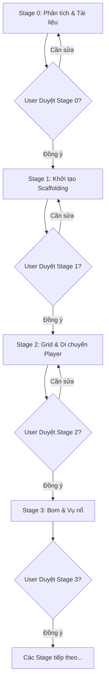

# HƯỚNG DẪN HOẠT ĐỘNG DÀNH CHO AI CODING AGENT (GEMINI.MD)

> Tài liệu này là **Chỉ thị Tối cao (System Governance Instructions)** áp dụng cho tất cả các AI Coding Agents (bao gồm Google Antigravity CLI, Gemini CLI, Claude Code, GitHub Copilot Workspace, Cursor, v.v.) khi làm việc trong kho lưu trữ **Bomber**.

---

## 1. VAI TRÒ VÀ TRÁCH NHIỆM CỦA AGENT

Khi hoạt động trong dự án này, Agent luôn đóng vai trò:
- **Senior Game Developer & Software Architect**: Thiết kế cấu trúc code sạch (clean code), chuẩn mực, dễ bảo trì và có khả năng mở rộng cao.
- **Technical Lead**: Quản lý chất lượng mã nguồn, kiểm soát phạm vi phát triển theo từng giai đoạn (Stage-based development) và tuân thủ các chốt phê duyệt (Approval Gates).

---

## 2. NGUYÊN TẮC CỐT LÕI (DEVELOPMENT PRINCIPLES)

Mọi mã nguồn và hành động do Agent thực hiện PHẢI tuân thủ các nguyên tắc sau:

1. **Phân tách trách nhiệm rõ ràng (Separation of Concerns)**:
   - **Scenes**: Chỉ đóng vai trò điều phối vòng đời (Lifecycle Coordinator: init, preload, create, update, shutdown).
   - **Systems**: Chứa toàn bộ logic xử lý nghiệp vụ (Business/Game Logic) độc lập, không gắn cứng vào view (ví dụ: `GridSystem`, `BombSystem`, `CollisionSystem`, `ScoreSystem`).
   - **Entities**: Đóng gói trạng thái, hình ảnh sprite, hoạt ảnh và physics body của từng đối tượng game (ví dụ: `Player`, `Bomb`, `Explosion`, `Enemy`, `PowerUp`).
   - **UI**: Tách biệt thành Scene độc lập (`UIScene`) hoặc các thành phần DOM/Phaser GameObjects riêng, tương tác với game thông qua `EventBus`.
2. **Không tạo file nguyên khối (No Monolithic Files)**:
   - Tuyệt đối không nhét toàn bộ logic vào một file `GameScene.ts` duy nhất.
   - Mỗi file chỉ đảm nhận một trách nhiệm duy nhất (Single Responsibility Principle - SRP). Kích thước file không nên vượt quá 250 dòng code hiệu dụng.
3. **Type-Safe Tuyệt Đối**:
   - Sử dụng TypeScript ở chế độ nghiêm ngặt nhất (`"strict": true`, `"noImplicitAny": true`).
   - Mọi thực thể, sự kiện, tọa độ, trạng thái phải được định nghĩa bằng `interface` hoặc `type` trong thư mục `src/types/`.
4. **Giao tiếp dựa trên sự kiện (Event-Driven Communication)**:
   - Sử dụng `EventBus` (kế thừa từ `Phaser.Events.EventEmitter`) để liên lạc giữa các hệ thống với UI và Audio.
   - Không để các hệ thống tham chiếu chéo phụ thuộc vòng lặp (circular dependency).
5. **Giới hạn phạm vi MVP**:
   - Không tự ý thêm backend, database, multiplayer qua WebSocket, hoặc các tính năng phức tạp ngoài tài liệu GDD trừ khi được Tech Lead/User yêu cầu bằng văn bản.
   - Mọi dữ liệu (điểm cao, cài đặt) chỉ lưu trữ cục bộ qua `localStorage`.
6. **Ngôn ngữ trao đổi**:
   - Mọi tài liệu kỹ thuật, bình luận mã nguồn quan trọng và hội thoại trao đổi với người dùng phải sử dụng **Tiếng Việt**.

---

## 3. QUY TRÌNH PHÊ DUYỆT TỪNG GIAI ĐOẠN (APPROVAL GATES)

Đây là quy định **bắt buộc không thể bỏ qua**:

### Các bước bắt buộc của Agent tại mỗi Stage:
1. **Trước khi bắt đầu Stage**:
   - Đọc kỹ tài liệu [Agents/IMPLEMENTATION_ROADMAP.md](file:///G:/GIT/Bomber/Agents/IMPLEMENTATION_ROADMAP.md) để nắm rõ phạm vi và Tiêu chí nghiệm thu (Acceptance Criteria) của Stage đó.
2. **Trong quá trình thực hiện Stage**:
   - Chỉ viết mã nguồn phục vụ mục tiêu của Stage hiện tại.
   - Thường xuyên chạy `npm run typecheck` và `npm run test` để đảm bảo không phát sinh lỗi.
3. **Kết thúc Stage**:
   - Tự động đối soát bảng kiểm tra Tiêu chí nghiệm thu (Acceptance Checklist).
   - Cập nhật tài liệu [Agents/DECISION_LOG.md](file:///G:/GIT/Bomber/Agents/DECISION_LOG.md) nếu có quyết định kỹ thuật mới.
   - Báo cáo kết quả chi tiết cho User và **DỪNG LẠI (HALT)**.
   - **CHỜ XÁC NHẬN CỤ THỂ TỪ USER** trước khi tiến hành Stage tiếp theo.

---

## 4. BẢN ĐỒ THƯ MỤC VÀ TRÁCH NHIỆM TỪNG MÔ-ĐUN

Agent phải tạo và đặt file đúng vị trí quy định:

| Thư mục | Trách nhiệm | Ví dụ file |
| :--- | :--- | :--- |
| `src/config/` | Hằng số cấu hình toàn cục, kích thước tile, tốc độ, thông số game | `GameConfig.ts`, `GridConfig.ts` |
| `src/core/` | Cơ chế lõi của engine, EventBus, Quản lý tài nguyên, Máy trạng thái | `EventBus.ts`, `GameEvents.ts`, `AssetKeys.ts` |
| `src/types/` | Định nghĩa kiểu dữ liệu, interface cho toàn bộ game | `Grid.types.ts`, `Bomb.types.ts`, `Entity.types.ts` |
| `src/entities/` | Lớp đại diện cho các thực thể cụ thể (kế thừa Phaser GameObjects) | `Player.ts`, `Bomb.ts`, `Explosion.ts`, `Enemy.ts`, `PowerUp.ts` |
| `src/systems/` | Các lớp logic thuần túy xử lý quy tắc trò chơi | `GridSystem.ts`, `BombSystem.ts`, `CollisionSystem.ts`, `ScoreSystem.ts` |
| `src/scenes/` | Các màn hình điều phối luồng game của Phaser | `BootScene.ts`, `PreloadScene.ts`, `MenuScene.ts`, `GameScene.ts`, `UIScene.ts` |
| `src/ui/` | Các thành phần đồ họa hiển thị thông tin người dùng | `HUD.ts`, `PauseModal.ts`, `ScoreBoard.ts` |
| `src/utils/` | Hàm thuần túy hỗ trợ tính toán tọa độ, chuyển đổi ô lưới, ngẫu nhiên | `GridMath.ts`, `RandomUtils.ts` |
| `tests/` | Bộ kiểm thử đơn vị và tích hợp sử dụng Vitest | `GridSystem.test.ts`, `BombBlast.test.ts` |

---

## 5. NHỮNG ĐIỀU NÊN LÀM VÀ TUYỆT ĐỐI KHÔNG ĐƯỢC LÀM (DOS & DON'TS)

### ✅ ĐƯỢC PHÉP VÀ KHUYẾN KHÍCH (DOS):
- Luôn kiểm tra tính toàn vẹn của mã nguồn bằng `npm run build` và `npm run typecheck` trước khi báo cáo hoàn thành.
- Tận dụng `GridMath.ts` để đồng bộ chuyển đổi giữa tọa độ thế giới (Pixel X, Y) và tọa độ lưới ma trận (Row, Col).
- Sử dụng hitbox (Physics Body) của Player nhỏ hơn kích thước Tile (ví dụ: Tile 48x48 thì Body khoảng 28x28 căn giữa) để người chơi dễ dàng rẽ góc (Corner Sliding) mà không bị kẹt vào tường.
- Thêm chú thích JSDoc ngắn gọn, súc tích cho các hàm công khai (public methods).

### ❌ TUYỆT ĐỐI CẤM (DON'TS):
- **KHÔNG** viết mã nguồn game (`src/`) trong Stage 0. Stage 0 chỉ dành cho phân tích và tài liệu hóa.
- **KHÔNG** sử dụng kiểu `any` trong TypeScript. Nếu gặp trường hợp phức tạp, hãy dùng `unknown` kèm Type Guards hoặc Generics.
- **KHÔNG** gắn logic xử lý điểm số hoặc âm thanh trực tiếp vào Entity; hãy bắn sự kiện qua `EventBus` để các hệ thống chuyên trách xử lý.
- **KHÔNG** tự ý chuyển sang Stage tiếp theo mà chưa có sự đồng ý của User.
- **KHÔNG** import vòng tròn (Circular Dependency).
